<div align="center">
  <h1>🛡️ SentinelOps</h1>
  <p><strong>Enterprise-Grade Observability, APM & SRE Multi-Tenant SaaS Platform</strong></p>
  <p>
    <em>Modern dağıtık mikroservis mimarileri için uçtan uca telemetri toplama, dağıtık izleme (APM), log yönetimi, SLO mühendisliği, yapay zeka destekli kök neden analizi ve SaaS abonelik altyapısı.</em>
  </p>

  <p>
    <a href="#-türkçe-dokümantasyon">Türkçe Dokümantasyon</a> •
    <a href="#-english-documentation">English Documentation</a> •
    <a href="#-mimari-ve-veri-akışı--architecture">Mimari / Architecture</a> •
    <a href="#-ekran-görüntüleri--screenshot-gallery">Ekran Görüntüleri / Screenshots</a> •
    <a href="#-docker-ile-hızlı-kurulum--quickstart">Kurulum / Quickstart</a>
  </p>

  <p>
    
    
    
    
    
    
    
    
    
    
  </p>
</div>

---

## 📸 Canlı Platform Önizlemesi / Live Platform Preview

### Operasyonel Genel Bakış / Operational Overview
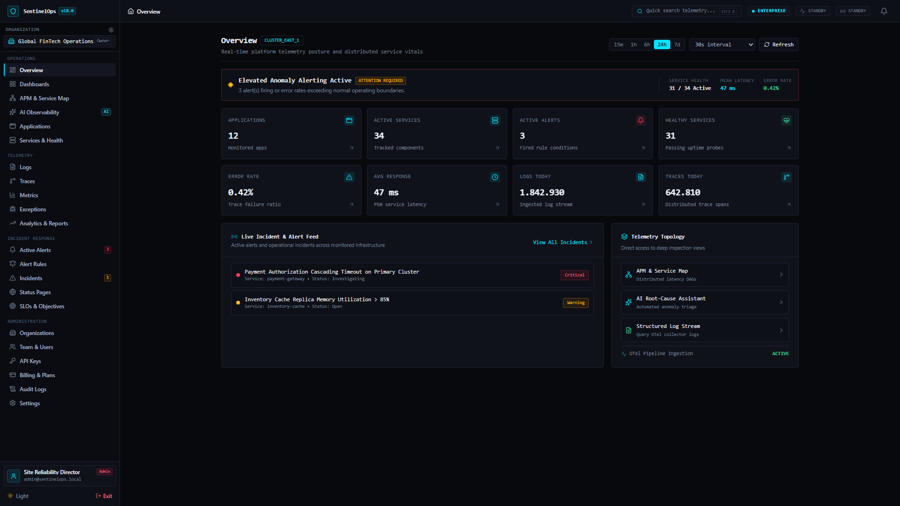

### Gelişmiş Log Gezgini & Dağıtık İzleme / Log Explorer & Distributed Tracing
<table>
  <tr>
    <td width="50%">
      <strong>Gelişmiş Log Gezgini (Log Explorer)</strong><br/>
      <em>Parametrik arama, gecikme rozeti, kayıtlı sorgular ve CSV/JSON dışa aktarma</em><br/>
      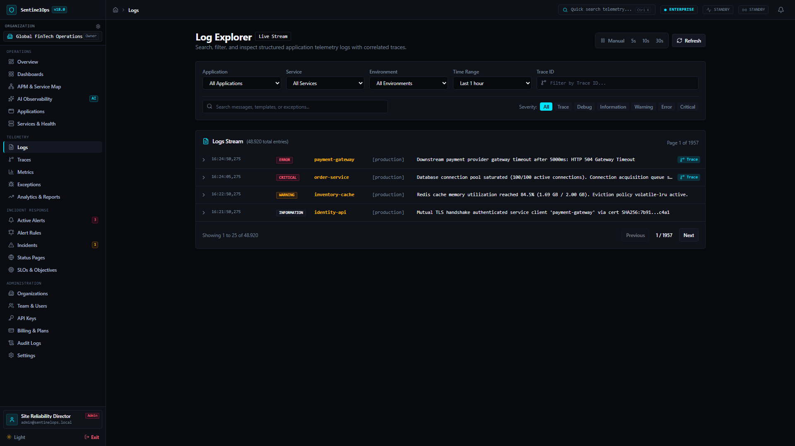
    </td>
    <td width="50%">
      <strong>Dağıtık İzleme Şelalesi (Trace Waterfall)</strong><br/>
      <em>Milisaniye hassasiyetinde span görselleştirme ve otomatik en yavaş span tespiti</em><br/>
      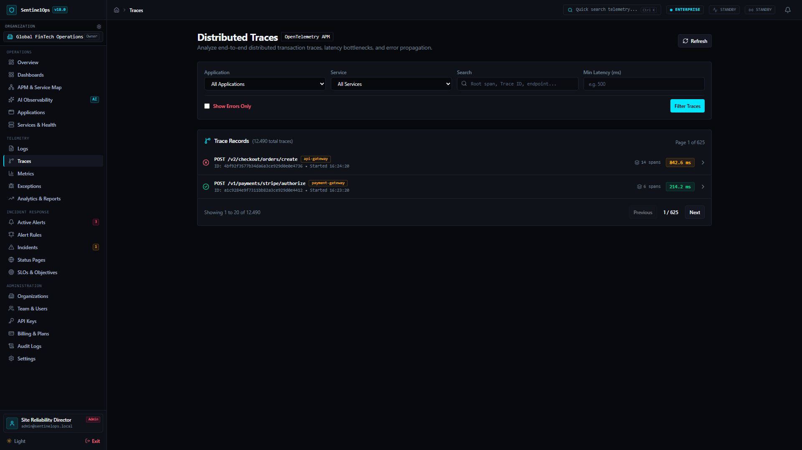
    </td>
  </tr>
  <tr>
    <td width="50%">
      <strong>Gerçek APM Servis Haritası (APM Topology)</strong><br/>
      <em>Sentetik mock içermeyen, veritabanı telemetrisinden dinamik yönlü servis grafiği</em><br/>
      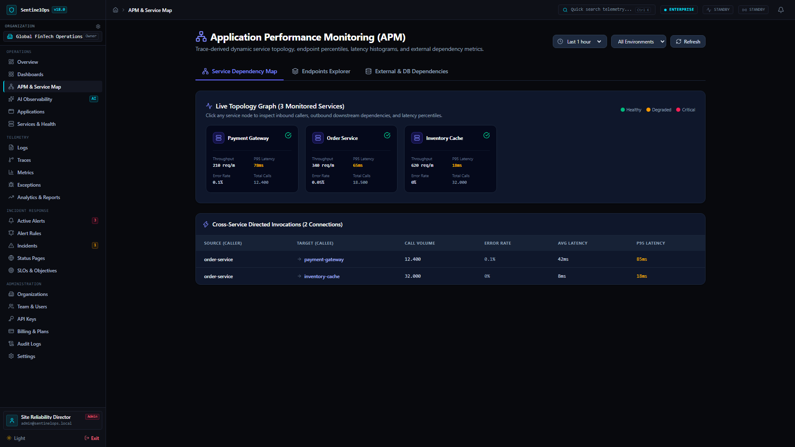
    </td>
    <td width="50%">
      <strong>SLO ve Hata Bütçesi Takibi (SLO Engineering)</strong><br/>
      <em>Google SRE standartlarında hata bütçesi tüketimi ve çok pencereli burn rate analizi</em><br/>
      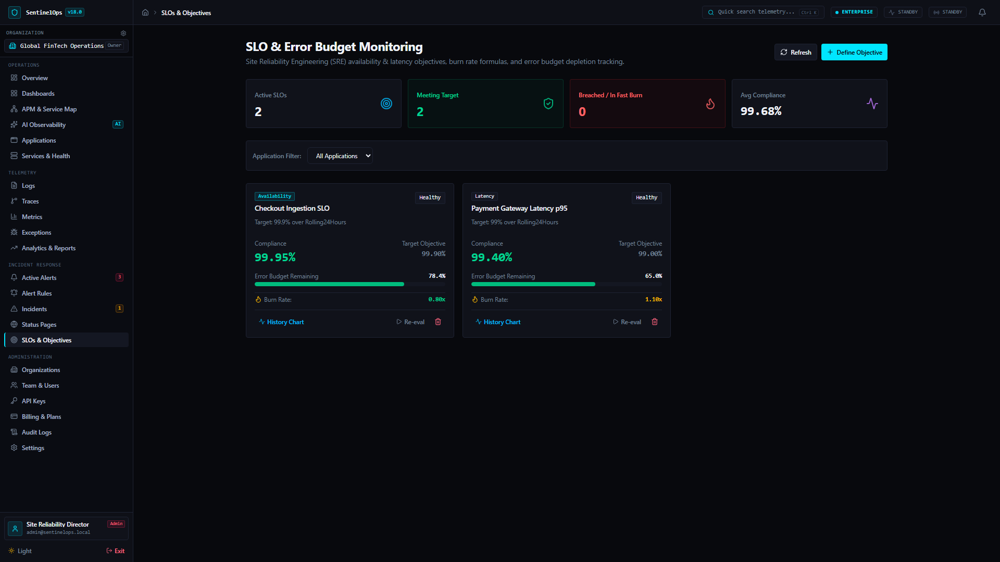
    </td>
  </tr>
</table>

---

# 🇹🇷 TÜRKÇE DOKÜMANTASYON

## 1. SentinelOps Nedir?
**SentinelOps**, yüksek ölçekli dağıtık mikroservis mimarileri için geliştirilmiş, **OpenTelemetry** standartlarıyla uyumlu, çok kiracılı (multi-tenant) bir kurumsal gözlemlenebilirlik (observability), APM ve Site Reliability Engineering (SRE) SaaS platformudur. 

Datadog, Dynatrace ve Grafana ekosistemlerinin en güçlü kabiliyetlerini tek bir modern platformda birleştiren SentinelOps; logları, dağıtık izleri (traces), metrikleri, servis bağımlılık grafiğini, yapay zeka destekli kök neden analizini ve kurumsal SaaS abonelik yönetimini **Precision Dark** tasarım diliyle sunar.

---

## 2. Projenin Amacı ve Kapsamı
- **Tek Merkezden Gözlemlenebilirlik**: Dağınık log, metrik ve trace yığınlarını tek bir korelasyon motorunda toplamak.
- **Gerçek Zamanlı Karar Desteği**: Dağıtık bir çağrı zincirindeki en yavaş span'i (slowest span) ve kopuk üst span'leri (orphaned parent) otomatik tespit etmek.
- **SRE ve Hata Bütçesi Mühendisliği**: SLO hedefleri belirleyip Google SRE standartlarına uygun çok pencereli burn rate (1h ve 6h) alarmları tetiklemek.
- **Güvenli ve İzole Çok Kiracılık (Multi-Tenancy)**: Kiracılar arası veri sızıntısını (IDOR) engelleyen katı sunucu taraflı yetkilendirme ve SSRF korumalı bildirim motoru.
- **Abonelik ve Kota Yönetimi**: Aylık telemetri kotalarını izleyerek kota aşımında geri basınç (HTTP 429 backpressure) uygulamak.

---

## 3. Temel Yetenekler ve Özellikler

### 📊 Telemetri & APM (Uygulama Performans Yönetimi)
- **OTLP Standart Altyapısı**: OpenTelemetry Protocol (OTLP/HTTP ve gRPC) üzerinden traces, metrics ve logs kabulü.
- **Gelişmiş Log Gezgini**: Sunucu tarafı sorgu çalıştırma süresi ölçümü (`⏱ queryDurationMs`), organizasyon bazlı kayıtlı log sorguları (Saved Queries) ve sınırlandırılmış RFC 4180 CSV / NDJSON dışa aktarma.
- **Milisaniye Hassasiyetinde Trace Şelalesi**: Çağrı ağacında en uzun süren span'in kehribar rengi `Slowest` etiketiyle, eksik kök referanslarının `Orphaned` uyarısıyla işaretlenmesi.
- **Dinamik Servis Haritası (Service Topology)**: Hiçbir sentetik mock veri kullanılmadan, doğrudan veritabanındaki gerçek `SpanRecord` kayıtlarından yönlü iletişim kenarları ve P50/P95/P99 gecikme yüzdelikleri hesaplama.
- **Özel Panolar (Custom Dashboards)**: 12 farklı widget türü içeren dinamik pano oluşturucu, JSON şema doğrulayıcı ve organizasyon varsayılanı atama (`Default Dashboard`).

### 🎯 SRE & Akıllı Alarm Yönlendirme
- **SLO & Burn Rate Mühendisliği**: 7, 30 ve 90 günlük yuvarlanan değerlendirme pencerelerinde hata bütçesi tüketim hızını izleme.
- **SSRF Korumalı Webhook Dağıtımı**: Slack ve Microsoft Teams uyumlu bildirim formatlayıcıları; döngüsel (loopback `127.0.0.1`), özel IP (RFC 1918) ve bulut metaveri (`169.254.169.254`) adreslerine istek yapılmasını DNS seviyesinde engelleyen `SsrfProtectionValidator`.
- **Canlı Olay İletişimi (SignalR)**: `/hubs/alerts` üzerinden tarayıcıya anlık olay push bildirimleri ve otomatik yeniden bağlanma.

### 🏢 Çok Kiracılı SaaS Yönetimi
- **Katı Kiracı İzolasyonu**: `X-Organization-Id` başlıklarının veritabanı üyelik doğrulaması yapılmadan işlenmemesi.
- **Kullanım Takibi & Kota Uygulama**: Aylık log, trace ve metrik tüketimi %100'e ulaştığında OTLP isteklerine `HTTP 429 Too Many Requests` ve `Retry-After: 3600` başlığı dönme.
- **Kademeli Veri Saklama (Data Retention)**: Starter (7 gün), Pro (30 gün) ve Enterprise (90 gün) saklama sınırları; arka plan worker'ı tarafından 500'erlik güvenli parçalar halinde otomatik temizleme.
- **Abonelik & Faturalama**: Sandbox ortamında güvenli plan yükseltme/düşürme, fatura detayları ve müşteri portalı oturumu.

---

## 4. Kullanılan Teknolojiler

| Alan | Teknoloji / Kütüphane | Versiyon | Kullanım Amacı |
| :--- | :--- | :--- | :--- |
| **Backend Runtime** | .NET (C#) | 10.0 (`net10.0`) | Yüksek performanslı çekirdek API ve arka plan işleyicileri |
| **Mimari Yaklaşım** | Clean Architecture / DDD | — | Bağımsızlık, gevşek bağlılık ve yüksek test edilebilirlik |
| **ORM & Veritabanı** | EF Core 10 / Npgsql / PostgreSQL | 17.x (Alpine) | İlişkisel veri saklama, JSONB desteği, deterministik migration |
| **Önbellek & Akışlar** | Redis / StackExchange.Redis | 7.x (Alpine) | Dağıtık önbellek, oturum yönetimi ve Redis Streams telemetri kuyrukları |
| **Gözlemlenebilirlik** | OpenTelemetry .NET SDK / Collector | v1.20 | OTLP telemetri protokolü standart entegrasyonu |
| **Frontend UI** | React / TypeScript | 19.2 / 5.9 | Modern bileşen mimarisi ve tip güvenliği |
| **Stil & Tasarım** | Tailwind CSS / Lucide Icons | v4.3 / v1.55 | Precision Dark kurumsal tasarım sistemi tokens |
| **Grafik Motoru** | Recharts | 3.10 | Milisaniye hassasiyetinde zaman serisi grafik görselleştirmesi |
| **Durum & API İletişimi** | TanStack Query / Axios | 5.104 / 1.20 | Asenkron veri önbellekleme ve sunucu durum senkronizasyonu |
| **Birim & Entegrasyon Test** | xUnit / FluentAssertions / NSubstitute | — | 309 adet backend doğrulama testi |
| **Frontend Testleri** | Vitest / React Testing Library | 5.0 | 76 adet arayüz ve bileşen testi |
| **E2E Tarayıcı Testleri** | Playwright | 1.64 | Canlı servisler üzerinde 4 ekran çözünürlüğünde 89 kullanıcı testi |
| **Konteynerleştirme** | Docker & Docker Compose | Compose v2 | Çok aşamalı (multi-stage) derleme ve izole çalıştırma |
| **Orkestrasyon** | Kubernetes & Helm | Helm v3 | Üretime hazır dağıtım şablonları |

---

## 5. Clean Architecture Katmanları

SentinelOps, bağımlılıkların yalnızca iç katmanlara doğru aktığı katı Clean Architecture prensiplerine uyar:

1. **`SentinelOps.Domain`**:
   - Dış framework bağımlılığı içermeyen saf POCO varlıkları (`Application`, `LogEntry`, `TraceRecord`, `SpanRecord`, `MetricRecord`, `AlertRule`, `ServiceLevelObjective`, `SavedLogQuery`, `Organization`).
   - Value Objects, Domain Events ve Aggregate Roots.
2. **`SentinelOps.Contracts`**:
   - Dış dünya ile iletişim kurulan DTO'lar, istek modelleri (Requests) ve yanıt modelleri (Responses).
3. **`SentinelOps.Application`**:
   - CQRS komut ve sorguları (MediatR), FluentValidation doğrulama pipeline'ı ve servis arayüzleri (`IApplicationDbContext`, `ICurrentUserService`, `IApmService`, `ISavedLogQueryService`, `IEntitlementService`).
4. **`SentinelOps.Infrastructure`**:
   - EF Core 10 DbContext, PostgreSQL konfigürasyonları, Redis Stream kuyruk işleyicileri, Identity kullanıcı yönetimi ve SSRF korumalı Slack/Teams bildirim servisleri.
5. **`SentinelOps.Api`**:
   - ASP.NET Core 10 Web API, JWT kimlik doğrulama, SignalR gerçek zamanlı iletişim hub'ları ve sağlık kontrol uçları (`/health/live`, `/health/ready`).
6. **`SentinelOps.Worker`**:
   - Arka planda Redis Streams'ten telemetri tüketen ve 500'erlik partiler halinde veri saklama politikalarını yürüten bağımsız .NET 10 servisi.
7. **`SentinelOps.Web`**:
   - React 19, TypeScript ve Vite ile derlenen, Nginx üzerinde servis edilen tek sayfa uygulaması (SPA).

---

## 6. Sistem Mimarisi & Telemetri Veri Akışı

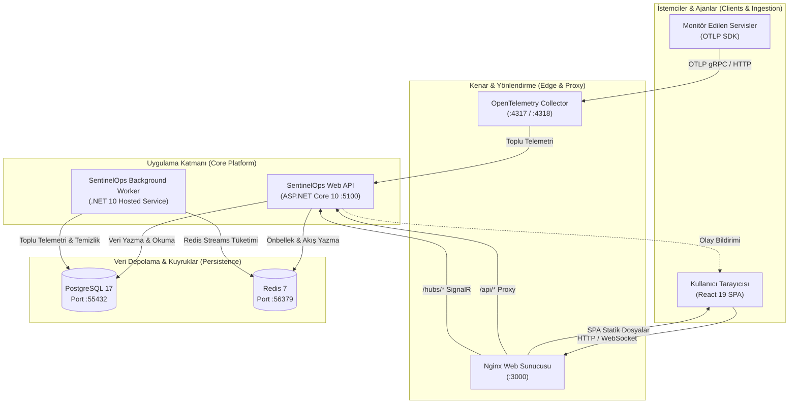

---

## 7. Docker ile Hızlı Kurulum

### Gereksinimler
- Docker Desktop (v4.30+)
- Minimum 4 GB RAM ayrılmış Docker kaynağı

### Adım Adım Başlatma
1. Depoyu klonlayın:
   ```bash
   git clone https://github.com/Terabithia1572/SentinelOps.git
   cd SentinelOps
   ```
2. Servisleri Docker Compose ile ayağa kaldırın:
   ```bash
   docker compose up -d
   ```
3. Servislerin durumunu doğrulayın:
   ```bash
   docker compose ps
   ```
4. Tarayıcınızda açın:
   - **Kullanıcı Arayüzü**: [http://localhost:3000](http://localhost:3000)
   - **Swagger API Dokümantasyonu**: [http://localhost:5100/swagger](http://localhost:5100/swagger)
   - **Canlı Sağlık Kontrolü**: [http://localhost:5100/health/live](http://localhost:5100/health/live)

---

## 8. Testlerin Çalıştırılması

SentinelOps, %100 başarı oranına sahip 474 adet otomatik test ile korunmaktadır:

```bash
# 1. Backend Testlerini Çalıştırma (309 Test)
dotnet test

# 2. Frontend Birim Testlerini Çalıştırma (76 Test)
cd src/SentinelOps.Web
npm run test:run

# 3. TypeScript ve Prodüksiyon Derleme Kontrolü
npm run build

# 4. Playwright Uçtan Uca (E2E) Canlı Tarayıcı Testleri (89 Test)
npx playwright test
```

---

<br/>

---

# 🇬🇧 ENGLISH DOCUMENTATION

## 1. What is SentinelOps?
**SentinelOps** is an enterprise-grade, multi-tenant observability, Application Performance Monitoring (APM), and Site Reliability Engineering (SRE) SaaS platform natively built for high-scale distributed cloud architectures.

Unifying the operational strengths of Datadog, Dynatrace, and Grafana into a single, cohesive developer platform, SentinelOps correlates structured logs, distributed traces, metrics, dynamic service topologies, automated root cause analysis, and multi-tenant commercial billing within an approved **Precision Dark** visual system.

---

## 2. Project Goals & Architecture Principles
- **Unified Observability Core**: Correlate telemetry across spans, metrics, and logs in real time.
- **Autonomous Forensic Discovery**: Automatically detect slowest spans and trace trees with missing/orphaned parents.
- **SRE & Error Budget Engineering**: Monitor SLO targets using rolling evaluation windows and Google SRE multi-window burn rate alerts (1h and 6h windows).
- **Hardened Multi-Tenancy**: Server-side tenant validation mitigating Insecure Direct Object References (IDOR) alongside DNS-level SSRF defense on all external webhooks.
- **Backpressure & Quotas**: Automated OTLP ingestion throttling (`HTTP 429 Too Many Requests`) when tenant monthly allocations are exhausted.

---

## 3. Core Capabilities

### 📊 Telemetry, APM & Tracing
- **Native OpenTelemetry (OTLP)**: Full ingestion support for OTLP over HTTP/JSON and gRPC for logs, traces, and metrics.
- **Advanced Log Explorer**: Server-side execution latency measurement (`⏱ queryDurationMs`), organization-scoped saved queries, and bounded streaming RFC 4180 CSV / NDJSON export (up to 5,000 items).
- **Millisecond-Accurate Waterfall Visualizer**: Automated slowest span detection (`isSlowestSpan: true`) tagged with an amber `Slowest` pill, and broken trace root identification (`isOrphanedParent: true`).
- **Real Database-Driven APM**: Zero synthetic fallbacks; directed service graph edges, endpoint latencies (P50/P95/P99), and external database/HTTP dependencies aggregated directly from PostgreSQL `SpanRecord` telemetry.
- **Custom Observability Dashboards**: Dynamic 12-widget catalog, strict layout schema sanitizer, and atomic organization default dashboard assignment.

### 🎯 SRE & Secure Alert Routing
- **SLO & Burn Rate Monitoring**: Rolling 7-day, 30-day, and 90-day compliance evaluation with Google SRE error budget tracking.
- **SSRF-Protected Notification Providers**: Slack Block Kit and Microsoft Teams Adaptive Card formatters protected by `SsrfProtectionValidator`, which blocks loopback (`127.0.0.1`), private RFC 1918 subnets, and cloud metadata endpoint `169.254.169.254`.
- **Real-Time SignalR Push**: Instantaneous incident lifecycle dispatching via `/hubs/alerts` with automatic client reconnection and cache invalidation.

### 🏢 Multi-Tenant SaaS Governance
- **Strict Tenant Isolation**: Server-side membership validation for all `X-Organization-Id` headers.
- **Ingestion Quota Enforcement**: Real-time month-to-date tracking with `HTTP 429 Too Many Requests` backpressure and `Retry-After: 3600` headers.
- **Tiered Data Retention**: Starter (7d), Pro (30d), and Enterprise (90d) retention caps purged automatically by background worker jobs in 500-record chunks.
- **SaaS Billing & Customer Portal**: Sandbox-safe plan transitions, itemized invoices, and customer portal session flows.

---

## 4. Technology Stack & Specifications

| Tier | Technology | Version | Purpose |
| :--- | :--- | :--- | :--- |
| **Backend Core** | .NET (C#) | 10.0 (`net10.0`) | High-performance Web API and hosted background workers |
| **Architecture** | Clean Architecture / DDD | — | Strict separation of concerns and dependency inversion |
| **Database & ORM** | EF Core 10 / Npgsql / PostgreSQL | 17-alpine | Relational persistence, JSONB telemetry, migrations |
| **Distributed Cache & Queue**| Redis / StackExchange.Redis | 7-alpine | Distributed caching, session tokens, Redis Streams queue |
| **Observability Standard** | OpenTelemetry .NET SDK / Collector | v1.20 | Standardized OTLP telemetry ingestion |
| **Frontend Framework** | React / TypeScript | 19.2 / 5.9 | Component lifecycle and strict type safety |
| **Design System** | Tailwind CSS / Lucide Icons | v4.3 / v1.55 | Precision Dark enterprise tokens (`#08090D`) |
| **Visualization** | Recharts | 3.10 | High-density time-series charts |
| **Backend Testing** | xUnit / FluentAssertions / NSubstitute | — | 309 unit & integration tests |
| **Frontend Testing** | Vitest / Testing Library | 5.0 | 76 component unit tests |
| **E2E Testing** | Playwright | 1.64 | 89 browser user journeys across 4 viewports |
| **Containerization** | Docker & Docker Compose | Compose v2 | Multi-stage reproducible container builds |

---

## 5. Clean Architecture Layers

```
src/
├── SentinelOps.Domain/          # Core Domain Entities, Value Objects, Enums (Zero dependencies)
├── SentinelOps.Contracts/       # DTOs, Requests, Responses (Clean contract boundaries)
├── SentinelOps.Application/     # CQRS, MediatR Handlers, FluentValidation, Interfaces
├── SentinelOps.Infrastructure/  # EF Core DbContext, Npgsql, Redis, Identity, Notification Providers
├── SentinelOps.Api/             # REST Endpoints, SignalR Hubs, Health Checks, Middleware
├── SentinelOps.Worker/          # Background Redis Streams consumer & 500-row chunk retention worker
└── SentinelOps.Web/             # React 19 SPA, Tailwind CSS v4, Precision Dark UI
```

---

## 6. System Architecture Diagram

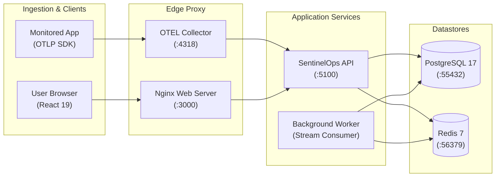

---

## 7. Quickstart with Docker Compose

1. **Clone the Repository**:
   ```bash
   git clone https://github.com/Terabithia1572/SentinelOps.git
   cd SentinelOps
   ```
2. **Start All Services**:
   ```bash
   docker compose up -d
   ```
3. **Verify Service Health**:
   ```bash
   docker compose ps
   ```
4. **Access the Application**:
   - Web Platform: [http://localhost:3000](http://localhost:3000)
   - Swagger OpenAPI: [http://localhost:5100/swagger](http://localhost:5100/swagger)
   - Live Health: [http://localhost:5100/health/live](http://localhost:5100/health/live)

---

## 8. Automated Test Execution

SentinelOps features 474 passing automated tests with a 100% pass rate:

```bash
# Execute backend test suite (309 tests across Domain, Application, and Integration)
dotnet test

# Execute frontend Vitest unit suite (76 tests across 19 suites)
cd src/SentinelOps.Web
npm run test:run

# Verify TypeScript typecheck and production build
npm run build

# Execute Playwright E2E suite against live containers (89 executions across 4 viewports)
npx playwright test
```

---

## 📸 Ekran Görüntüleri / Screenshot Gallery

| Modül / Module | Ekran Görüntüsü / Screenshot | Açıklama / Description |
| :--- | :--- | :--- |
| **Operasyonel Pano / Overview** |  | Platform SLA durumu, canlı KPI sayaçları ve aktif olaylar |
| **Log Gezgini / Logs** |  | Gecikme süresi rozeti, kayıtlı sorgular ve CSV/JSON indirme |
| **Trace Şelalesi / Traces** |  | Milisaniye hassasiyetinde en yavaş span (Slowest) tespiti |
| **Metrik Panosu / Metrics** | 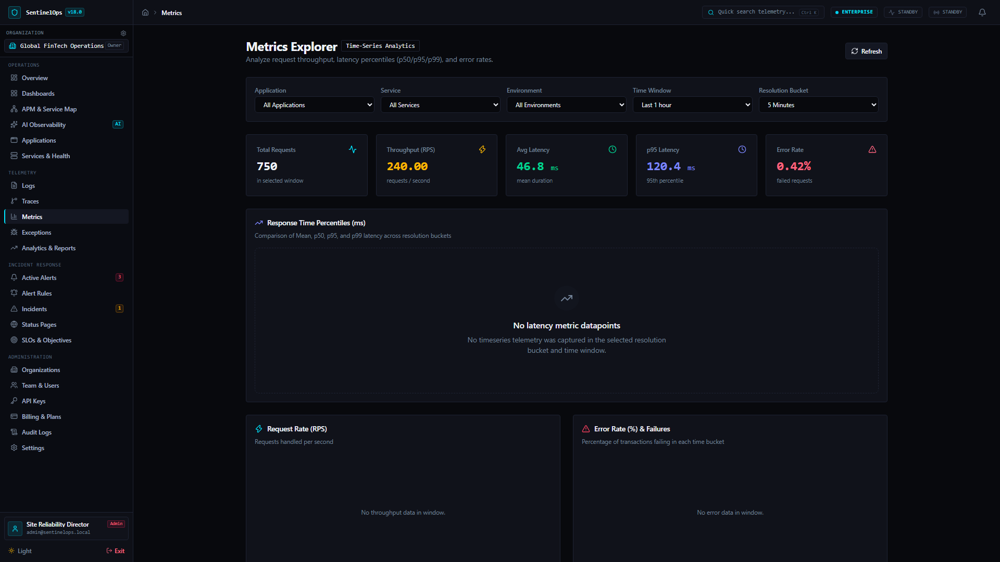 | Senkronize Recharts CPU, Bellek ve İstek grafikleri |
| **APM Servis Haritası / APM** |  | Gerçek veritabanı telemetrisinden dinamik yönlü topoloji |
| **Olay Yönetimi / Incidents** | 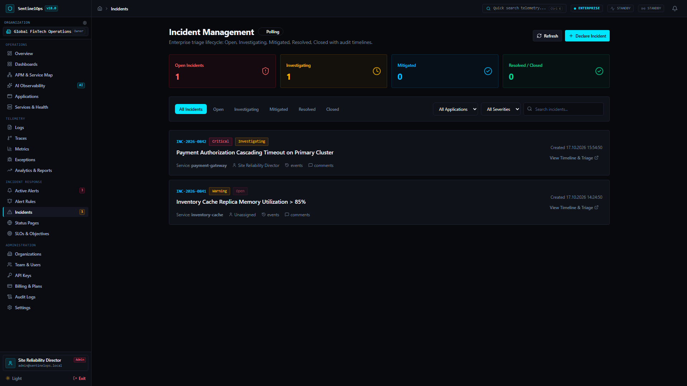 | Canlı SignalR bağlantılı triyaj kuyruğu ve durum filtreleri |
| **Olay Detay & Kök Neden / RCA** | 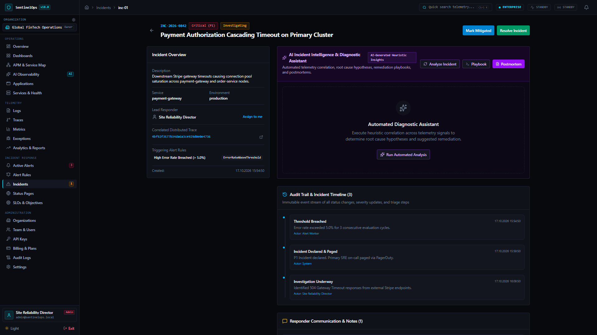 | Adli inceleme çekmecesi, zaman çizelgesi ve postmortem modalı |
| **Yapay Zeka / AI Observability** | 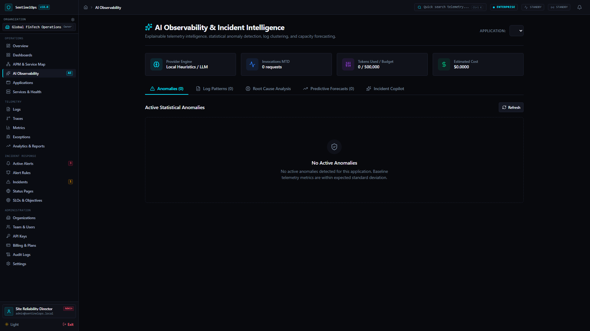 | İstatistiksel anomali tespiti ve kapasite tahminleme konsolu |
| **SLO Mühendisliği / SLOs** |  | Hata bütçesi tüketimi ve çok pencereli burn rate takibi |
| **Kiracı & Kotalar / Organizations** | 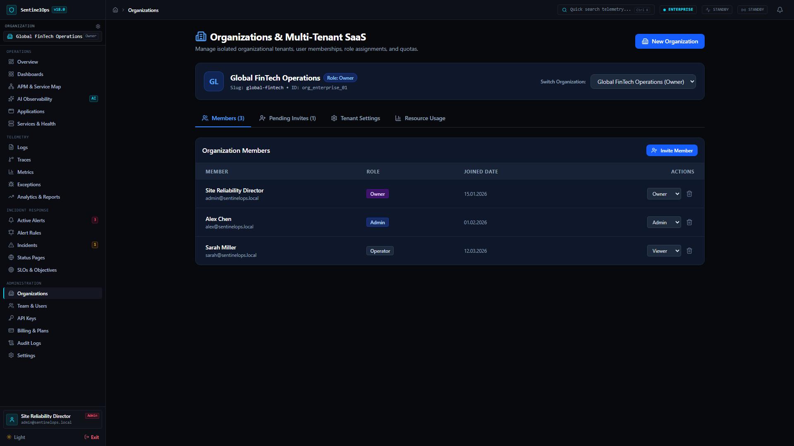 | %80, %95 ve %100 kota uyarı rozetleri ve üye yönetimi |
| **SaaS Abonelik / Billing** | 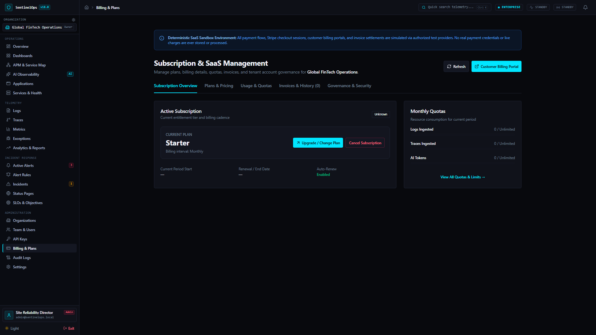 | Starter, Pro ve Enterprise planları ile fatura geçmişi |
| **Alarm Kuralları / Alert Rules** | 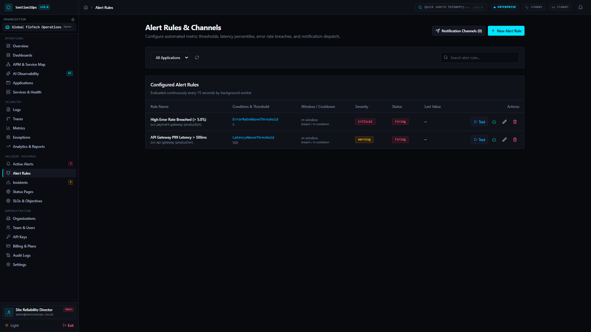 | Slack, Teams ve SSRF korumalı webhook yönlendirmesi |
| **Durum Sayfaları / Status Pages** | 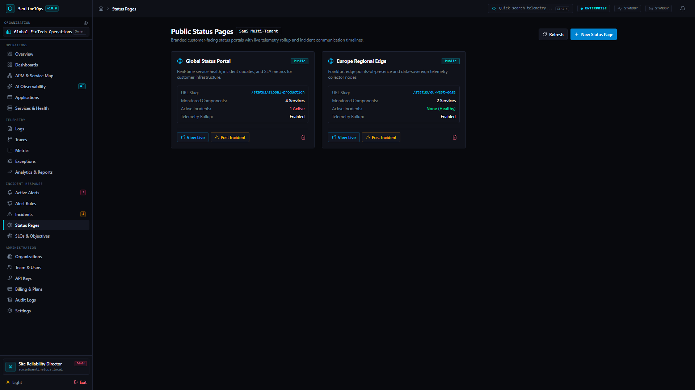 | Halka açık servis durum bileşenleri ve bakım pencereleri |
| **Giriş Ekranı / Login** | 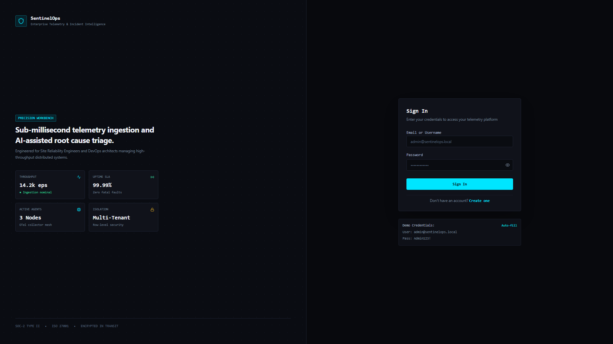 | Yüksek kontrastlı Precision Dark kimlik doğrulama ekranı |
| **Mobil Görünüm / Mobile UI** | 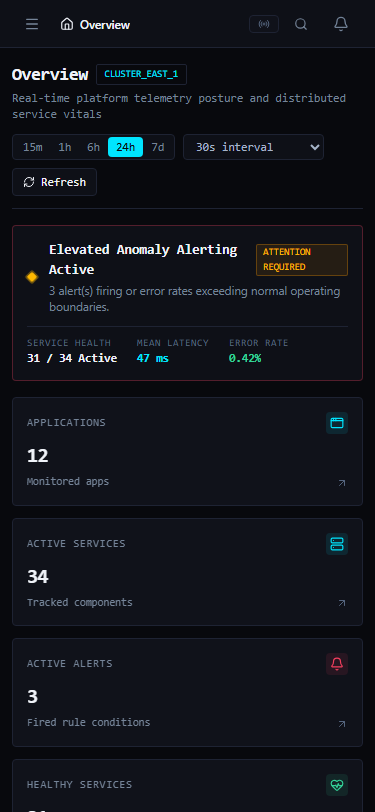 | Taşma yapmayan mobil uyumlu responsive operasyon ekranı |

---

## ⚠️ Bilinen Sınırlamalar / Known Limitations

SentinelOps geliştirme ve doğrulama sınırları şeffaf ve dürüst şekilde belirtilmiştir:
1. **Faturalama ve Ödemeler (SaaS Billing)**: Fatura kesme ve plan geçişleri sandbox ortamında test edilmiştir; gerçek Stripe hesaplarından para çekilmez.
2. **Bildirim Dağıtımı (Notifications)**: Slack ve Teams uyumlu yük formatlayıcıları ve SSRF korumalı test uçları doğrulanmıştır; yerel ortamda canlı dış bildirimler kullanıcı tarafından gerçek webhook URL'si sağlanmadıkça sanal ortamda çalıştırılır.
3. **Yapay Zeka Analizleri (AI Intelligence)**: Deterministik istatistiksel algoritmalar ve yerel test sağlayıcıları kullanılmıştır; harici canlı yapay zeka çıkarımı için geçerli OpenAI veya Anthropic API anahtarı yapılandırılmalıdır.
4. **Veritabanı Kümeleme**: SentinelOps tek birincil (single-primary) PostgreSQL ve Okuma Replika mimarisine uygundur; aktif-aktif çoklu ana çoğaltma (multi-master) içermez.

---

## 👨‍💻 Proje Mühendisliği ve Telif / Authorship & Copyright

- **Tasarım / Designed by:** [Yunus İNAN](https://github.com/Terabithia1572)
- **Geliştirme / Developed by:** [Yunus İNAN](https://github.com/Terabithia1572)
- **Yazılım Mimarisi / Software Architecture:** [Yunus İNAN](https://github.com/Terabithia1572)
- **GitHub:** [https://github.com/Terabithia1572/SentinelOps](https://github.com/Terabithia1572/SentinelOps)

### 📄 Lisans / License
Bu proje **MIT Lisansı** kapsamında lisanslanmıştır. Detaylar için [LICENSE](LICENSE) dosyasına bakabilirsiniz.

Copyright © 2026 Yunus İNAN. All rights reserved.
