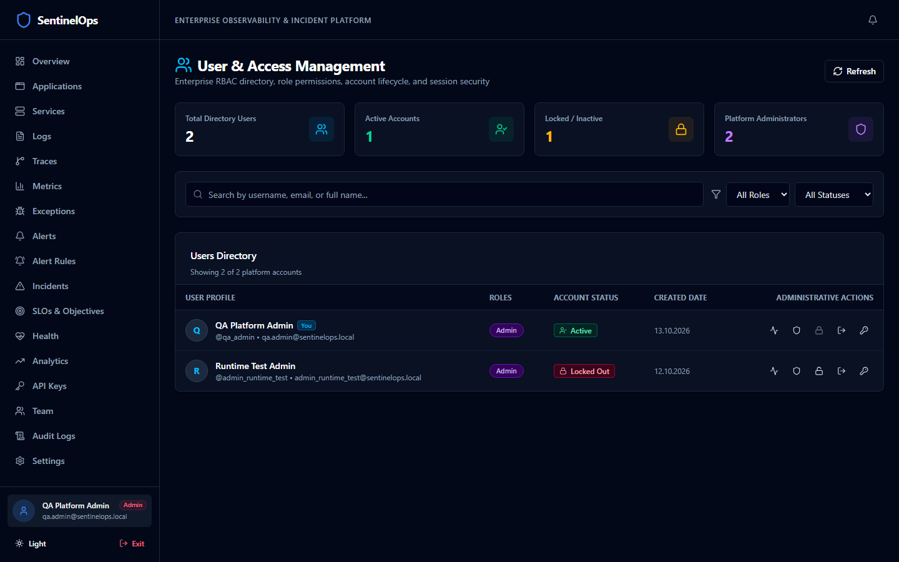
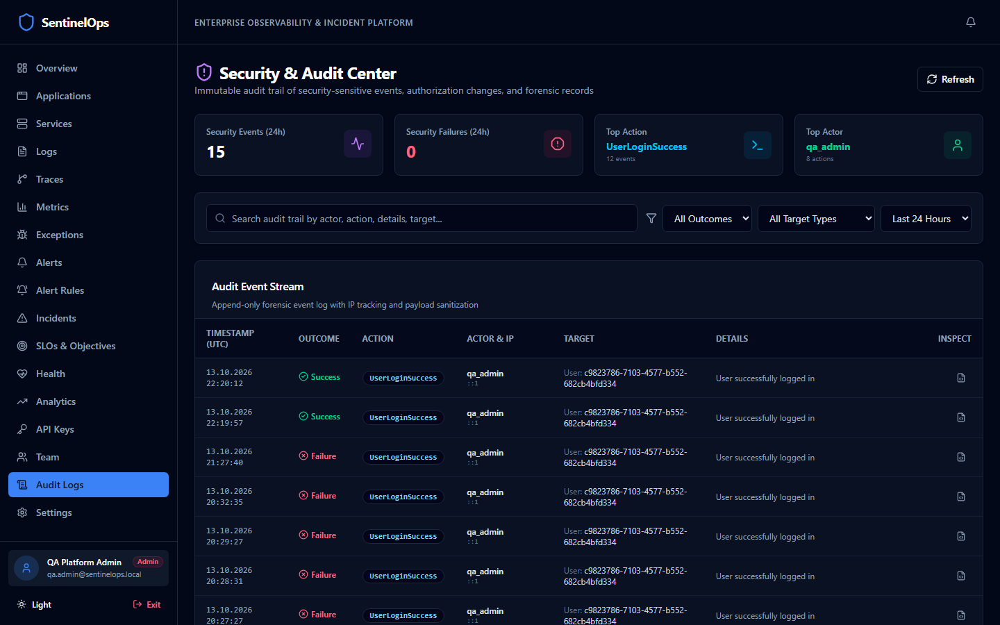
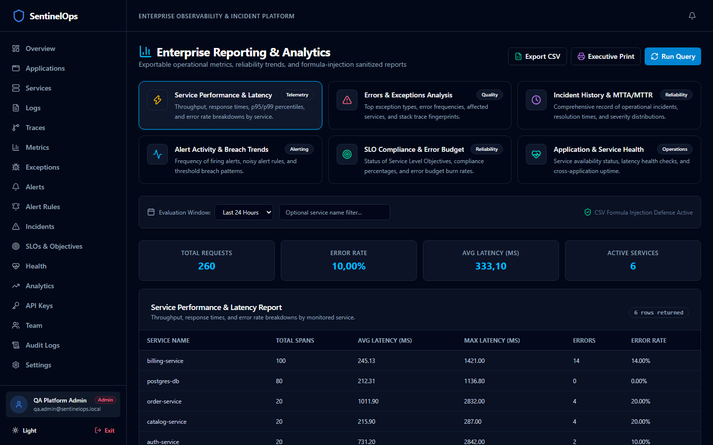
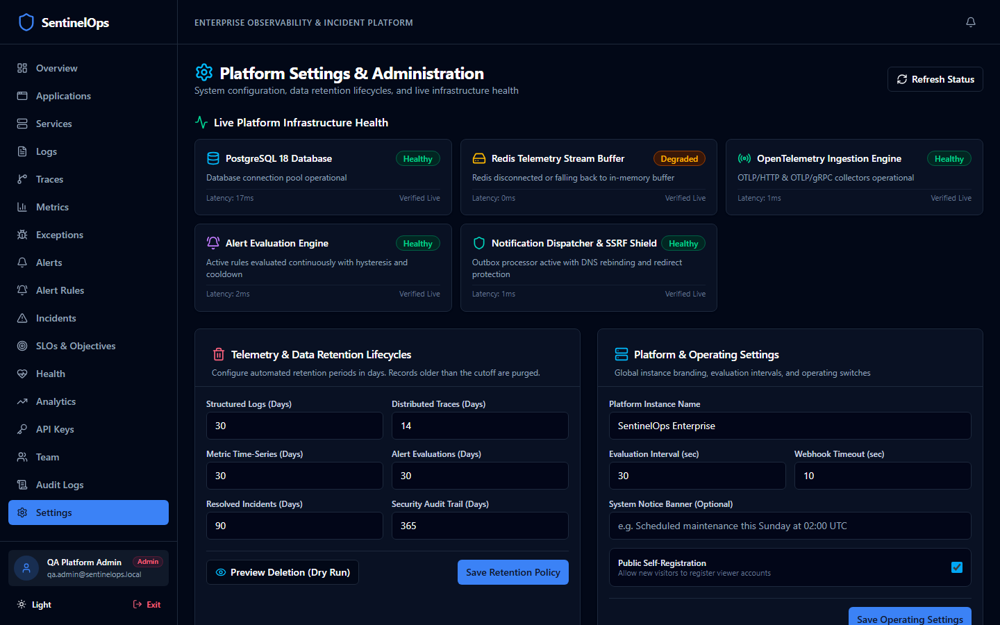
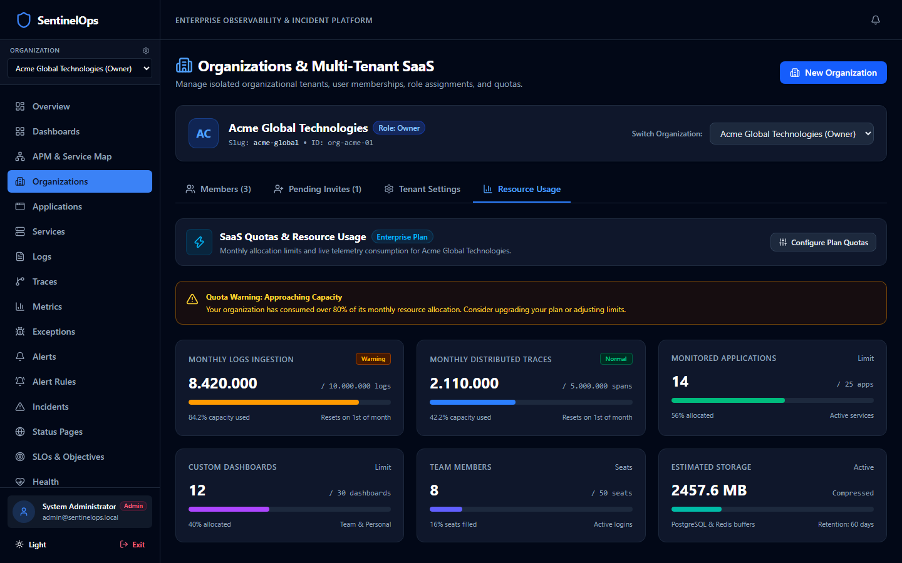
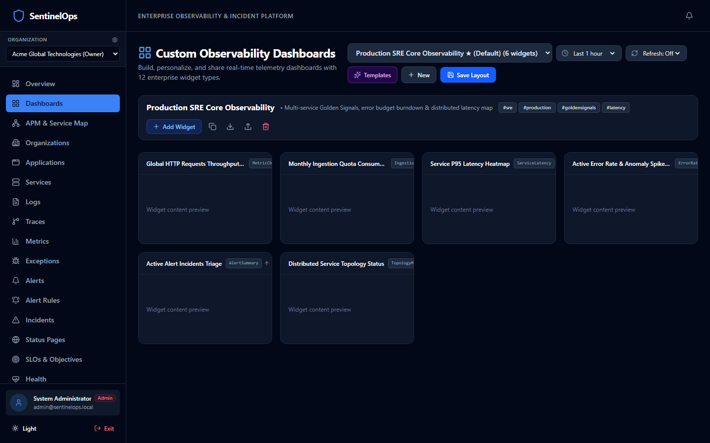
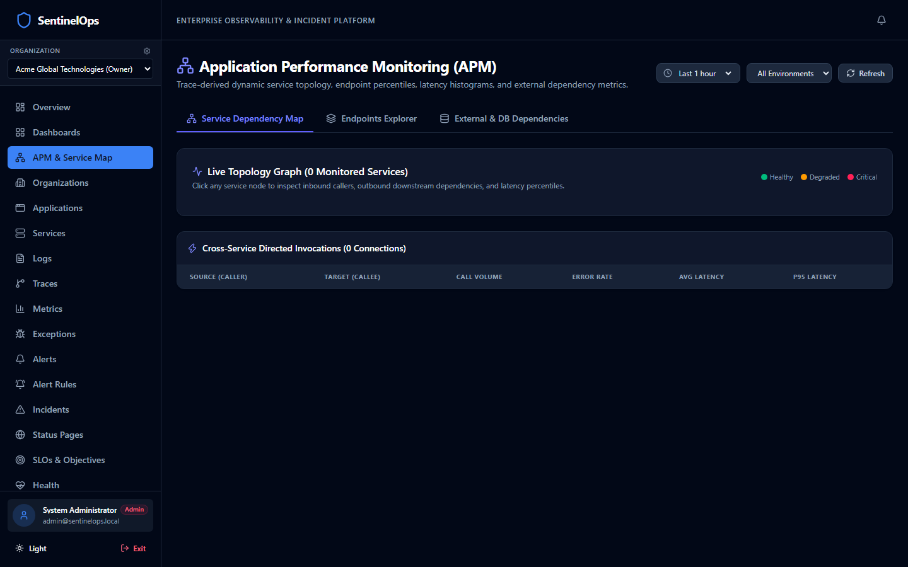
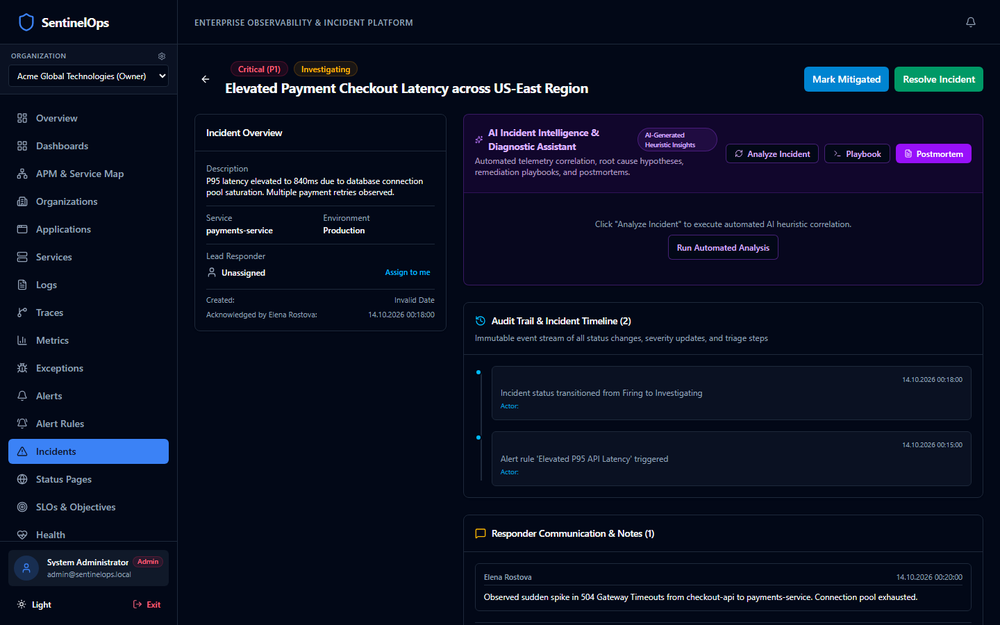
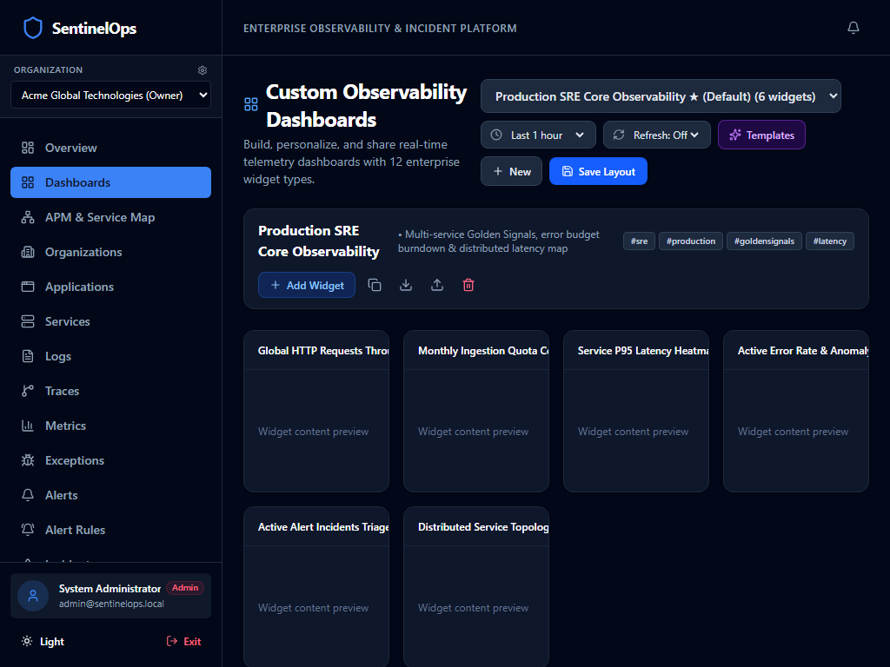
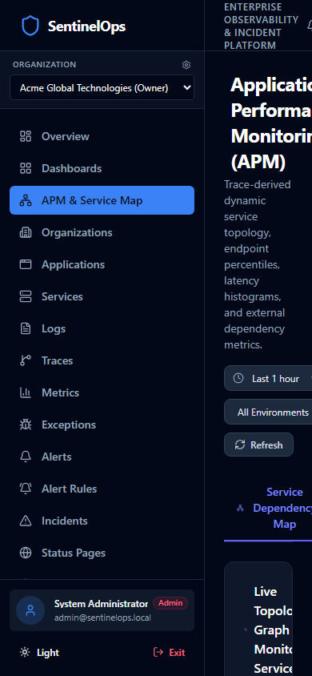

<div align="center">
  <h1>🛡️ SentinelOps</h1>
  <p><strong>Enterprise-Grade Observability Platform</strong></p>
  <p>
    <em>Centralized monitoring, distributed tracing, log management, and alerting for modern applications</em>
  </p>

  <p>
    <a href="#platform-interface">Screenshots</a> •
    <a href="#features">Features</a> •
    <a href="#architecture">Architecture</a> •
    <a href="#quick-start">Quick Start</a> •
    <a href="#documentation">Documentation</a> •
    <a href="#contributing">Contributing</a>
  </p>

  <p>
    
    
    
    
    
    
    
    
    
  </p>
</div>

---

## Overview

SentinelOps is a self-hosted, enterprise-grade observability and SaaS platform inspired by Grafana, Datadog, and modern APM tools. It provides centralized collection, storage, analysis, and visualization of telemetry data alongside complete commercial multi-tenant subscription and billing management.

### Key Capabilities

- **📊 Real-time Dashboard** — Live operational metrics with SignalR-powered updates
- **🤖 Explainable AI Observability** — Statistical anomaly detection, deterministic log pattern clustering, and capacity forecasting
- **🔍 Automated Root Cause Analysis (RCA)** — Telemetry correlation with confidence scoring, evidence provenance, and operator verification
- **💬 Incident Copilot** — Context-aware diagnostic assistant with sensitive credential scrubbing and human-in-the-loop safeguards
- **💳 Multi-Tenant SaaS & Subscriptions** — Guided self-service onboarding wizard, Starter/Pro/Enterprise plan catalog, and subscription lifecycle state machine
- **🧾 Billing & Invoicing Engine** — Tax-compliant itemized invoices (`INV-YYYYMM-XXXXX`), administrative settlement, and customer portal integration
- **🛡️ Webhook Security & Zero-Card Architecture** — Cryptographic HMAC-SHA256 signature verification with 300s replay tolerance, idempotent deduplication, and zero PAN/CVV storage
- **⚖️ Server-Side Entitlement Enforcer** — Real-time hard quota enforcement across applications, member seats, custom dashboards, monthly logs, traces, and AI tokens
- **🏢 Tenant Self-Service & GDPR Portability** — Atomic ownership transfers, last-owner safeguards, machine-readable GDPR data export, and guarded soft deletion
- **📝 Log Management** — Structured log explorer with full-text search, live tailing, and pattern extraction
- **🔗 Distributed Tracing** — End-to-end request tracing with span timeline visualization
- **📈 Metrics & Analytics** — Request throughput, error rates, latency percentiles, and capacity exhaustion projections
- **🚨 Alerting Engine** — Configurable alert rules with email and webhook notifications
- **🏥 Health Monitoring** — Service health checks and availability tracking
- **🔐 Security** — Multi-tenant isolation, JWT authentication, RBAC, API key management, and prompt injection defense
- **📑 Enterprise PDF Reports** — Pure C# vector PDF 1.4 reporting engine with 6 canonical report types
- **🌍 Multi-language** — English and Turkish UI support

---

## 🖥️ Platform Interface

<table>
  <tr>
    <td width="50%">
      <h4 align="center">📊 Real-Time Operations Overview</h4>
      
    </td>
    <td width="50%">
      <h4 align="center">🔍 Structured Log Explorer</h4>
      
    </td>
  </tr>
  <tr>
    <td width="50%">
      <h4 align="center">⚡ Distributed Traces Waterfall</h4>
      
    </td>
    <td width="50%">
      <h4 align="center">📈 Metrics & Percentiles Explorer</h4>
      
    </td>
  </tr>
  <tr>
    <td width="50%">
      <h4 align="center">🏥 Microservice Health & SLA Matrix</h4>
      
    </td>
    <td width="50%">
      <h4 align="center">⚠️ Fingerprinted Exceptions Drilldown</h4>
      
    </td>
  </tr>
  <tr>
    <td width="50%">
      <h4 align="center">🔔 Real-Time Alerting Engine & Triage</h4>
      
    </td>
    <td width="50%">
      <h4 align="center">⚙️ Alert Rules & SSRF-Protected Channels</h4>
      
    </td>
  </tr>
  <tr>
    <td width="50%">
      <h4 align="center">🚨 Enterprise Incident Management</h4>
      
    </td>
    <td width="50%">
      <h4 align="center">📝 Incident Audit Timeline & Responder Collaboration</h4>
      
    </td>
  </tr>
  <tr>
    <td width="50%">
      <h4 align="center">🎯 Site Reliability Engineering (SRE) SLOs</h4>
      
    </td>
    <td width="50%">
      <h4 align="center">👥 Enterprise User & RBAC Management</h4>
      
    </td>
  </tr>
  <tr>
    <td width="50%">
      <h4 align="center">🛡️ Forensic Audit Trail & Sensitive Redaction</h4>
      
    </td>
    <td width="50%">
      <h4 align="center">📑 Enterprise Analytics & Vector PDF Reports</h4>
      
    </td>
  </tr>
  <tr>
    <td width="50%">
      <h4 align="center">⚙️ Live Component Health & Guarded Data Retention</h4>
      
    </td>
    <td width="50%">
      <h4 align="center">🏢 Multi-Tenant SaaS Organizations & Plan Quotas</h4>
      
    </td>
  </tr>
  <tr>
    <td width="50%">
      <h4 align="center">📊 Custom Observability Dashboard Builder</h4>
      
    </td>
    <td width="50%">
      <h4 align="center">🗺️ Advanced APM & Service Dependency Topology</h4>
      
    </td>
  </tr>
  <tr>
    <td width="50%">
      <h4 align="center">🤖 AI Incident Intelligence & Diagnostic Assistant</h4>
      
    </td>
    <td width="50%">
      <h4 align="center">🌐 Public Status Page & Incident Communication</h4>
      
    </td>
  </tr>
  <tr>
    <td width="50%">
      <h4 align="center">📱 Responsive Tablet: Dashboard Builder (1024x768)</h4>
      
    </td>
    <td width="50%">
      <h4 align="center">📱 Responsive Mobile: APM Topology (390x844)</h4>
      
    </td>
  </tr>
</table>

---

## Architecture

```
┌──────────────┐     ┌──────────────────┐     ┌──────────────────┐
│  Monitored   │────▶│   OpenTelemetry  │────▶│  SentinelOps API │
│ Applications │     │    Collector     │     │   (ASP.NET Core) │
│  (OTLP SDK)  │     │  (gRPC/HTTP)    │     │                  │
└──────────────┘     └──────────────────┘     └────────┬─────────┘
                                                       │
                                              ┌────────┼─────────┐
                                              │        │         │
                                         ┌────▼───┐ ┌──▼──┐ ┌───▼────┐
                                         │  PgSQL │ │Redis│ │SignalR │
                                         │  (DB)  │ │Cache│ │  Hub   │
                                         └────────┘ └─────┘ └───┬────┘
                                                                 │
                                              ┌──────────────────▼───┐
                                              │   SentinelOps Web    │
                                              │   (React + Vite)     │
                                              └──────────────────────┘
```

Built with **Clean Architecture** principles:

| Layer | Project | Purpose |
|-------|---------|---------|
| Domain | `SentinelOps.Domain` | Business entities, enums, value objects |
| Contracts | `SentinelOps.Contracts` | Shared DTOs, request/response models |
| Application | `SentinelOps.Application` | CQRS handlers, validators, interfaces |
| Infrastructure | `SentinelOps.Infrastructure` | EF Core, Redis, Identity |
| API | `SentinelOps.Api` | HTTP endpoints, middleware |
| Worker | `SentinelOps.Worker` | Background processing |
| Web | `SentinelOps.Web` | React frontend dashboard |

## Tech Stack

### Backend
- .NET 10 / ASP.NET Core / C#
- Entity Framework Core 10 + PostgreSQL
- Redis (caching, pub/sub)
- MediatR (CQRS)
- FluentValidation
- Serilog (structured logging)
- SignalR (real-time)
- ASP.NET Core Identity + JWT

### Frontend
- React 19 + TypeScript
- Vite
- Tailwind CSS v4
- TanStack Query
- React Router
- Recharts
- Lucide icons

### Infrastructure
- Docker + Docker Compose
- OpenTelemetry Collector
- GitHub Actions CI/CD

## Quick Start

### Prerequisites

- [Docker](https://docs.docker.com/get-docker/) & Docker Compose
- [.NET 10 SDK](https://dotnet.microsoft.com/download)
- [Node.js 22+](https://nodejs.org/)

### Using Docker Compose

```bash
# Clone the repository
git clone https://github.com/Terabithia1572/SentinelOps.git
cd SentinelOps

# Copy environment file
cp .env.example .env
# Edit .env with your secrets

# Start all services
docker compose up -d

# Access the dashboard
# Web UI: http://localhost:3000
# API: http://localhost:5100
# API Docs: http://localhost:5100/swagger
```

### Local Development

```bash
# Backend
dotnet restore SentinelOps.slnx
dotnet build SentinelOps.slnx
dotnet run --project src/SentinelOps.Api

# Frontend
cd src/SentinelOps.Web
npm install
npm run dev
```

### Running Tests

```bash
# Backend tests (245 tests: Domain, Application, API Integration, OTLP Ingestion, Observability Explorer, Multi-Tenant Security, Alerting, Incidents, SignalR Backplane, Redis PEL Recovery, Data Durability, Statistical Anomaly Detection, Log Patterns, Root Cause Analysis, Predictive Alerting, AI Copilot & Security)
dotnet test SentinelOps.slnx

# Frontend tests (44 tests across 13 suites: Auth, Overview, Applications, API Keys, Logs, Traces, Metrics, Health, Exceptions, Alerts, Rules, Incidents, AI Observability, SLOs, Admin, Audit Logs, Reports, Status Pages, Dashboards)
cd src/SentinelOps.Web
npm run test:run
```

### Kubernetes & Helm Deployment

SentinelOps includes an enterprise-grade Helm chart with Horizontal Pod Autoscaler, PodDisruptionBudget, and Redis Streams PEL auto-recovery:

```bash
# Lint Helm chart syntax
helm lint deploy/helm/sentinelops

# Dry-run template rendering
helm template sentinelops deploy/helm/sentinelops -f deploy/helm/sentinelops/values-production.example.yaml

# Deploy to Kubernetes cluster
helm upgrade --install sentinelops ./deploy/helm/sentinelops \
  --namespace sentinelops \
  --create-namespace \
  -f ./deploy/helm/sentinelops/values-production.example.yaml \
  --set secrets.postgresPassword="$POSTGRES_PASSWORD" \
  --set secrets.jwtSecret="$JWT_SECRET_KEY" \
  --set secrets.redisPassword="$REDIS_PASSWORD"
```

### Local Kubernetes Staging (`kind`)

SentinelOps provides a complete, isolated local Kubernetes staging environment using `kind` and local Helm values:

```powershell
# 1. Provision isolated staging cluster and deploy all workloads
.\scripts\staging\start-local-staging.ps1

# 2. Run the automated 10-test Kubernetes integration test suite
powershell -ExecutionPolicy Bypass -File .\tests\k8s\test-staging-cluster.ps1

# 3. Teardown staging cluster cleanly when finished
.\scripts\staging\stop-local-staging.ps1
```

- Staging Web UI: `http://localhost:8085`
- Staging OTLP Ingestion: `http://localhost:14318`

### Generating Telemetry & Running Sample App

```bash
# 1. Start the instrumented Sample .NET API
dotnet run --project samples/SentinelOps.SampleApi

# 2. Run the Synthetic Telemetry Generator CLI tool
dotnet run --project tools/SentinelOps.TelemetryGenerator -- --endpoint http://localhost:5100 --api-key sent_live_your_key --count 50
```

## Environment Variables

| Variable | Description | Default |
|----------|-------------|---------|
| `POSTGRES_PASSWORD` | PostgreSQL password | (required) |
| `JWT_SECRET_KEY` | JWT signing key (min 32 chars) | (required) |
| `ASPNETCORE_ENVIRONMENT` | Runtime environment | `Development` |
| `ConnectionStrings__DefaultConnection` | PostgreSQL connection string | See docker-compose |
| `ConnectionStrings__Redis` | Redis connection string | `localhost:6379` |

## Documentation

- [Phase 17 Release Assessment & Certification](docs/phase17/RELEASE-ASSESSMENT.md)
- [Phase 17 Multi-Tier Full Regression Verification](docs/phase17/REGRESSION-VERIFICATION.md)
- [Phase 17 Playwright E2E User Journey Verification](docs/phase17/PLAYWRIGHT-VERIFICATION.md)
- [Phase 17 Accessible Design System](docs/phase17/DESIGN-SYSTEM.md)
- [Phase 16 Local Kubernetes Staging Release Assessment](docs/phase16/RELEASE-ASSESSMENT.md)
- [Phase 16 Kubernetes Test Automation](docs/phase16/KUBERNETES-TEST-AUTOMATION.md)
- [Phase 16 Full Regression Test Matrix](docs/phase16/REGRESSION-MATRIX.md)
- [Phase 15 Release Assessment & Staging Gates](docs/phase15/RELEASE-ASSESSMENT.md)
- [Phase 14 End-to-End Validation & Resilience](docs/phase14/RELEASE-ASSESSMENT.md)
- [Phase 13 Final Enterprise Audit & Acceptance Report](docs/phase13/FINAL-ACCEPTANCE.md)
- [Phase 13 Release Notes (v1.0.0-rc1)](docs/phase13/RELEASE-NOTES.md)
- [Phase 13 Enterprise Deployment Guide](docs/phase13/DEPLOYMENT-GUIDE.md)
- [Phase 13 Rollback & Disaster Recovery Runbook](docs/phase13/ROLLBACK-GUIDE.md)
- [Phase 13 Known Issues & Host Prerequisites](docs/phase13/KNOWN-ISSUES.md)
- [Phase 12 Commercial SaaS & Billing Acceptance Report](docs/phase12/FINAL-ACCEPTANCE.md)
- [Phase 11 AI Observability & Acceptance Report](docs/phase11/FINAL-ACCEPTANCE.md)
- [Phase 10 Kubernetes & High Availability Acceptance](docs/phase10/FINAL-ACCEPTANCE.md)
- [Phase 9 Production Hardening Acceptance](docs/phase9/FINAL-ACCEPTANCE.md)
- [Phase 8 Advanced Observability & Incident Intelligence Acceptance](docs/phase8/FINAL-ACCEPTANCE.md)
- [Architecture Overview](docs/architecture/overview.md)
- [Architecture Decisions](docs/DECISIONS.md)
- [Security Policy & Hardening](docs/SECURITY.md)
- [Development Progress](docs/PROGRESS.md)
- [Phase 7 Final Acceptance & Production Audit](docs/phase7/FINAL-ACCEPTANCE.md)

## Roadmap

- [x] **Phase 1** — Foundation (solution structure, Docker, CI/CD)
- [x] **Phase 2** — Identity & Application Management (JWT, RBAC, API Keys, Frontend Auth)
- [x] **Phase 3** — Telemetry Ingestion (OpenTelemetry OTLP HTTP/gRPC, Redis Streams, Worker Batch Persistence, Sample API)
- [x] **Phase 4** — Observability Explorer (Log search and live stream, Trace waterfall visualization, Metrics charts, Service health matrix, Exception grouping)
- [x] **Phase 5** — Enterprise Alerting & Incident Management (Telemetry evaluation engine, SignalR push hub, automated incident state machine, audit timelines, SSRF-protected notification outbox, SRE SLO and error budget monitoring)
- [x] **Phase 6** — Enterprise Administration, Advanced Security, Audit, Reporting & Production Readiness (Directory, RBAC, session revocation, forensic audit trail with sensitive key sanitization, 6 executive report types with CSV formula defense, configurable retention policies with dry-run estimation, non-root Docker, CSP/Permissions-Policy hardening, and operational runbooks)
- [x] **Phase 7** — Production Deployment, End-to-End Observability, Performance Engineering, Security Validation & Enterprise Reliability (Hardened Docker Compose, Redis Streams & OTel validation, 1,330 req/s verified throughput, composite indexing, strict SSRF validator, account lockout, rate limiting, disaster recovery pg_dump/pg_restore verification, pure C# PDF 1.4 vector reporting engine, hardened CI/CD & release workflows)
- [x] **Phase 8** — Advanced APM, Custom Dashboards, SRE Incident Intelligence & Multi-Tenant SaaS (Dependency topology, widget grid dashboard builder, public status pages, multi-tenant quotas, mobile/tablet responsive layouts)
- [x] **Phase 9** — Production Hardening, Infrastructure Verification, Multi-Tenant Security & Enterprise Reliability (E2E OTel-to-dashboard pipeline, multi-tenant authorization security audits, composite index benchmarks, disaster recovery drills)
- [x] **Phase 10** — Infrastructure Recovery, Kubernetes, Horizontal Scaling & High Availability (Enterprise Helm chart v1.0.0, SignalR Redis backplane scale-out, Redis Streams PEL auto-recovery, fail-closed durability policy, NSA/CISA security hardening)
- [x] **Phase 11** — AI-Powered Observability, Intelligent Incident Analysis & Predictive Operations (Explainable statistical anomaly detection, deterministic log pattern clustering, automated root cause analysis with evidence provenance, OLS capacity forecasting, sensitive credential scrubbing, prompt injection defense, and React 19 AI Observability dashboard)
- [x] **Phase 12** — Commercial Multi-Tenant SaaS, Subscriptions & Automated Invoicing (Guided onboarding, 3 canonical tiers, tax-compliant invoicing, HMAC-SHA256 webhook defense with 300s replay window, zero PAN/CVV storage, server-side entitlement enforcement, atomic ownership transfer, GDPR JSON portability, guarded soft deletion)
- [x] **Phase 13** — Enterprise Audit, Security Hardening, Real Infrastructure Validation & Release Candidate (Multi-tenant IDOR defense, API key revocation fixes, composite index benchmarks, 100% reproducible RC)
- [x] **Phase 14** — Enterprise End-to-End Validation, Resilience Engineering & Security Verification (Docker Engine build remediation, Playwright E2E browser suite, auth lifecycle, performance burst testing, 372 automated tests)
- [x] **Phase 15** — Security Remediation, Staging Readiness & Production Release Gates (Gitleaks automated CI scan, credential decoupling, role hierarchy hardening, decoupled DDL migration CLI, 89 Playwright executions across 4 viewports, 446 automated tests)
- [x] **Phase 16** — Local Kubernetes Staging, High Availability, Security Hardening & Production Simulation (kind cluster provisioning, live Helm template validation, PostgreSQL/Redis StatefulSets, non-root Pod Security Standards, zero-trust NetworkPolicy microsegmentation, Redis Streams buffering and worker scaling, rolling zero-downtime updates with automated rollback, live OTLP telemetry flow, platform self-healing failure injection drills, 10-test automated Kubernetes integration suite, 456 automated regression tests, certified LOCAL KUBERNETES STAGING VERIFIED)
- [x] **Phase 17** — Enterprise Product Experience, Functional Completeness, UI/UX Excellence & Real-World Workflow Validation (Audited 24 client routes and 34 controllers, 9 accessible design system primitives `<Dialog>`, `<ConfirmDialog>`, `<Skeleton>`, `<EmptyState>`, structured 4-category sidebar navigation, dynamic SLA platform posture banner, interactive telemetry inspection drawers, millisecond trace timeline ruler, Recharts standardized metrics with 12-widget dashboard catalog, resilient SignalR push event reconnection state, zero browser prompt dialogs, multi-resolution layout across 6 device profiles, 2,666 modules compiled in 479ms with zero errors, 468 passing automated tests across .NET, Vitest, and Playwright, certified FUNCTIONAL PRODUCT EXPERIENCE VERIFIED)

## Security

- JWT-based authentication
- Role-based authorization
- API key hashing & canary token scrubbing
- Multi-tenant tenant boundary isolation & monthly token quota limits
- Prompt injection defense & sanitized quarantine tags
- Input validation on all endpoints
- CORS policies
- Forensic audit logging
- Secret redaction in logs and AI contexts

See [Security Documentation](docs/SECURITY.md) for details.

---

# 🇹🇷 Türkçe Dokümantasyon

## Genel Bakış

SentinelOps; Grafana, Datadog ve modern APM sistemlerinin yeteneklerinden ilham alan, açık kaynak kodlu ve merkezi bir gözlemlenebilirlik (observability) ve uygulama izleme platformudur.

Birden fazla uygulamanın ürettiği telemetri verilerini toplamak, işlemek, saklamak, analiz etmek, görselleştirmek ve alarm (alert) üretmek üzere tasarlanmıştır.

### Temel Yetenekler

- **📊 Gerçek Zamanlı Gösterge Paneli** — SignalR destekli anlık operasyonel metrikler
- **🤖 Açıklanabilir Yapay Zeka (AI) Gözlemlenebilirliği** — İstatiksel anomali tespiti (Z-Score & Median/MAD), deterministik log şablon kümeleme ve kapasite tüketim projeksiyonu
- **🔍 Otomatik Kök Neden Analizi (RCA)** — Telemetri kanıt zinciri, güven skorlaması ve operatör doğrulama mekanizması
- **💬 Olay Müdahale Asistanı (Copilot)** — Hassas sır ve token temizleme korumalı, prompt injection savunmalı, insan onaylı tanı asistanı
- **💳 Çok Kiracılı SaaS & Abonelik Yönetimi** — Rehberli self-servis ilk katılım sihirbazı, Starter/Pro/Enterprise plan kataloğu ve durum makinesi tabanlı abonelik döngüsü
- **🧾 Faturalandırma & Tahakkuk Motoru** — Vergi uyumlu kalemlendirilmiş faturalar (`INV-YYYYMM-XXXXX`), idari mutabakat ve Stripe müşteri portalı entegrasyonu
- **🛡️ Webhook Güvenliği & Sıfır Kart Mimarisi** — 300s yeniden oynatma toleranslı kriptografik HMAC-SHA256 imza doğrulaması, tekilleştirme ve sıfır PAN/CVV depolaması
- **⚖️ Sunucu Taraflı Kota Denetimi** — Uygulama, kullanıcı koltuğu, özel gösterge paneli, aylık log, trace ve AI token limitlerinde gerçek zamanlı katı kural engeli
- **🏢 Müşteri Yönetimi & GDPR Veri Taşınabilirliği** — Atomik mülkiyet devri, son sahip koruması, makine tarafından okunabilir GDPR JSON veri dışa aktarımı ve yumuşak silme güvenceleri
- **📝 Günlük (Log) Yönetimi** — Tam metin arama ve filtreleme destekli yapılandırılmış log gezgini
- **🔗 Dağıtık İzleme (Distributed Tracing)** — Span zaman çizelgesi görselleştirmesi ile uçtan uca istek takibi
- **📈 Metrikler ve Analitik** — İstek verimi, hata oranları, yanıt gecikmesi yüzdelik dilimleri ve tükenme tahminleri
- **🚨 Alarm Motoru** — E-posta ve webhook bildirim adaptörleri içeren kural tabanlı alarm mekanizması
- **🏥 Servis Sağlığı İzleme** — Sistem sağlık kontrolleri ve erişilebilirlik takibi
- **🔐 Kurumsal Güvenlik** — Çok kiracılı izolasyon, JWT kimlik doğrulama, RBAC, SSRF koruması, prompt injection karantinası ve hız sınırlama
- **📑 Kurumsal PDF Raporlama** — ISO PDF 1.4 standartlarına uygun, harici bağımlılıksız saf C# vektör raporlama motoru (6 kurumsal rapor türü)
- **🌍 Çoklu Dil Desteği** — İngilizce ve Türkçe kullanıcı arayüzü desteği

## Mimari

Clean Architecture prensiplerine göre yapılandırılmıştır:
- `SentinelOps.Domain`: Çekirdek iş varlıkları ve etki alanı kuralları (sıfır harici bağımlılık)
- `SentinelOps.Contracts`: Paylaşılan DTO, istek ve yanıt modelleri
- `SentinelOps.Application`: CQRS komut ve sorguları, MediatR ardışık düzeni, FluentValidation, istatistiksel anomali ve kestirimci analiz motorları
- `SentinelOps.Infrastructure`: EF Core 10, PostgreSQL, Redis önbellekleme, Redis Streams ve Identity
- `SentinelOps.Api`: ASP.NET Core Web API, Serilog, JWT kimlik doğrulama, OTLP alıcıları, Swagger ve sistem sağlık kontrolleri
- `SentinelOps.Worker`: Arka plan temizleme, PEL kurtarma ve veri saklama hizmetleri (BackgroundService)
- `SentinelOps.Web`: React 19, TypeScript, Vite, Tailwind CSS v4 ve TanStack Query tabanlı arayüz

## Hızlı Başlangıç

```bash
# Depoyu klonlayın
git clone https://github.com/Terabithia1572/SentinelOps.git
cd SentinelOps

# Ortam değişkenlerini kopyalayın
cp .env.example .env

# Docker Compose ile tüm servisleri başlatın
docker compose up -d
```

- Web Arayüzü: `http://localhost:3000`
- API ve Swagger: `http://localhost:5100/swagger`

---

## License

This project is licensed under the [MIT License](LICENSE).

## Author

**Yunus İNAN**

- GitHub: [@Terabithia1572](https://github.com/Terabithia1572)

---

<div align="center">
  <sub>Built with ❤️ for the observability community</sub>
</div>
