<div align="center">
  <h1>🛡️ SentinelOps</h1>
  <p><strong>Enterprise-Grade Observability Platform</strong></p>
  <p>
    <em>Centralized monitoring, distributed tracing, log management, and alerting for modern applications</em>
  </p>

  <p>
    <a href="#platform-interface">Screenshots</a> •
    <a href="#features">Features</a> •
    <a href="#architecture">Architecture</a> •
    <a href="#quick-start">Quick Start</a> •
    <a href="#documentation">Documentation</a> •
    <a href="#contributing">Contributing</a>
  </p>

  <p>
    
    
    
    
    
  </p>
</div>

---

## Overview

SentinelOps is a self-hosted, open-source observability platform inspired by Grafana, Datadog, and modern APM tools. It provides centralized collection, storage, analysis, and visualization of telemetry data from your applications.

### Key Capabilities

- **📊 Real-time Dashboard** — Live operational metrics with SignalR-powered updates
- **📝 Log Management** — Structured log explorer with full-text search and filtering
- **🔗 Distributed Tracing** — End-to-end request tracing with span timeline visualization
- **📈 Metrics & Analytics** — Request throughput, error rates, latency percentiles
- **🚨 Alerting Engine** — Configurable alert rules with email and webhook notifications
- **🏥 Health Monitoring** — Service health checks and availability tracking
- **🔐 Security** — JWT authentication, role-based access control, API key management
- **🌍 Multi-language** — English and Turkish UI support

---

## 🖥️ Platform Interface

<table>
  <tr>
    <td width="50%">
      <h4 align="center">📊 Real-Time Operations Overview</h4>
      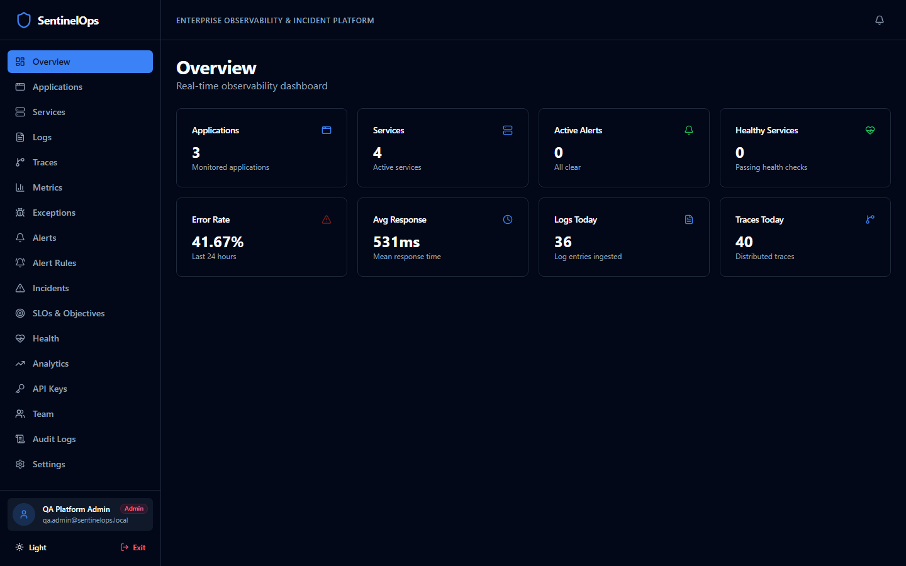
    </td>
    <td width="50%">
      <h4 align="center">🔍 Structured Log Explorer</h4>
      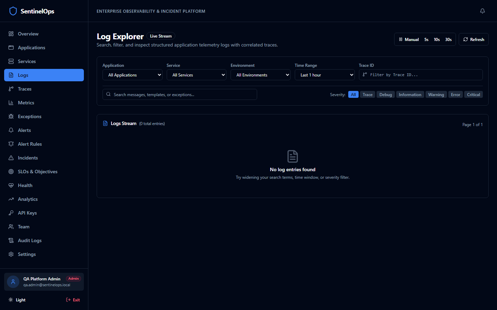
    </td>
  </tr>
  <tr>
    <td width="50%">
      <h4 align="center">⚡ Distributed Traces Waterfall</h4>
      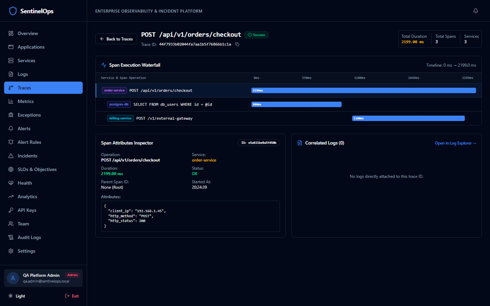
    </td>
    <td width="50%">
      <h4 align="center">📈 Metrics & Percentiles Explorer</h4>
      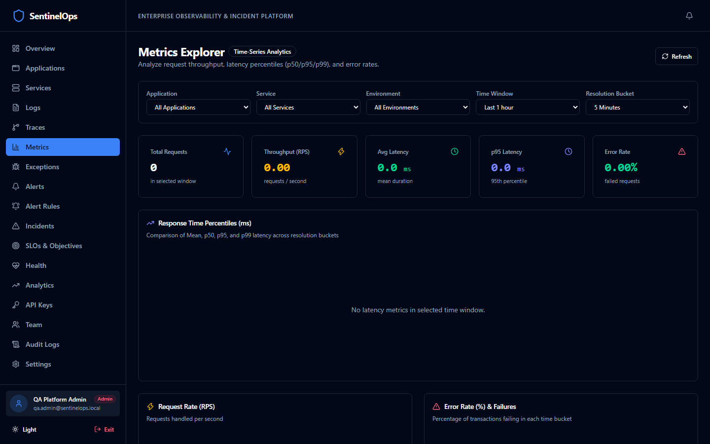
    </td>
  </tr>
  <tr>
    <td width="50%">
      <h4 align="center">🏥 Microservice Health & SLA Matrix</h4>
      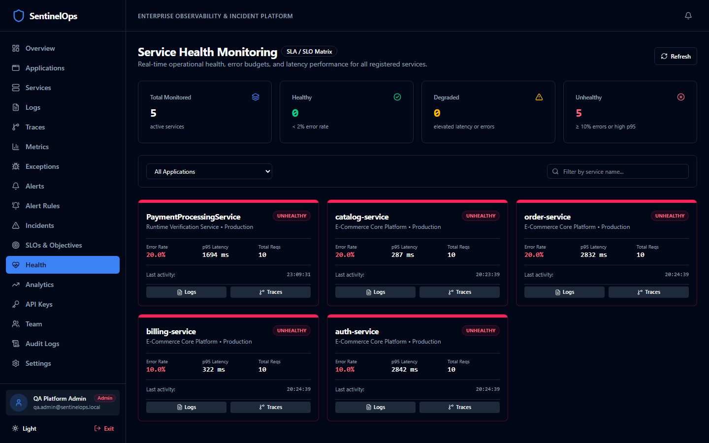
    </td>
    <td width="50%">
      <h4 align="center">⚠️ Fingerprinted Exceptions Drilldown</h4>
      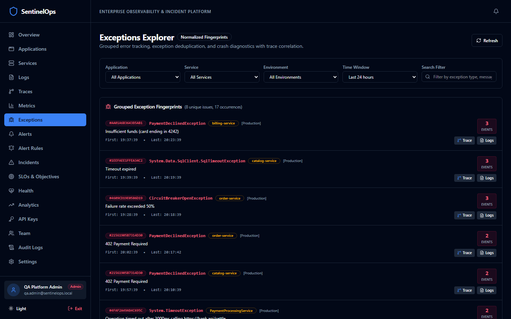
    </td>
  </tr>
  <tr>
    <td width="50%">
      <h4 align="center">🔔 Real-Time Alerting Engine & Triage</h4>
      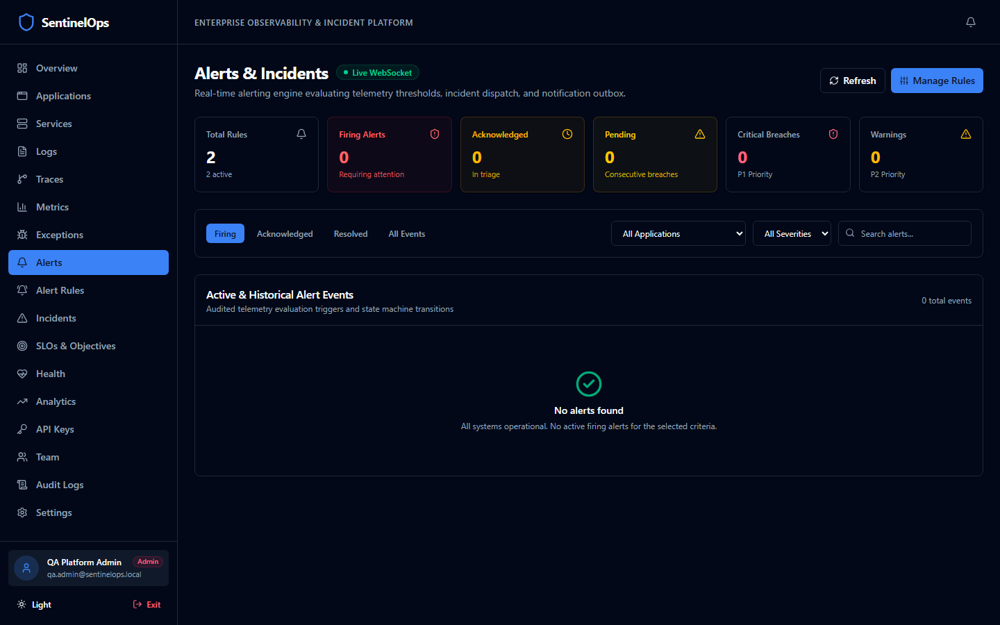
    </td>
    <td width="50%">
      <h4 align="center">⚙️ Alert Rules & SSRF-Protected Channels</h4>
      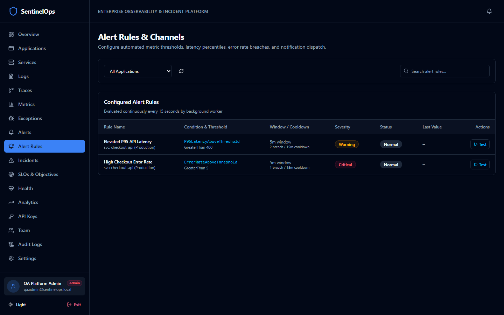
    </td>
  </tr>
  <tr>
    <td width="50%">
      <h4 align="center">🚨 Enterprise Incident Management</h4>
      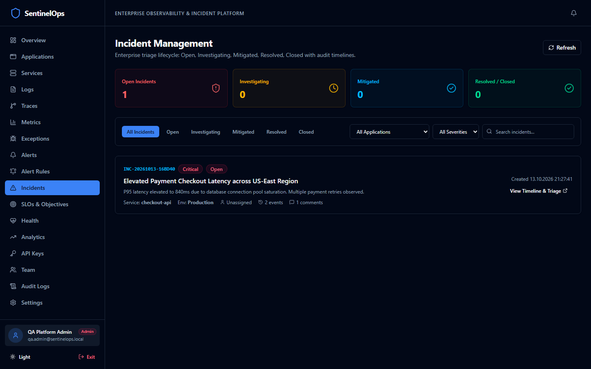
    </td>
    <td width="50%">
      <h4 align="center">📝 Incident Audit Timeline & Responder Collaboration</h4>
      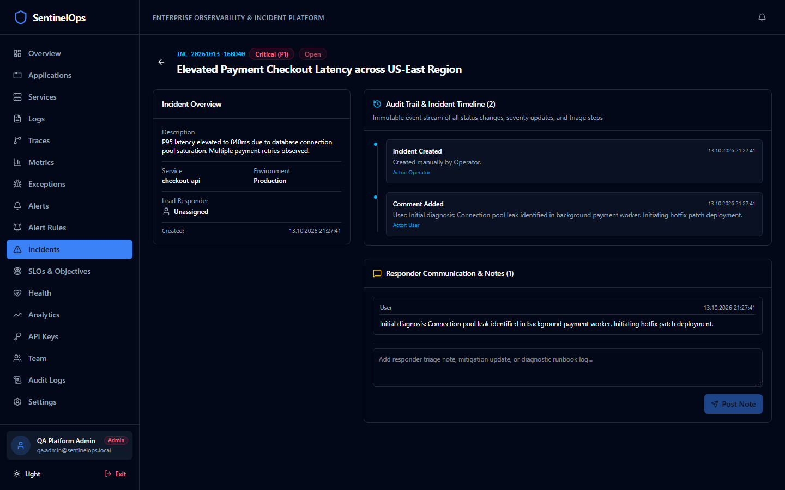
    </td>
  </tr>
  <tr>
    <td width="100%" colspan="2">
      <h4 align="center">🎯 Site Reliability Engineering (SRE) SLOs & Error Budgets</h4>
      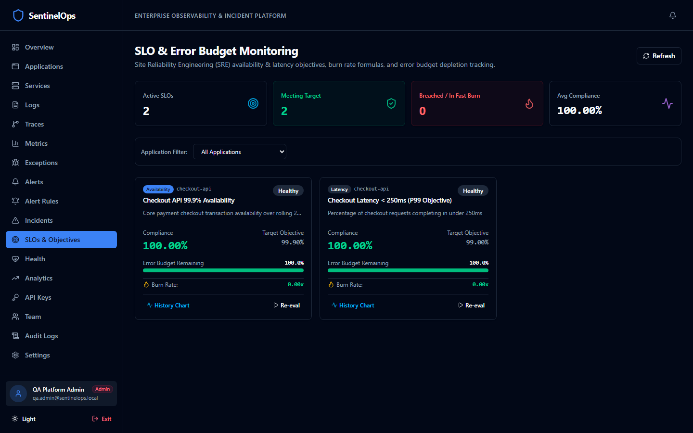
    </td>
  </tr>
</table>

---

## Architecture

```
┌──────────────┐     ┌──────────────────┐     ┌──────────────────┐
│  Monitored   │────▶│   OpenTelemetry  │────▶│  SentinelOps API │
│ Applications │     │    Collector     │     │   (ASP.NET Core) │
│  (OTLP SDK)  │     │  (gRPC/HTTP)    │     │                  │
└──────────────┘     └──────────────────┘     └────────┬─────────┘
                                                       │
                                              ┌────────┼─────────┐
                                              │        │         │
                                         ┌────▼───┐ ┌──▼──┐ ┌───▼────┐
                                         │  PgSQL │ │Redis│ │SignalR │
                                         │  (DB)  │ │Cache│ │  Hub   │
                                         └────────┘ └─────┘ └───┬────┘
                                                                 │
                                              ┌──────────────────▼───┐
                                              │   SentinelOps Web    │
                                              │   (React + Vite)     │
                                              └──────────────────────┘
```

Built with **Clean Architecture** principles:

| Layer | Project | Purpose |
|-------|---------|---------|
| Domain | `SentinelOps.Domain` | Business entities, enums, value objects |
| Contracts | `SentinelOps.Contracts` | Shared DTOs, request/response models |
| Application | `SentinelOps.Application` | CQRS handlers, validators, interfaces |
| Infrastructure | `SentinelOps.Infrastructure` | EF Core, Redis, Identity |
| API | `SentinelOps.Api` | HTTP endpoints, middleware |
| Worker | `SentinelOps.Worker` | Background processing |
| Web | `SentinelOps.Web` | React frontend dashboard |

## Tech Stack

### Backend
- .NET 10 / ASP.NET Core / C#
- Entity Framework Core 10 + PostgreSQL
- Redis (caching, pub/sub)
- MediatR (CQRS)
- FluentValidation
- Serilog (structured logging)
- SignalR (real-time)
- ASP.NET Core Identity + JWT

### Frontend
- React 19 + TypeScript
- Vite
- Tailwind CSS v4
- TanStack Query
- React Router
- Recharts
- Lucide icons

### Infrastructure
- Docker + Docker Compose
- OpenTelemetry Collector
- GitHub Actions CI/CD

## Quick Start

### Prerequisites

- [Docker](https://docs.docker.com/get-docker/) & Docker Compose
- [.NET 10 SDK](https://dotnet.microsoft.com/download)
- [Node.js 22+](https://nodejs.org/)

### Using Docker Compose

```bash
# Clone the repository
git clone https://github.com/Terabithia1572/SentinelOps.git
cd SentinelOps

# Copy environment file
cp .env.example .env
# Edit .env with your secrets

# Start all services
docker compose up -d

# Access the dashboard
# Web UI: http://localhost:3000
# API: http://localhost:5100
# API Docs: http://localhost:5100/swagger
```

### Local Development

```bash
# Backend
dotnet restore SentinelOps.slnx
dotnet build SentinelOps.slnx
dotnet run --project src/SentinelOps.Api

# Frontend
cd src/SentinelOps.Web
npm install
npm run dev
```

### Running Tests

```bash
# Backend tests (109 tests: Domain, Application, API Integration, OTLP Ingestion, Observability Explorer, Security, Alerting, Incidents, SLOs)
dotnet test SentinelOps.slnx

# Frontend tests (19 tests: Auth, Overview, Applications, API Keys, Logs, Traces, Metrics, Health, Exceptions, Alerts, Rules, Incidents, SLOs)
cd src/SentinelOps.Web
npm run test:run
```

### Generating Telemetry & Running Sample App

```bash
# 1. Start the instrumented Sample .NET API
dotnet run --project samples/SentinelOps.SampleApi

# 2. Run the Synthetic Telemetry Generator CLI tool
dotnet run --project tools/SentinelOps.TelemetryGenerator -- --endpoint http://localhost:5100 --api-key sent_live_your_key --count 50
```

## Environment Variables

| Variable | Description | Default |
|----------|-------------|---------|
| `POSTGRES_PASSWORD` | PostgreSQL password | (required) |
| `JWT_SECRET_KEY` | JWT signing key (min 32 chars) | (required) |
| `ASPNETCORE_ENVIRONMENT` | Runtime environment | `Development` |
| `ConnectionStrings__DefaultConnection` | PostgreSQL connection string | See docker-compose |
| `ConnectionStrings__Redis` | Redis connection string | `localhost:6379` |

## Documentation

- [Architecture Overview](docs/architecture/overview.md)
- [Architecture Decisions](docs/DECISIONS.md)
- [Security Policy & Hardening](docs/SECURITY.md)
- [Development Progress](docs/PROGRESS.md)

## Roadmap

- [x] **Phase 1** — Foundation (solution structure, Docker, CI/CD)
- [x] **Phase 2** — Identity & Application Management (JWT, RBAC, API Keys, Frontend Auth)
- [x] **Phase 3** — Telemetry Ingestion (OpenTelemetry OTLP HTTP/gRPC, Redis Streams, Worker Batch Persistence, Sample API)
- [x] **Phase 4** — Observability Explorer (Log search and live stream, Trace waterfall visualization, Metrics charts, Service health matrix, Exception grouping)
- [x] **Phase 5** — Enterprise Alerting & Incident Management (Telemetry evaluation engine, SignalR push hub, automated incident state machine, audit timelines, SSRF-protected notification outbox, SRE SLO and error budget monitoring)
- [ ] **Phase 6** — Advanced Analytics
- [ ] **Phase 7** — Production Hardening
- [ ] **Phase 8** — Portfolio Presentation

## Security

- JWT-based authentication
- Role-based authorization
- API key hashing
- Input validation on all endpoints
- CORS policies
- Audit logging
- Secret redaction in logs

See [Security Documentation](docs/security/) for details.

---

# 🇹🇷 Türkçe Dokümantasyon

## Genel Bakış

SentinelOps; Grafana, Datadog ve modern APM sistemlerinin yeteneklerinden ilham alan, açık kaynak kodlu ve merkezi bir gözlemlenebilirlik (observability) ve uygulama izleme platformudur.

Birden fazla uygulamanın ürettiği telemetri verilerini toplamak, işlemek, saklamak, analiz etmek, görselleştirmek ve alarm (alert) üretmek üzere tasarlanmıştır.

### Temel Yetenekler

- **📊 Gerçek Zamanlı Gösterge Paneli** — SignalR destekli anlık operasyonel metrikler
- **📝 Günlük (Log) Yönetimi** — Tam metin arama ve filtreleme destekli yapılandırılmış log gezgini
- **🔗 Dağıtık İzleme (Distributed Tracing)** — Span zaman çizelgesi görselleştirmesi ile uçtan uca istek takibi
- **📈 Metrikler ve Analitik** — İstek verimi, hata oranları, yanıt gecikmesi yüzdelik dilimleri
- **🚨 Alarm Motoru** — E-posta ve webhook bildirim adaptörleri içeren kural tabanlı alarm mekanizması
- **🏥 Servis Sağlığı İzleme** — Sistem sağlık kontrolleri ve erişilebilirlik takibi
- **🔐 Kurumsal Güvenlik** — JWT kimlik doğrulama, rol tabanlı yetkilendirme (RBAC) ve API anahtarı yönetimi
- **🌍 Çoklu Dil Desteği** — İngilizce ve Türkçe kullanıcı arayüzü desteği

## Mimari

Clean Architecture prensiplerine göre yapılandırılmıştır:
- `SentinelOps.Domain`: Çekirdek iş varlıkları ve etki alanı kuralları (sıfır harici bağımlılık)
- `SentinelOps.Contracts`: Paylaşılan DTO, istek ve yanıt modelleri
- `SentinelOps.Application`: CQRS komut ve sorguları, MediatR ardışık düzeni, FluentValidation
- `SentinelOps.Infrastructure`: EF Core 10, PostgreSQL, Redis önbellekleme ve Identity
- `SentinelOps.Api`: ASP.NET Core Web API, Serilog, JWT kimlik doğrulama, Swagger ve sistem sağlık kontrolleri
- `SentinelOps.Worker`: Arka plan temizleme ve veri saklama hizmetleri (BackgroundService)
- `SentinelOps.Web`: React 19, TypeScript, Vite, Tailwind CSS v4 ve TanStack Query tabanlı arayüz

## Hızlı Başlangıç

```bash
# Depoyu klonlayın
git clone https://github.com/Terabithia1572/SentinelOps.git
cd SentinelOps

# Ortam değişkenlerini kopyalayın
cp .env.example .env

# Docker Compose ile tüm servisleri başlatın
docker compose up -d
```

- Web Arayüzü: `http://localhost:3000`
- API ve Swagger: `http://localhost:5100/swagger`

---

## License

This project is licensed under the [MIT License](LICENSE).

## Author

**Yunus İNAN**

- GitHub: [@Terabithia1572](https://github.com/Terabithia1572)

---

<div align="center">
  <sub>Built with ❤️ for the observability community</sub>
</div>
