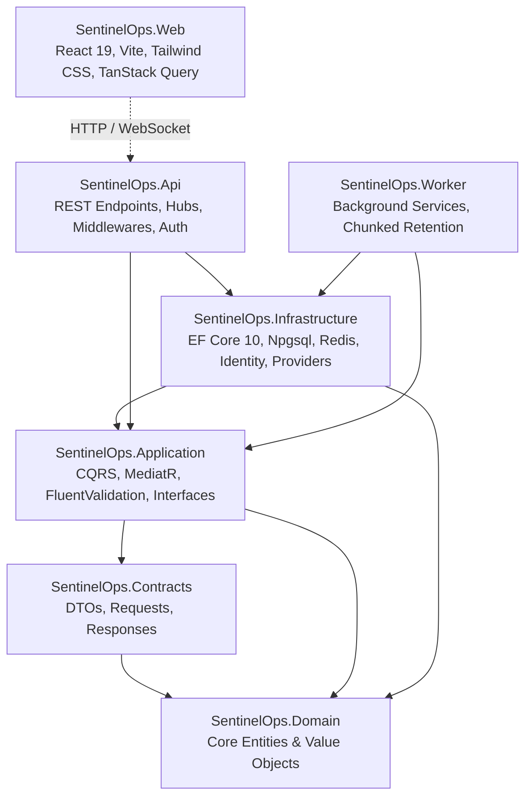

# SentinelOps — Architecture & Codebase Release Audit

## 1. Executive Summary
This document provides an exhaustive structural and architectural audit of the SentinelOps solution at Phase 20 baseline commit `85fcdfe`. The repository adheres to Clean Architecture and Domain-Driven Design (DDD) principles, enforcing strict separation of concerns, multi-tenant isolation, dependency inversion, and enterprise-grade observability pipelines.

---

## 2. Solution Structure & Dependency Inversion

### Layer Boundaries Verification

1. **SentinelOps.Domain**:
   - Zero framework dependencies (no EF Core, ASP.NET Core, or external packages).
   - Contains pure domain entities (`Application`, `Environment`, `Service`, `LogEntry`, `TraceRecord`, `SpanRecord`, `MetricRecord`, `AlertRule`, `AlertIncident`, `ServiceLevelObjective`, `SavedLogQuery`, `Organization`).
   - Implements Aggregate Roots, Domain Events, and Value Objects.

2. **SentinelOps.Contracts**:
   - Framework-independent data transfer objects, request records, and response schemas.
   - Enforces clean API contract boundaries between clients and internal application services.

3. **SentinelOps.Application**:
   - Core business logic orchestrated via CQRS with MediatR and FluentValidation pipeline behaviors.
   - Declares domain repository abstractions and service interfaces (`IApplicationDbContext`, `ICurrentUserService`, `ICurrentTenantService`, `IApmService`, `ISavedLogQueryService`, `IEntitlementService`, `ISloService`).
   - Treats warnings as errors (`TreatWarningsAsErrors=true`).

4. **SentinelOps.Infrastructure**:
   - Implements application abstractions using EF Core 10 with Npgsql (PostgreSQL), StackExchange.Redis (distributed caching, Redis Streams), and ASP.NET Core Identity.
   - Notification dispatching with DNS SSRF validation (`SlackNotificationProvider`, `TeamsNotificationProvider`).
   - Tiered retention enforcement and periodic chunked telemetry pruning.

5. **SentinelOps.Api**:
   - ASP.NET Core 10 Web API hosting REST controllers, SignalR `/hubs/alerts`, Swagger OpenAPI documentation, and health endpoints (`/health/live`, `/health/ready`).
   - Robust middleware pipeline: `SecurityHeadersMiddleware`, `ExceptionHandlingMiddleware`, `RequestLoggingMiddleware`, `TenantResolutionMiddleware`.
   - Dual-token JWT authentication with sliding refresh token rotation.

6. **SentinelOps.Worker**:
   - Dedicated .NET 10 hosted background service handling high-throughput telemetry ingestion from Redis Streams, predictive anomaly detection, and automated 500-record batch retention purges.

7. **SentinelOps.Web**:
   - Modern React 19 single-page application built with Vite, TypeScript strict mode, and Tailwind CSS v4.
   - Adheres to the approved Precision Dark design system with zero blank screens and full responsive compliance.

---

## 3. Multi-Tenant Architecture & Security Model

- **Tenant Isolation**: Every database entity is partitioned by `OrganizationId`. Client-supplied headers (`X-Organization-Id`) are strictly validated against authenticated user memberships in `TenantResolutionMiddleware` and controller filters. IDOR vulnerabilities are prevented through compound queries (`Where(x => x.Id == id && x.OrganizationId == currentOrgId)`).
- **Entitlements & Throttling**: Monthly tenant quotas on logs, traces, and metrics are verified on OTLP ingestion. When monthly usage exhausts plan allocations, ingestion requests are throttled with `HTTP 429 Too Many Requests` and a standard `Retry-After: 3600` header.
- **SSRF Defenses**: All outbound notification webhooks undergo asynchronous DNS host resolution before dispatch, blocking loopback addresses (`127.0.0.1`, `localhost`), private RFC 1918 subnets, and cloud instance metadata endpoints (`169.254.169.254`).

---

## 4. Audit Verdict

- **Architecture Integrity**: **EXCELLENT** (Zero circular references, pure domain isolation, strict dependency direction).
- **Codebase Cleanliness**: **VERIFIED** (.NET 10 solution builds with 0 errors and 0 warnings; TypeScript typechecks with 0 errors).
- **Release Readiness**: **APPROVED**.
