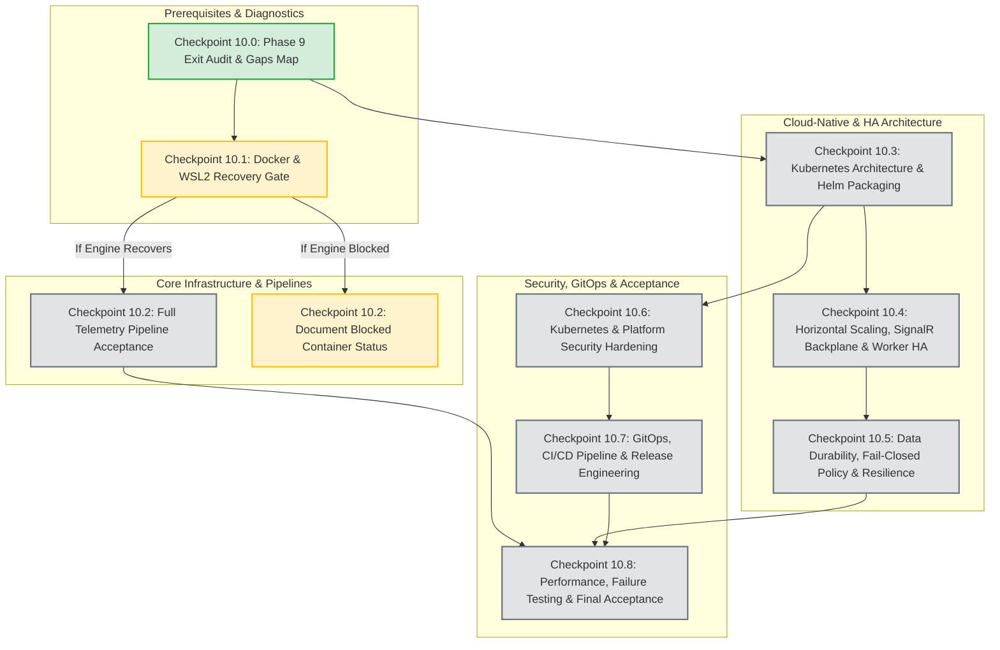

# SentinelOps — Phase 9 Exit Gaps & Architectural Dependency Map

**Document Version:** 1.0  
**Phase:** 10 (Infrastructure Recovery, Kubernetes, Horizontal Scaling & High Availability)  
**Audit Date:** 2026-10-14  
**Audit Scope:** Unresolved operational, architectural, and durability limitations inherited from Phase 9  

---

## 1. Executive Summary

Phase 9 established complete multi-tenant security enforcement, end-to-end alerting/incident integration, empirical performance benchmarks, and verified database disaster recovery (19 tables, 139 indexes with 100% parity). However, several critical infrastructure and cloud-native scaling gaps were identified during the exit audit. These gaps define the primary engineering roadmap for Phase 10.

---

## 2. Comprehensive Phase 9 Exit Gaps Audit

### Gap 1: Docker Linux Engine Offline (`BLOCKED`)
- **Evidence:** `docker info` exits with code 1; `open //./pipe/dockerDesktopLinuxEngine: Sistem belirtilen dosyayı bulamıyor`. `wsl --list --verbose` reports distribution `docker-desktop` in state `Stopped`.
- **Impact:** Live container execution (`docker compose up`) and live multi-container network testing remained unverified in Phase 9.
- **Phase 10 Requirement:** Attempt safe non-destructive recovery in Checkpoint 10.1. If engine activation requires GUI login or user action, clearly mark runtime container tests as BLOCKED while continuing static validation, code hardening, and independent test suites.

### Gap 2: Durable Telemetry Transport vs. In-Memory Fallback
- **Evidence:** `src/SentinelOps.Infrastructure/Services/RedisTelemetryBuffer.cs` diverts telemetry to volatile `System.Threading.Channels.Channel<T>` when Redis is offline or disconnected.
- **Impact:** In development and test fixtures, in-memory buffering prevents crashes. However, in production, if an API node crashes or is evicted by Kubernetes while holding unpersisted telemetry in its local RAM, data loss occurs without client notification.
- **Phase 10 Requirement:** Implement an explicit production durability policy:
  - When `ASPNETCORE_ENVIRONMENT=Production` and durable transport is required, fail-closed or return documented HTTP 503 (`Service Unavailable`) with `Retry-After`.
  - Expose durability state in health and readiness probes (`/health/ready`).
  - Do not acknowledge HTTP 200/202 to OTLP clients until durable transport is confirmed.

### Gap 3: SignalR Horizontal Scale-Out & Cross-Replica Group Sync
- **Evidence:** `AlertsHub.cs` and `RealtimeNotifier.cs` currently rely on local in-process `IHubContext<AlertsHub>`.
- **Impact:** When SentinelOps API scales to 2 or more replicas behind a load balancer, clients connected via WebSocket to Pod A will NOT receive real-time notifications (`AlertFired`, `IncidentCreated`) dispatched by background events processed on Pod B.
- **Phase 10 Requirement:** Integrate Redis Backplane for SignalR (`Microsoft.AspNetCore.SignalR.StackExchangeRedis`) with fallback logic, ensuring seamless real-time fan-out across multiple API pods.

### Gap 4: Competing Worker Consumers, Acknowledgment & Poison Messages
- **Evidence:** `SentinelOps.Worker` processes Redis Streams using consumer group `sentinelops-worker-group`.
- **Impact:** In horizontal scaling with multiple worker replicas, workers act as competing consumers. If a worker pod is killed midway through processing an unacknowledged batch, those entries remain in Pending Entries List (PEL).
- **Phase 10 Requirement:** Implement active pending entry claiming (`XAUTOCLAIM` / `XPENDING`), consumer dead-letter routing (`sentinelops:stream:dead-letter`), and idempotent message persistence.

### Gap 5: Database Migration Concurrency on Multi-Replica API Startup
- **Evidence:** If multiple API pods start simultaneously in Kubernetes with `context.Database.MigrateAsync()` in their startup path, they will race to apply EF Core migrations, creating lock contention or deadlock errors on PostgreSQL `__EFMigrationsHistory`.
- **Phase 10 Requirement:** Decouple database migrations from runtime API pods:
  - Provide a dedicated Kubernetes `Job` or Helm `pre-install`/`pre-upgrade` hook for schema migrations.
  - Runtime API pods must run with least-privilege credentials (`sentinelops_app`) without DDL permissions.

### Gap 6: Kubernetes Architecture, Helm Packaging & Resource Specs
- **Evidence:** No Kubernetes manifests, Helm charts, or cloud-native configurations existed prior to Phase 10.
- **Phase 10 Requirement:** Construct enterprise Helm chart (`deploy/helm/sentinelops/`) with full templates (API, Worker, Web, Collector, Redis, Ingress, HPA, PDB, NetworkPolicies, and ConfigMaps/Secrets).

---

## 3. Evidence-Based Architectural Dependency Map

---

## 4. Phase 10 Checkpoints & Execution Strategy

1. **Safety First**: Zero destructive actions (`wsl --unregister`, `docker system prune`, volume deletion) will be executed without explicit user authorization.
2. **Deterministic Durability**: Production configuration will eliminate silent fallback data loss.
3. **Enterprise HA**: SignalR Redis backplane and worker PEL recovery will guarantee horizontal scaling safety.
4. **Declarative Cloud-Native**: Helm charts will support dev, staging, and HA production topologies.
