# SentinelOps — AI Architecture & Provider Abstraction Report
## Checkpoint 11.1: Modular, Testable & Provider-Independent AI Architecture

**Document Version:** 1.0.0  
**Implementation Date:** October 14, 2026  
**Status:** **PASSED & VERIFIED**  
**Repository:** [https://github.com/Terabithia1572/SentinelOps](https://github.com/Terabithia1572/SentinelOps)  
**Workspace:** `C:\Users\Yunus\Desktop\SentinelOps`  

---

## 1. Architectural Philosophy & Design Principles

SentinelOps Phase 11 introduces a layered, explainable, and secure AI observability system that builds directly upon the Phase 8 deterministic incident intelligence foundation.

### Core Architectural Principles
1. **Explainability Over Black Boxes**: Deterministic heuristics, statistical anomaly detection, and LLM-assisted operations are strictly isolated and explicitly labeled in code, metadata, and UI. Deterministic rules are never marketed as machine learning, and mocked responses are never portrayed as live AI inference.
2. **Data Minimization & Redaction First**: Sensitive credentials (API keys, JWT bearer tokens, connection strings, passwords) are scrubbed before prompt synthesis or external network egress.
3. **Provider Agnosticism**: All capabilities are exposed via interfaces (`IAiProvider`, `IIncidentAnalysisService`, `IAnomalyDetectionService`, etc.), decoupled from any specific proprietary model provider.
4. **Tenant Isolation**: Multi-tenant boundaries are strictly enforced at the database and service layers. Quotas, pattern dictionaries, anomaly baselines, and forecast horizons are segregated by `OrganizationId`.
5. **Human-in-the-Loop Governance**: AI recommendations are advisory only. No shell command, database mutation, or service restart can ever be executed autonomously without explicit operator confirmation.

---

## 2. Interface Specifications

The architecture introduces standard domain interfaces in `SentinelOps.Application.Common.Interfaces`:

```mermaid
classDiagram
    class IAiProvider {
        <<interface>>
        +string ProviderId
        +string ProviderName
        +bool IsEnabled
        +CompleteAsync(AiCompletionRequest) Task~AiCompletionResult~
        +ChatAsync(AiCopilotChatRequest) Task~AiCopilotChatResponse~
    }
    class IAnomalyDetectionService {
        <<interface>>
        +EvaluateSignalAsync(AnomalyEvaluationRequest) Task~AnomalyDetectionResult~
        +GetActiveAnomaliesAsync(Guid) Task~IReadOnlyList~TelemetryAnomalyDto~~
        +ResolveAnomalyAsync(Guid, string) Task~bool~
    }
    class ILogPatternAnalysisService {
        <<interface>>
        +ExtractPattern(string, string) LogPatternExtractionResult
        +AnalyzeApplicationLogsAsync(Guid, TimeSpan) Task~LogPatternAnalysisResult~
        +GetPatternsAsync(Guid) Task~IReadOnlyList~LogPatternDto~~
    }
    class IRootCauseAnalysisService {
        <<interface>>
        +PerformRcaAsync(Guid) Task~RcaAnalysisResult~
        +VerifyHypothesisAsync(Guid, string, bool, string) Task~bool~
    }
    class IPredictiveAlertingService {
        <<interface>>
        +ForecastMetricAsync(CapacityForecastRequest) Task~CapacityForecastResult~
        +GetActiveForecastsAsync(Guid) Task~IReadOnlyList~PredictiveForecastDto~~
    }
    class IAiUsageMeter {
        <<interface>>
        +CanExecuteAiOperationAsync(Guid, int) Task~bool~
        +RecordUsageAsync(Guid, int, double) Task
        +GetUsageAsync(Guid) Task~AiUsageDto~
    }
    class IAiProviderFactory {
        <<interface>>
        +GetProvider(string) IAiProvider
        +GetProviderForOrganizationAsync(Guid) Task~IAiProvider~
    }

    IAiProvider <|.. DisabledAiProvider
    IAiProvider <|.. DeterministicAiProvider
    IAiProvider <|.. ExternalLlmProvider
    IAiProviderFactory ..> IAiProvider
```



---

## 3. Provider Implementations

| Provider | ID | Network Egress | Description & Behavior |
| :--- | :--- | :--- | :--- |
| **DisabledAiProvider** | `Disabled` | None | Returns explicit policy-disabled status (`IsSuccessful = false`, `IsEnabled = false`). Used when AI features are disabled globally or opted out by an organization. |
| **DeterministicAiProvider** | `Deterministic` | None | Evaluates telemetry signatures, logs, traces, and alert rules using deterministic heuristic algorithms. Scrubs all sensitive data. Zero external latency, 100% reproducible. |
| **ExternalLlmProvider** | `ExternalLlm` | HTTPS (Configured Endpoint) | Enterprise LLM integration supporting OpenAI-compatible endpoints with configurable model, timeouts, exponential backoff retries, and circuit breakers. If unconfigured or keys missing, gracefully reports unconfigured state without throwing. |

---

## 4. Configuration & Safety Policy

The AI configuration model (`AiOptions`) is bound from `appsettings.json`:

```json
"AiSettings": {
  "Enabled": true,
  "DefaultProvider": "Deterministic",
  "ExternalProvider": {
    "Endpoint": "",
    "ApiKey": "",
    "Model": "gpt-4o-mini",
    "TimeoutSeconds": 30,
    "MaxRetries": 3,
    "MaxTokens": 2000,
    "MonthlyTokenBudget": 1000000,
    "MaxConcurrency": 5
  }
}
```

### Safety Controls
1. **Pre-Request Secret Scrubbing**:
   - `sk_*`, `sentinel_*`, `sent_live_*` patterns -> `[REDACTED_API_KEY]`
   - `Bearer <token>` patterns -> `Bearer [REDACTED_TOKEN]`
   - `password=...`, `pwd=...`, `secret=...` -> `[REDACTED_SECRET]`
   - Database connection strings -> `Host=[REDACTED_HOST];Password=[REDACTED_CREDENTIAL]`
2. **Circuit Breaker**: Automatically trips for 60 seconds if 3 consecutive failures occur, shielding upstream providers and preventing cascading latency.
3. **Quota Metering**: `IAiUsageMeter` checks `OrganizationSettings.MaxMonthlyAiTokens` against `OrganizationUsage.AiTokensUsedMonthToDate`. Operations exceeding quota are blocked before invocation.

---

## 5. Verification Evidence

- **Unit Test Suite**: Added [`AiArchitectureTests.cs`](file:///c:/Users/Yunus/Desktop/SentinelOps/tests/SentinelOps.Application.Tests/Ai/AiArchitectureTests.cs) with 5 comprehensive tests:
  - `DisabledAiProvider_AlwaysReturnsDisabledResult` (PASS)
  - `DeterministicAiProvider_ScrubsSensitiveSecrets_InPromptAndLogs` (PASS)
  - `ExternalLlmProvider_WhenUnconfigured_FailsGracefullyWithoutNetworkCall` (PASS)
  - `AiUsageMeter_BlocksExecution_WhenOrganizationQuotaExceeded` (PASS)
  - `AiUsageMeter_BlocksExecution_WhenAiIsDisabledForOrganization` (PASS)
- **Backend Test Count**: 206 tests passed (29 Domain + 63 Application + 114 Api.IntegrationTests), 0 warnings, 0 errors under `--warnaserror`.
- **Verdict**: **PASSED (Checkpoint 11.1 Complete)**.
