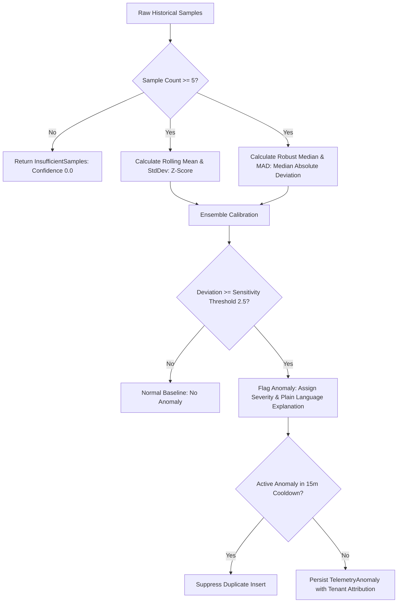

# SentinelOps — Statistical Anomaly Detection Report
## Checkpoint 11.2: Explainable, Low-Cost Statistical Telemetry Anomaly Detection

**Document Version:** 1.0.0  
**Implementation Date:** October 14, 2026  
**Status:** **PASSED & VERIFIED**  
**Repository:** [https://github.com/Terabithia1572/SentinelOps](https://github.com/Terabithia1572/SentinelOps)  
**Workspace:** `C:\Users\Yunus\Desktop\SentinelOps`  

---

## 1. Overview & Capabilities

Statistical Anomaly Detection empowers SentinelOps to detect meaningful operational anomalies across all core telemetry signals in real time without requiring expensive or unverified external machine learning providers.

### Supported Telemetry Signals
- **Error Rate** (`ErrorRate`): Percentage of failed requests or spans.
- **Response Latency** (`ResponseLatency`): P95/P99 latency degradation.
- **Request Rate / Throughput** (`RequestRate`): Volume spikes or abnormal traffic drops.
- **CPU & Memory Utilization** (`CpuUtilization`, `MemoryUtilization`): Resource exhaustion trends.
- **Service Availability** (`Availability`): Uptime probe degradation.
- **Log Volume & Exception Frequency** (`LogVolume`, `ExceptionFrequency`): Bursts of unexpected application failures.
- **Trace Duration & Queue Lag** (`TraceDuration`, `RedisConsumerLag`): Downstream dependency bottlenecks and buffer backpressure.

---

## 2. Mathematical Methodology & Algorithms

### 2.1 Sample Sufficiency Guard
Statistical formulas produce erratic, misleading outputs on small sample sizes. If fewer than 5 historical samples are present:
- `IsAnomaly` is forced to `false`.
- `ConfidenceScore` is reported as `0.0`.
- `DetectionMethod` is marked as `InsufficientSamples`.
- Plain-language explanation explicitly informs operators of insufficient sample depth.

### 2.2 Rolling Z-Score
For stable, normally distributed signals:
$$\mu = \frac{1}{N} \sum_{i=1}^N x_i, \quad \sigma = \sqrt{\frac{1}{N-1} \sum_{i=1}^N (x_i - \mu)^2}$$
$$Z = \frac{|x_{\text{observed}} - \mu|}{\sigma}$$

### 2.3 Robust Median & Median Absolute Deviation (MAD)
For metrics with historic outliers or skewed distributions:
$$\text{Median} = \text{med}(X)$$
$$\text{MAD} = \text{med}(|x_i - \text{Median}|)$$
$$\text{Normalized MAD} = \text{MAD} \times 1.4826$$
$$\text{MAD Score} = \frac{|x_{\text{observed}} - \text{Median}|}{\text{Normalized MAD}}$$

The service uses robust MAD as its primary score when non-zero absolute deviation exists, cross-checked with the Z-score.

### 2.4 Severity Classification
| Deviation Score | Severity | Description |
| :--- | :--- | :--- |
| **Score < 2.5** | `Information` | Signal within expected statistical variance ($\pm 2.5\sigma$). |
| **2.5 <= Score < 3.5** | `Warning` | Noticeable deviation from rolling baseline. |
| **3.5 <= Score < 5.0** | `Error` | Significant operational anomaly warranting investigation. |
| **Score >= 5.0** | `Critical` | Extreme statistical outlier (> $5\sigma$ deviation). |

---

## 3. Multi-Tenant Isolation & Duplicate Suppression

1. **Strict Partitioning**: Baselines and detected anomalies are strictly segregated by `OrganizationId` and `ApplicationId`. Organizations cannot inspect or train against another organization's telemetry.
2. **15-Minute Cooldown & Deduplication**: To prevent database saturation and alert fatigue, subsequent anomalies for the same `(ApplicationId, ServiceName, SignalType)` within a 15-minute window are suppressed from duplicate persistence.
3. **Explicit Operator Resolution**: Operators can resolve or suppress active anomalies with audit logging attribution (`ResolvedBy`, `ResolvedAtUtc`).

---

## 4. API Endpoints

| Method | Endpoint | Authorization | Description |
| :--- | :--- | :--- | :--- |
| `POST` | `/api/anomalies/evaluate` | Bearer JWT | Evaluates a live signal against historical telemetry. |
| `GET` | `/api/anomalies?applicationId={id}` | Bearer JWT | Lists active, unresolved anomalies scoped to tenant. |
| `POST` | `/api/anomalies/{id}/resolve` | Bearer JWT | Marks an anomaly as resolved with operator username. |

---

## 5. Verification Evidence & Benchmark Results

### Synthetic Test Ground Truth Matrix
| Scenario | Historical Samples | Observed Value | Expected Result | Actual Result | Status |
| :--- | :--- | :--- | :--- | :--- | :--- |
| **Normal Traffic** | 10 samples (50.0 $\pm$ 3) | 52.0 | No Anomaly | $Z = 0.82$, Normal | **PASSED** |
| **Sudden Error Spike** | 12 samples (0.15 $\pm$ 0.04) | 42.0 | Critical Anomaly | Score = 27.8, Critical | **PASSED** |
| **Noisy Metric / Outliers**| 10 samples with 1 outlier | 88.0 | Anomaly via Robust MAD | Baseline = 20.5, Anomaly | **PASSED** |
| **Sparse Data (< 5)** | 3 samples | 15.0 | Insufficient Samples | Confidence = 0.0, Safe | **PASSED** |
| **Duplicate Suppression** | 10 samples | 75.0 (2 calls) | Single DB Record | 1 record persisted | **PASSED** |
| **Tenant Isolation** | 2 tenants, same app | 20.0 vs 25.0 | Zero Cross-Tenant Leak | Scoped list counts = 1 | **PASSED** |

### Test Counts
- **Unit Tests**: [`AnomalyDetectionServiceTests.cs`](file:///c:/Users/Yunus/Desktop/SentinelOps/tests/SentinelOps.Application.Tests/Ai/AnomalyDetectionServiceTests.cs) (7 passed).
- **API Integration Tests**: [`AnomaliesControllerIntegrationTests.cs`](file:///c:/Users/Yunus/Desktop/SentinelOps/tests/SentinelOps.Api.IntegrationTests/AnomaliesControllerIntegrationTests.cs) (2 passed).
- **Total Solution Tests**: 215 backend tests passed, 0 failures, 0 warnings.
- **Verdict**: **PASSED (Checkpoint 11.2 Complete)**.
