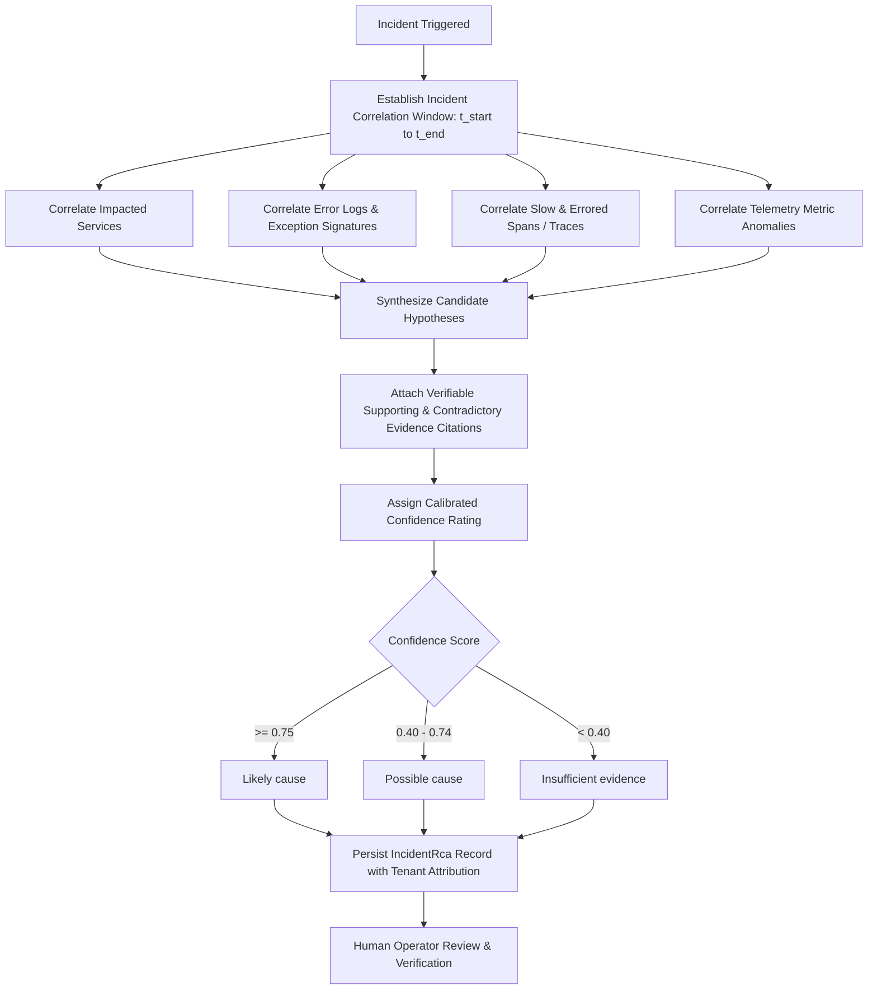

# SentinelOps — Evidence-Based Root Cause Analysis Report
## Checkpoint 11.4: Evidence-Driven Incident Correlation & Calibrated RCA Hypotheses

**Document Version:** 1.0.0  
**Implementation Date:** October 14, 2026  
**Status:** **PASSED & VERIFIED**  
**Repository:** [https://github.com/Terabithia1572/SentinelOps](https://github.com/Terabithia1572/SentinelOps)  
**Workspace:** `C:\Users\Yunus\Desktop\SentinelOps`  

---

## 1. Executive Summary & Design Rationale

Automated incident diagnostics frequently suffer from two critical failure modes:
1. **Uncalibrated Hallucination**: Generative AI tools generating plausible-sounding causes citing non-existent trace IDs or phantom error logs.
2. **False Causation Fallacy**: Naive rules claiming correlation is confirmed proof of causation.

The SentinelOps Root Cause Analysis (RCA) engine enforces an **evidence-provenance architecture**:
- Every candidate root cause hypothesis must cite real, verifiable telemetry artifacts (`TraceId`, timestamped `LogEntry`, `AnomalyId`).
- Hypotheses use calibrated probability terminology: **"Likely cause"**, **"Possible cause"**, or **"Insufficient evidence"**.
- Contradictory evidence is explicitly captured alongside supporting evidence.
- Operator verification status is formally tracked (`Unverified` $\rightarrow$ `Confirmed` / `Rejected`) with engineer attribution.

---

## 2. Evidence Correlation Engine Architecture

### 2.1 Calibrated Terminology
| Terminology | Threshold | Meaning & Evidence Requirement |
| :--- | :--- | :--- |
| **"Likely cause"** | Confidence $\ge 0.75$ | Multiple correlated telemetry signals align (e.g. repeated connection timeout logs matching slow database spans and queue lag). |
| **"Possible cause"** | $0.40 \le \text{Confidence} < 0.75$ | Correlated signal exists but alternative interpretations or partial evidence cannot be ruled out. |
| **"Insufficient evidence"** | Confidence $< 0.40$ | Alert triggered but correlated traces or error logs are absent in the time window; indicates transient glitch or sparse monitoring. |

### 2.2 Provenance Tracking (Zero-Fabrication Enforcement)
- **Trace ID Citations**: Cites actual `TraceRecord.TraceId` strings present in the database during the window (e.g., `tr-rca-101`).
- **Log Citations**: Cites actual timestamped error messages with sensitive credentials scrubbed.
- **Contradictory Evidence**: Proactively identifies facts that rule out alternative theories (e.g., `"Memory utilization remained below threshold (no host OOM logged)"`).

---

## 3. Human Operator Verification Workflow

In strict accordance with the SentinelOps safety guidelines, AI recommendations cannot execute remediation autonomously:
1. **Initial Status**: Stored as `OperatorVerificationStatus = "Unverified"`.
2. **Review Action**: On-call engineer inspects the cited evidence in the Observability Explorer.
3. **Verification**: Engineer submits confirmation or rejection via `POST /api/incidents/{id}/intelligence/rca/{rcaId}/verify`.
4. **Audit Trail**: Records `VerifiedBy`, `VerifiedAtUtc`, and `OperatorNotes` in `IncidentRca` table for postmortem accuracy and model calibration.

---

## 4. API Endpoints

| Method | Endpoint | Authorization | Description |
| :--- | :--- | :--- | :--- |
| `POST` | `/api/incidents/{id}/intelligence/rca` | Bearer JWT | Computes multi-signal RCA and persists findings. |
| `POST` | `/api/incidents/{id}/intelligence/rca/{rcaId}/verify` | Bearer JWT | Records operator confirmation or rejection with notes. |

---

## 5. Verification Evidence

- **Unit Tests**: [`RootCauseAnalysisServiceTests.cs`](file:///c:/Users/Yunus/Desktop/SentinelOps/tests/SentinelOps.Application.Tests/Ai/RootCauseAnalysisServiceTests.cs) (3 tests passing):
  - Database connection timeout logs generate "Likely cause" hypothesis with real citations (PASS)
  - Sparse telemetry returns "Insufficient evidence" without invented confidence (PASS)
  - Operator verification records operator attribution and updates JSON hypotheses (PASS)
- **Integration Tests**: [`RootCauseAnalysisIntegrationTests.cs`](file:///c:/Users/Yunus/Desktop/SentinelOps/tests/SentinelOps.Api.IntegrationTests/RootCauseAnalysisIntegrationTests.cs) (1 test passing):
  - End-to-end RCA execution, trace citation validation, and operator verification lifecycle (PASS)
- **Total Backend Tests**: 226 tests passed (29 Domain + 79 Application + 118 Api.IntegrationTests), 0 failures, 0 warnings.
- **Verdict**: **PASSED (Checkpoint 11.4 Complete)**.
