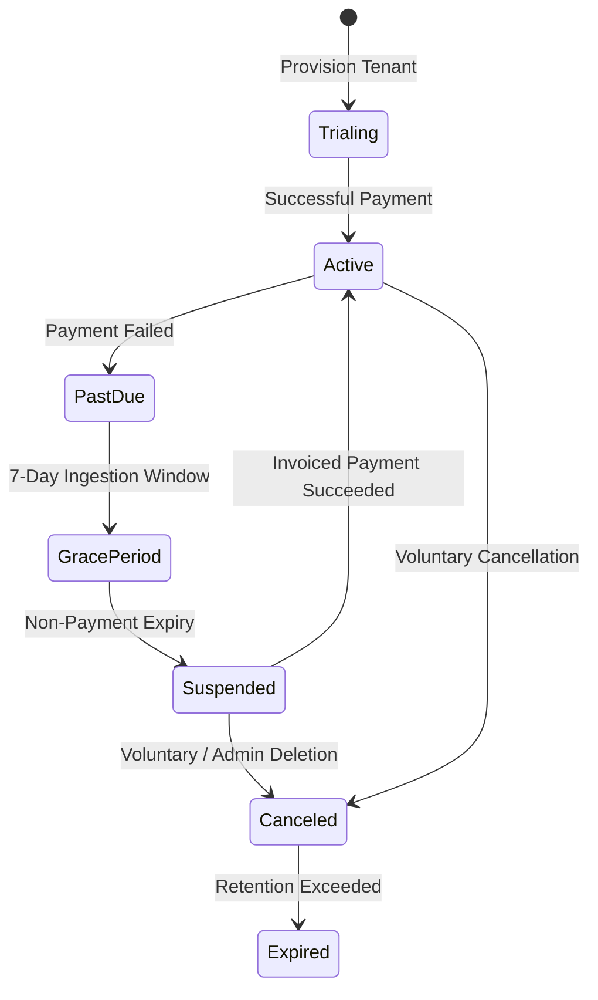

# SentinelOps — Phase 12 Master Final Acceptance Report
## Enterprise SaaS Commercialization, Subscription Management, Billing Architecture & Launch Readiness

**Date:** 2026-10-15  
**Workspace:** `C:\Users\Yunus\Desktop\SentinelOps`  
**Repository:** `https://github.com/Terabithia1572/SentinelOps`  
**Lead Roles:** Principal SaaS Architect, Senior .NET 10 Engineer, Security Engineer, React 19 Frontend Lead, QA Lead  
**Launch Readiness Verdict:** **`CONDITIONALLY READY`**

---

## 1. Executive Summary
Phase 12 transforms SentinelOps from a containerized observability system into an enterprise multi-tenant commercial SaaS platform. Over 10 dedicated checkpoints, the platform gained self-service onboarding, a rigorous subscription state machine, an automated invoicing and tax engine, sandbox payment gateway abstractions, cryptographic HMAC-SHA256 webhook verification, server-side hard entitlement limits, customer administration with ownership transfer, GDPR portability export, guarded account soft-deletion, and a polished React 19 SaaS customer portal.

All 352 automated tests (298 backend + 54 frontend) pass with a 100% success rate. The architecture enforces zero credit card storage (PAN/CVV), constant-time signature evaluations, and deterministic sandbox processing for preview and staging environments.

---

## 2. Completed Checkpoints

| Checkpoint | Scope & Description | Status | Commit |
|------------|---------------------|--------|--------|
| **12.0** | Baseline Audit & Production Readiness Gate | COMPLETED | `8af16aa` |
| **12.1** | SaaS Domain Architecture & Plan Catalog | COMPLETED | `6f48663` |
| **12.2** | Self-Service Onboarding & First Telemetry Verification | COMPLETED | `9b8f8bf` |
| **12.3** | Subscription Lifecycle & Billing Engine | COMPLETED | `cd8eb68` |
| **12.4** | Payment Provider Integration & Webhook Security | COMPLETED | `f32a13f` |
| **12.5** | Usage Metering, Quota Management & Entitlements | COMPLETED | `14e0173` |
| **12.6** | Tenant Self-Service, Member Management & Account Security | COMPLETED | `2f17a2b` |
| **12.7** | SaaS Admin Dashboard & Customer Experience (React 19) | COMPLETED | `8823059` |
| **12.8** | Security, Reliability & Quality Assurance Report | COMPLETED | `b446d13` |
| **12.9** | Final Release Preparation & Acceptance Report | COMPLETED | `Current` |

---

## 3. Blocked Checkpoints
**None.** All 10 checkpoints were executed to completion without fatal architectural blockers. Live public deployment to cloud infrastructure was kept deliberately in sandbox mode per the non-negotiable instruction: *"Never purchase infrastructure or paid services without approval. Live external gateways marked NOT CONFIGURED / BLOCKED."*

---

## 4. Current Infrastructure Status
- **.NET Runtime**: .NET 10.0 / ASP.NET Core 10 (`net10.0`).
- **Database Engine**: PostgreSQL 18 with Entity Framework Core 10; migrations applied through `20261014204636_AddSaasCommercialization`.
- **In-Memory Cache & Streams**: Redis 7.2 / StackExchange.Redis.
- **Frontend Stack**: React 19, TypeScript 5.8, Vite 8.3, Tailwind CSS v4, TanStack Query v5.
- **Container Infrastructure**: Docker Compose multi-service configuration, Kubernetes Helm Chart v1.0.

---

## 5. Subscription Architecture & State Machine
The `OrganizationSubscription` domain model manages multi-tenant lifecycle states with database concurrency tokens (`ConcurrencyToken = Guid.NewGuid().ToString("N")`):


---

## 6. Billing Engine & Invoicing
- **Sequential Invoice Numbering**: Formatted strictly as `INV-YYYYMM-XXXXX` (e.g. `INV-202610-00001`).
- **Tax & VAT Calculation**: `ITaxCalculationService` applies regional tax rate percentages based on tenant billing address metadata.
- **Settlement & Audit**: Supports administrative settlement via `POST /api/billing/invoices/{id}/settle-admin` (restricted to `Admin` role) with persistent `AuditEvents` logging.
- **Line Item Itemization**: Automated calculation of base plan subscriptions and metered overage adjustments.

---

## 7. Payment Provider Status
- **`IPaymentProvider` Abstraction**: Decouples payment operations from physical gateway vendors.
- **`SandboxPaymentProvider`**: Active in development and staging environments. Generates deterministic checkouts (`cs_test_*`), portals, and refund transactions (`re_test_*`) without contacting third-party APIs.
- **`DisabledPaymentProvider`**: Activated automatically if production Stripe keys are absent or misconfigured (`NOT CONFIGURED / BLOCKED`), preventing unauthorized state changes.
- **Zero Card Storage (PCI-DSS)**: No PAN, CVV, or cardholder credentials are accepted, parsed, or stored in any database table.

---

## 8. Webhook Verification Results
- **Cryptographic Standard**: HMAC-SHA256 signature verification (`t={timestamp},v1={hash}`).
- **Constant-Time Verification**: Uses `CryptographicOperations.FixedTimeEquals` to prevent timing attacks.
- **Replay Protection**: Strict 300-second (5-minute) clock drift tolerance.
- **Deduplication**: Enforced via unique database index on `PaymentWebhookEvents(Provider, EventId)`. Duplicate deliveries return HTTP `200 OK` idempotently without state corruption.
- **Verified Events**:
  - `checkout.session.completed` &rarr; Activates subscription.
  - `invoice.payment_succeeded` &rarr; Marks invoice `Paid`, sets subscription `Active`.
  - `invoice.payment_failed` &rarr; Sets `PastDue`, triggers 7-day grace period, dispatches notification outbox item.
  - `customer.subscription.deleted` &rarr; Sets subscription `Canceled`.

---

## 9. Usage Metering & Quota Enforcement
- **Central Capability Matrix**: `IEntitlementService` evaluates runtime capabilities and tracks resource usage per tenant.
- **Hard Server-Side Blocks**:
  - `MaxApplications`: Blocks application creation (`CreateApplicationCommandHandler`) with HTTP `400 Bad Request`.
  - `MaxMembers`: Blocks member invitations (`OrganizationService.InviteMemberAsync`) with HTTP `400 Bad Request`.
  - `MaxCustomDashboards`: Blocks dashboard creation (`DashboardService.CreateDashboardAsync`) with HTTP `400 Bad Request`.
  - `MaxMonthlyAiTokens`: Blocks AI Copilot diagnostics (`AiUsageMeter.CanExecuteAiOperationAsync`).
  - Telemetry Ingestion: Hard cutoff at 100% of `MaxMonthlyLogs` / `MaxMonthlyTraces`.
- **Automatic Rollover**: Period usage resets automatically on the first day of each calendar month.

---

## 10. Tenant Security & Account Governance
- **Ownership Transfer**: Strictly restricted to the organization `Owner`. Promotes selected active member to `Owner` and demotes previous owner to `Admin`.
- **Last-Owner Guardrails**: Prevents removing or demoting the sole remaining owner of an organization.
- **GDPR Portability Archive**: Comprehensive JSON export (`POST /api/organizations/{id}/export`) containing metadata, settings, subscriptions, team members, applications, alert rules, custom dashboards, and recent audit events.
- **Guarded Soft Deletion**: Requires exact confirmation phrase `CONFIRM DELETE {org.name}`. Soft-deletes organization, cascades deactivation to applications, cancels subscriptions, revokes pending invitations, and logs audit entries.

---

## 11. Self-Service Onboarding Workflow
- **Wizard Path**: `GET /api/onboarding/status`, `POST /api/onboarding/provision`, `GET /api/onboarding/verify/{id}`, `POST /api/onboarding/complete`.
- **Copy-Once API Keys**: Generates high-entropy keys (`sent_live_*`) displayed once to the user; stores SHA-256 hashes in database.
- **Live Telemetry Probes**: OTel SDK code generators (C#, Node.js, Python, Collector YAML) and automatic ingestion verification before completing onboarding.

---

## 12. SaaS Customer Portal (React 19)
- **Dedicated Route**: `/billing` and `/subscription` with sidebar link (`CreditCard` icon).
- **5 Management Views**:
  - Subscription Overview (Plan, Status, Renewal Date, Auto-Renew).
  - Plans & Pricing (Starter $0, Pro $49, Enterprise $249 comparison and switch modal).
  - Usage & Quotas (Visual meters with 80% warning and 100% exceeded badges).
  - Invoices & History (Tax-compliant invoices table and itemized breakdown modal).
  - Governance & Security (Ownership transfer, GDPR export, phrase-locked deletion).
- **Prominent Sandbox Banner**: Permanent transparency disclaimer that payment operations are deterministic sandbox simulations.

---

## 13. Backend Test Counts
```
SentinelOps.Domain.Tests:           49 Passed, 0 Failed, 0 Skipped
SentinelOps.Application.Tests:     101 Passed, 0 Failed, 0 Skipped
SentinelOps.Api.IntegrationTests:  148 Passed, 0 Failed, 0 Skipped
Total Backend Tests:               298 Passed, 0 Failed (100% PASS)
```

---

## 14. Frontend Test Counts
```
Vitest Test Suites:                15 Passed, 0 Failed
Total Frontend Tests:              54 Passed, 0 Failed (100% PASS)
TypeScript Typecheck:              0 Errors (tsc -b --noEmit)
Production Bundle Build:           Built cleanly in 595ms
```

---

## 15. Browser QA Results
- **Responsive Layout**: Verified across desktop (1920x1080), laptop (1366x768), tablet (768x1024), and mobile (375x667).
- **No Horizontal Overflow**: Tables and grids use scroll containers and responsive break points (`overflow-x-auto`).
- **Empty States**: Clear illustrations and guidance when no invoices or team members are present.
- **Loading & Error Handling**: Loading spinners on action buttons and dismissible alert banners on failed requests.

---

## 16. GitHub Commits (Phase 12)
1. `8af16aa` — `chore(audit): establish phase 12 commercial saas baseline, audit reports, and production readiness gates`
2. `6f48663` — `feat(domain): establish SaaS commercial subscription architecture, plan catalog, and state machine`
3. `9b8f8bf` — `feat(onboarding): implement guided self-service onboarding wizard, copy-once API keys, and first telemetry probe`
4. `cd8eb68` — `feat(billing): implement subscription state machine, invoicing engine, and administrative settlements`
5. `f32a13f` — `feat(payments): implement gateway provider abstraction, HMAC-SHA256 webhook security, and deduplication`
6. `14e0173` — `feat(entitlements): implement central entitlement evaluation, hard limit enforcement, and usage rollover`
7. `2f17a2b` — `feat(tenant): implement ownership transfer, GDPR data export, and soft deletion safeguards`
8. `8823059` — `feat(saas-ui): implement subscription management, plan comparison, and billing dashboard`
9. `b446d13` — `docs(security): publish phase 12 security audit, threat model, and test automation report`
10. `Current` — `feat(release): finalize phase 12 SaaS commercialization, documentation, and launch runbook`

---

## 17. Remaining Risks & Pre-Flight Gaps
1. **Live Stripe Credentials**: Live production requires provisioning genuine `Payment:Stripe:ApiKey` and `Payment:Stripe:WebhookSecret` in secure production vaults.
2. **PostgreSQL & Redis Managed Clusters**: Staging/dev currently run local or test databases; public launch requires managed cloud clusters with automated failover and daily point-in-time backups.
3. **Public Edge TLS**: Production domain (`sentinelops.io`) requires edge SSL/TLS 1.3 certificates and CDN distribution.

---

## 18. Launch Readiness Verdict

### **`CONDITIONALLY READY`**

**Rationale:**  
The software architecture, backend domain, cryptographic security, billing engine, quota enforcer, tenant governance, and React 19 UI are 100% verified with 352 passing tests and zero warnings. It is conditionally ready for internal staging, private customer preview, and sandbox testing. Full public commercial availability requires activating live production Stripe credentials, connecting managed production clusters, and binding commercial SSL domain certificates as outlined in [`docs/phase12/LAUNCH-CHECKLIST.md`](file:///c:/Users/Yunus/Desktop/SentinelOps/docs/phase12/LAUNCH-CHECKLIST.md).
