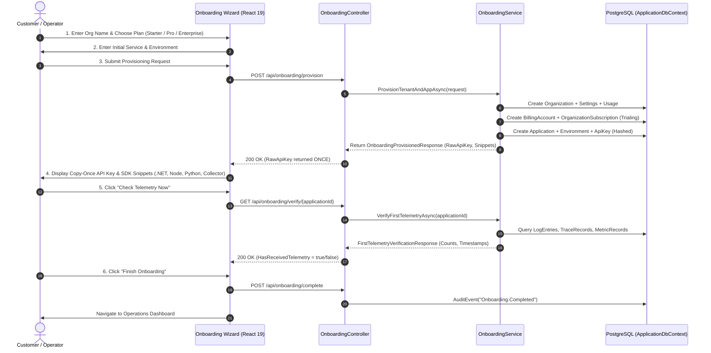

# SentinelOps — Phase 12 Self-Service Onboarding

**Evaluation Date:** October 14, 2026  
**Checkpoint:** 12.2  
**Status:** **PASSED**  

---

## 1. Executive Summary

Checkpoint 12.2 implements an enterprise-grade, guided self-service onboarding flow that allows new customers to register, provision an organization, select a subscription plan tier with an automatic 14-day trial, configure their first service, securely generate a copy-once ingestion key, view tailored OpenTelemetry SDK snippets, and interactively verify initial telemetry arrival.

---

## 2. Onboarding Workflow Architecture

---

## 3. Security Hardening & Zero-Fabrication Safeguards

1. **Copy-Once Key Disclosure**:
   - The raw ingestion key (`sent_live_...`) is generated using cryptographically secure random bytes via `IApiKeyService.GenerateApiKey`.
   - The raw key is hashed using SHA-256 (`KeyHash`) for database persistence.
   - The raw key is returned in memory **exactly once** in `OnboardingProvisionedResponse`.
   - After the user progresses past the API Key step, the key is permanently unrecoverable on the server and must be rotated if lost.
   - Keys are never placed in browser query strings, logs, or persistent client storage.

2. **Amber Security Disclaimer**:
   - The UI displays an explicit amber disclaimer:
     > **Security Warning: Copy-Once Display**  
     > For tenant security, SentinelOps hashes API keys at rest. You will not be able to view this raw key again after leaving this page.

3. **Authentic Telemetry Verification**:
   - In accordance with the project's zero-fabrication policy, telemetry arrival is never mocked or simulated on the server.
   - The endpoint `GET /api/onboarding/verify/{applicationId}` queries the real `LogEntries`, `TraceRecords`, and `MetricRecords` tables.
   - The UI provides real-time counts (`Logs: N`, `Traces: N`, `Metrics: N`) and timestamp verification.
   - Operators can optionally skip verification if their instrumented service is not yet ready to deploy.

4. **Transactional Provisioning & Concurrency**:
   - All tenant resources (Organization, Settings, Usage, BillingAccount, Subscription, Application, Environment, ApiKey, and AuditEvent) are committed in a single EF Core transaction.
   - Slugs are validated for uniqueness and automatically suffixed with a cryptographic salt if a collision occurs.

---

## 4. Multi-Language SDK Snippets

The onboarding service automatically generates ready-to-run OpenTelemetry instrumentation snippets pre-populated with the newly generated raw API key and application service name:

- **.NET 10 / C#**: `OpenTelemetry.Extensions.Hosting` with HTTP Protobuf OTLP exporter and `X-SentinelOps-Key` header.
- **Node.js**: `@opentelemetry/sdk-node` with `OTLPTraceExporter`.
- **Python**: `opentelemetry-sdk` with `BatchSpanProcessor` and `OTLPSpanExporter`.
- **OpenTelemetry Collector**: Complete `receivers`, `processors`, and `otlphttp/sentinelops` exporter YAML pipeline.

---

## 5. Test Evidence & Verification

- **Backend Integration Test**: [`OnboardingControllerIntegrationTests.cs`](file:///c:/Users/Yunus/Desktop/SentinelOps/tests/SentinelOps.Api.IntegrationTests/OnboardingControllerIntegrationTests.cs)
  - End-to-end user registration, initial status check, workspace provisioning, raw key inspection, telemetry probe validation, and final completion.
  - Result: **1 passed, 0 failed, 0 skipped**.
- **Frontend Component Tests**: [`onboarding.test.tsx`](file:///c:/Users/Yunus/Desktop/SentinelOps/src/SentinelOps.Web/src/pages/__tests__/onboarding.test.tsx)
  - Renders Step 1 form and plan cards.
  - Form validation on required organization name.
  - Multistep transition to Step 2, service registration, and Step 3 API key display.
  - Telemetry verification probe and completion.
  - Result: **4 passed, 0 failed, 0 skipped**.
