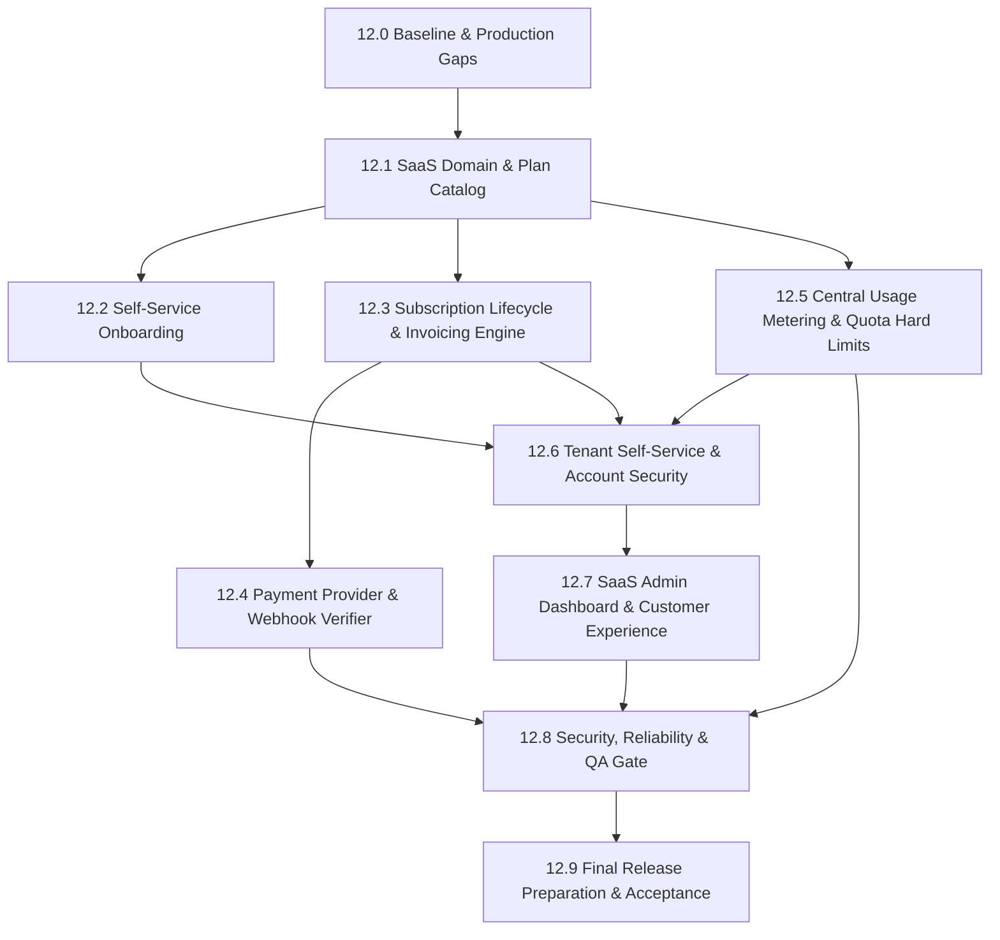

# SentinelOps — Phase 12 Production Readiness & SaaS Gaps Analysis

**Evaluation Date:** October 14, 2026  
**Status Assessment:** Checkpoint 12.0  

---

## 1. Identified SaaS Gaps

While Phases 1–11 delivered enterprise observability, high availability, Kubernetes manifests, and AI diagnostic capabilities, several key architectural components are required to make SentinelOps a commercially viable SaaS platform:

```
+--------------------------------------------------------------------------------------------------+
|                                    SaaS Capability Gaps                                          |
+--------------------+-----------------------------------------------------------------------------+
| Commercial Domain  | - No formal SubscriptionPlan entity or PlanVersion catalog                  |
|                    | - No OrganizationSubscription entity tracking lifecycle states             |
|                    | - Subscription states (Trialing, PastDue, GracePeriod, etc.) not codified   |
|                    | - No BillingAccount or customer contact address records                     |
+--------------------+-----------------------------------------------------------------------------+
| Invoicing & Pay    | - No SaaSInvoice or InvoiceLineItem models                                  |
|                    | - Invoices cannot be generated or downloaded                                |
|                    | - No PaymentTransaction records linking provider charges to invoices        |
|                    | - Payment provider integration abstraction missing                          |
|                    | - Webhook signature verification and replay defense missing                 |
+--------------------+-----------------------------------------------------------------------------+
| Onboarding         | - New users must manually register and navigate complex UI to create an app |
|                    | - No guided first-run onboarding wizard                                     |
|                    | - No copy-once API key generation workflow during onboarding                |
|                    | - First telemetry verification probe missing from setup flow                |
+--------------------+-----------------------------------------------------------------------------+
| Quotas & Metering  | - Usage counters stored only as cumulative MTD in OrganizationUsage         |
|                    | - No historical monthly billing period snapshots or rollovers               |
|                    | - Ingestion pipeline does not fail-closed on hard quota exhaustion          |
|                    | - Feature-level entitlements (e.g. vector PDF reports, AI copilot) loose    |
+--------------------+-----------------------------------------------------------------------------+
| Customer Self-Serv | - No self-service plan upgrade/downgrade UI                                 |
|                    | - No invoice history or payment method management                           |
|                    | - No data export request workflow (GDPR/Compliance)                         |
|                    | - No two-step account deletion request workflow with cooling-off period      |
+--------------------+-----------------------------------------------------------------------------+
```

---

## 2. Infrastructure & External Dependency Status

| Dependency | Required For | Current Status | Blocker / Resolution |
| :--- | :--- | :--- | :--- |
| **Docker Engine** | Local container verification | **AVAILABLE** | Docker Desktop 28.5.1 active on host. |
| **PostgreSQL 18** | Local persistence | **AVAILABLE** | Port 5432 open and answering TCP probes. |
| **Redis 7** | Cache, Streams, Backplane | **AVAILABLE** | Port 6379 open and answering TCP probes. |
| **Kubernetes** | Helm deployment validation | **NOT CONFIGURED** | Client installed, local cluster inactive. Manifests and Helm charts verified statically via `helm lint`. |
| **Live Payment Gateway** | Real credit card charging | **NOT CONFIGURED** | No commercial merchant account (Stripe, Adyen, etc.) configured. Sandboxed deterministic provider used for automated tests. |
| **External LLM** | Live cloud AI inference | **NOT CONFIGURED** | No paid OpenAI/Anthropic API keys in environment. Deterministic provider used for local tests. |

---

## 3. Dependency & Checkpoint Execution Plan



---

## 4. Non-Negotiable Execution Safeguards

1. **Zero Fake Payments**: Never simulate a real payment as approved without an authentic cryptographically signed provider webhook or deterministic sandbox test flag.
2. **Zero Raw Card Storage**: Never store, accept, or process raw PAN (credit card number), CVV, or payment credentials on SentinelOps servers.
3. **Fail-Closed Entitlements**: Quota enforcement must happen server-side; client UI cannot bypass plan limitations.
4. **Tenant Isolation**: Invoices, subscriptions, and payment methods must be strictly partitioned by `OrganizationId`.
