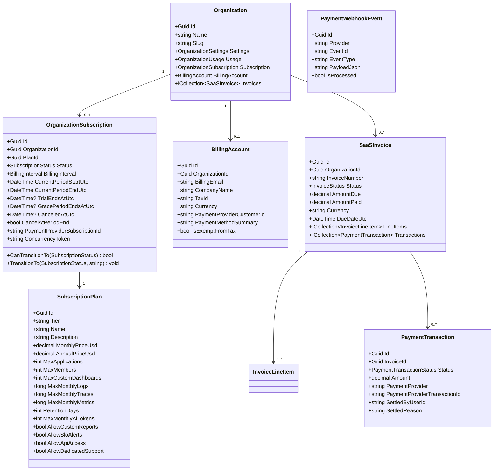
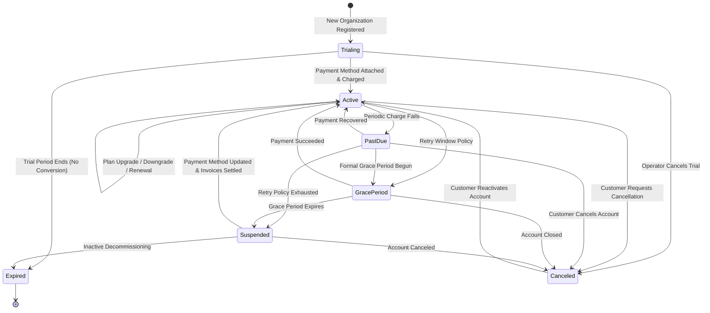

# SentinelOps — Phase 12 SaaS Domain Architecture & Plan Catalog

**Evaluation Date:** October 14, 2026  
**Checkpoint:** 12.1  
**Status:** **PASSED**  

---

## 1. Executive Summary

Checkpoint 12.1 establishes the foundational commercial subscription and billing domain for SentinelOps without duplicating the multi-tenant models (`Organization`, `OrganizationSettings`, `OrganizationUsage`) created in Phase 8.

The domain introduces explicit subscription lifecycle state modeling, canonical plan catalogs (Starter, Pro, Enterprise), billing accounts, financial invoicing models, audited payment transactions, and webhook deduplication logs.

---

## 2. SaaS Domain Architecture

---

## 3. Subscription State Machine & Transition Rules

### Transition Validation
The `OrganizationSubscription.CanTransitionTo` method rigorously enforces legal paths. Invalid transitions (e.g. attempting to jump directly from `Trialing` to `Suspended` without past-due billing, or from `Expired` to `Active`) throw an `InvalidOperationException`.

Every valid state change increments the entity's `ConcurrencyToken` and appends an entry to `SubscriptionHistory` capturing:
- `PreviousStatus` and `NewStatus`
- `PreviousPlanId` and `NewPlanId`
- Audit `Reason`
- `ChangedByUserId`
- `TimestampUtc`

---

## 4. Canonical Plan Catalog & Entitlements

| Entitlement / Dimension | Starter Plan | Professional Plan | Enterprise Plan |
| :--- | :--- | :--- | :--- |
| **Tier Identifier** | `Starter` | `Pro` | `Enterprise` |
| **Target Audience** | Solo developers, testbeds | Growing product teams | High-scale enterprise clusters |
| **Demonstration Pricing** | \$0 / mo (\$0 / yr) | \$49 / mo (\$490 / yr) | \$249 / mo (\$2,490 / yr) |
| **Applications Limit** | 3 | 20 | 100 |
| **Organization Members** | 3 | 25 | 100 |
| **Custom Dashboards** | 3 | 15 | 50 |
| **Monthly Logs Quota** | 100,000 | 1,000,000 | 10,000,000 |
| **Monthly Traces Quota** | 50,000 | 500,000 | 5,000,000 |
| **Monthly Metrics Quota**| 100,000 | 1,000,000 | 10,000,000 |
| **Retention Window** | 7 Days | 30 Days | 90 Days |
| **Monthly AI Tokens** | 10,000 | 100,000 | 1,000,000 |
| **Custom PDF Reports** | ❌ Disabled | ✅ Enabled | ✅ Enabled |
| **SLO Alert Engine** | ❌ Disabled | ✅ Enabled | ✅ Enabled |
| **API Access** | ✅ Enabled | ✅ Enabled | ✅ Enabled |
| **Dedicated Support SLA**| ❌ Community | ❌ Standard | ✅ 24/7 Dedicated |

---

## 5. Database Schema & Migration Evidence

The migration `20261014204636_AddSaasCommercialization.cs` was generated cleanly with:
- `SubscriptionPlans`: Unique index on `Tier`, seeded canonical plan records.
- `BillingAccounts`: Unique index on `OrganizationId`, index on `PaymentProviderCustomerId`.
- `OrganizationSubscriptions`: Unique index on `OrganizationId`, foreign key with `Restrict` on `PlanId`, concurrency token column.
- `SubscriptionHistories`: Indexes on `SubscriptionId`, `OrganizationId`, and `TimestampUtc`.
- `SaaSInvoices`: Unique index on `InvoiceNumber`, indexes on `OrganizationId`, `Status`, `DueDateUtc`.
- `InvoiceLineItems`: Index on `InvoiceId`, precision (18, 2) on currency fields.
- `PaymentTransactions`: Index on `InvoiceId`, `OrganizationId`, `Status`, and provider transaction reference.
- `PaymentWebhookEvents`: Unique composite index `(Provider, EventId)` for absolute deduplication and replay protection.

---

## 6. Verification & Test Evidence

- **Unit Tests**: Added [`SubscriptionDomainTests.cs`](file:///c:/Users/Yunus/Desktop/SentinelOps/tests/SentinelOps.Domain.Tests/Entities/SubscriptionDomainTests.cs) (20 test cases covering default states, legal transitions, illegal transition rejections, concurrency token rotation, audit history appending, and cancellation timestamp setting).
- **Execution**:
  `dotnet test tests/SentinelOps.Domain.Tests/SentinelOps.Domain.Tests.csproj` -> **49 passed, 0 failed, 0 skipped**.
- **Solution Build**:
  `dotnet build SentinelOps.slnx --warnaserror` -> **0 Warnings, 0 Errors**.
