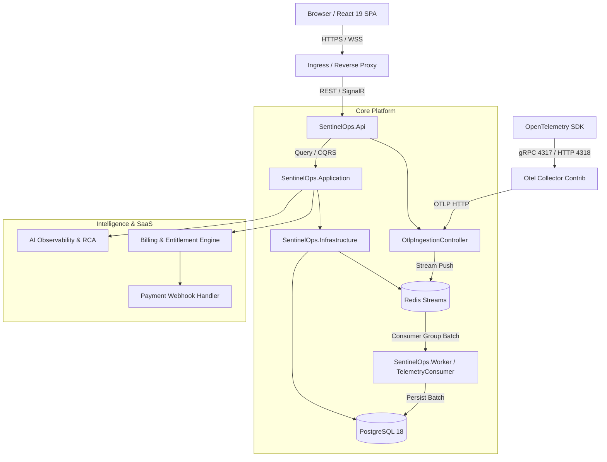

# SENTINELOPS — ARCHITECTURE & COMPONENT AUDIT
**Phase 13 Comprehensive Systems Audit**  
**Repository**: `https://github.com/Terabithia1572/SentinelOps`  
**Baseline Commit**: `a8d09ce`  

---

## 1. Architectural Overview & Component Topology

SentinelOps is architected following Clean / Onion Architecture principles in .NET 10:

---

## 2. Domain Entities Map (`src/SentinelOps.Domain/Entities`)

The domain model contains 47 persistent entities, maintaining zero external dependencies:

| Category | Entities | Responsibility |
|:---|:---|:---|
| **Core Telemetry** | `Application`, `Environment`, `Service`, `ApiKey`, `LogEntry`, `TraceRecord`, `SpanRecord`, `MetricRecord` | Real-time and historical telemetry models with index decorators. |
| **Alerts & Incidents** | `AlertRule`, `AlertIncident`, `AlertEvaluation`, `AlertEvent`, `Incident`, `IncidentComment`, `IncidentTimelineEvent`, `IncidentAlertRelation`, `IncidentRca`, `ServiceLevelObjective`, `SloEvaluation` | Stateful alert threshold evaluation, incident lifecycles, and RCA linkage. |
| **Notifications** | `NotificationChannel`, `AlertRuleNotificationChannel`, `NotificationOutbox`, `InAppNotification` | Multi-channel dispatching (Email, Webhook with SSRF protection) and in-app notifications. |
| **Tenant & SaaS** | `Organization`, `OrganizationMember`, `OrganizationInvitation`, `OrganizationSettings`, `OrganizationSubscription`, `SubscriptionPlan`, `SubscriptionHistory`, `OrganizationUsage`, `BillingAccount`, `SaaSInvoice`, `InvoiceLineItem`, `PaymentTransaction`, `PaymentWebhookEvent` | Complete SaaS tenant boundary, plan quotas, subscription state machines, and invoice auditing. |
| **Observability & Dashboards** | `CustomDashboard`, `StatusPage`, `StatusPageIncident`, `HealthCheckResult`, `AuditEvent`, `SystemSetting` | Configurable multi-widget dashboards, public incident status pages, and enterprise audit trails. |
| **AI Intelligence** | `TelemetryAnomaly`, `LogPattern`, `PredictiveForecast` | Statistical anomaly detection, log template clustering, and linear trend forecasting models. |

---

## 3. Application CQRS & Service Interfaces (`src/SentinelOps.Application`)

The application layer contains 35 primary interfaces under `SentinelOps.Application.Common.Interfaces` and feature-sliced MediatR commands/queries:

1. **Applications**: `GetApplicationsQuery`, `GetApplicationByIdQuery`, `CreateApplicationCommand`, `UpdateApplicationCommand`, `DeleteApplicationCommand`, `CreateEnvironmentCommand`, `DeleteEnvironmentCommand`, `CreateServiceCommand`.
2. **Logs**: `GetLogsQuery` (paged, filterable by time, severity, trace ID, application, environment).
3. **Traces**: `GetTracesQuery`, `GetTraceByIdQuery` (hierarchical span waterfall assembly).
4. **Metrics**: `GetMetricsQuery` (aggregated time-series buckets by interval).
5. **Dashboard**: `GetDashboardSummaryQuery` (high-level KPI counts and error rates).
6. **Users & Identity**: User registration, password change, profile update, role assignment.
7. **Pipeline Behaviors**:
   - `ValidationBehavior`: Automatic FluentValidation pipeline execution before handler invocation.

---

## 4. API Controllers Map (`src/SentinelOps.Api/Controllers`)

The API exposes 35 controller classes:

| Controller | Auth Policy | Primary Endpoints | Tenant Scoping Mechanism |
|:---|:---|:---|:---|
| `OtlpIngestionController` | `[RequireApiKey]` | `POST /v1/logs`, `POST /v1/traces`, `POST /v1/metrics` | Resolved via `ApiKey.ApplicationId` |
| `ApplicationsController` | `[Authorize]` | `GET`, `POST`, `PUT`, `DELETE /api/applications` | Handled via MediatR + `ICurrentTenantService` |
| `LogsController` | `[Authorize]` | `GET /api/logs` | Query filter via `ICurrentTenantService` |
| `TracesController` | `[Authorize]` | `GET /api/traces`, `GET /api/traces/{id}` | Query filter via `ICurrentTenantService` |
| `MetricsController` | `[Authorize]` | `GET /api/metrics` | Query filter via `ICurrentTenantService` |
| `OrganizationsController` | `[Authorize]` | `GET /api/organizations`, `POST`, `PUT`, `DELETE /api/organizations/{id}/members`, `POST /ownership-transfer`, `POST /export` | Explicit DB user membership verification |
| `SubscriptionsController`| `[Authorize]` | `GET /api/subscriptions/plans`, `POST /subscribe`, `POST /cancel`, `POST /upgrade` | Explicit DB membership check via `ISubscriptionService` |
| `BillingController` | `[Authorize]` | `GET /api/billing/entitlements`, `GET /usage`, `GET /account`, `GET /invoices` | Mix of `IBillingService` (checked) and `IEntitlementService` (unchecked) |
| `PaymentWebhooksController`| `[AllowAnonymous]` | `POST /api/billing/webhooks/{provider}` | HMAC-SHA256 signature verification + event deduplication |
| `IncidentIntelligenceController`| `[Authorize]` | `POST /api/incidents/{id}/analyze`, `POST /copilot/query` | Tenant-scoped via `IIncidentAnalysisService` |
| `AnomaliesController` | `[Authorize]` | `GET /api/anomalies`, `POST /detect` | Filtered via `IAnomalyDetectionService` |
| `ForecastsController` | `[Authorize]` | `GET /api/forecasts`, `POST /generate` | Filtered via `IPredictiveAlertingService` |
| `ApmController` | `[Authorize]` | `GET /api/apm/overview`, `GET /service-map`, `GET /endpoints` | Uses `GetRequiredOrganizationIdAsync` |
| `DashboardsController` | `[Authorize]` | `GET /api/dashboards`, `POST`, `PUT`, `DELETE` | Uses `GetRequiredOrganizationIdAsync` |
| `StatusPagesController`| `[Authorize]` | `GET /api/statuspages`, `POST`, `PUT`, `DELETE` | Uses `GetRequiredOrganizationIdAsync` |
| `PublicStatusController`| `[AllowAnonymous]` | `GET /api/public/status/{slug}` | Public read-only status by slug |
| `HealthController` | Anonymous | `GET /api/health`, `GET /health/live`, `GET /health/ready` | Platform liveness and readiness probes |

---

## 5. Background Hosted Services (`SentinelOps.Worker` & `SentinelOps.Infrastructure`)

1. **`TelemetryConsumerService`** (`SentinelOps.Infrastructure.Services`):
   - Reads from Redis Streams (`sentinelops:stream:logs`, `traces`, `metrics`) via consumer group `sentinelops-worker-group`.
   - Micro-batches records up to 100 items or 500ms intervals.
   - Persists batches to PostgreSQL and acknowledges stream IDs (`StreamAcknowledgeAsync`).
   - Supports dead-letter queue (`sentinelops:stream:dead-letter`) on unrecoverable serialization failures.
2. **`AlertEvaluationBackgroundService`** (`SentinelOps.Worker.Services`):
   - Periodically polls active `AlertRule` records every 60 seconds.
   - Evaluates metric thresholds against recent telemetry windows.
   - Fires or resolves `AlertIncident` records and emits notifications to outbox.
3. **`NotificationDispatcherBackgroundService`** (`SentinelOps.Worker.Services`):
   - Polls pending `NotificationOutbox` items.
   - Delivers notifications via configured channels (Email, Webhooks with SSRF IP address validation).
4. **`SloEvaluationBackgroundService`** (`SentinelOps.Worker.Services`):
   - Computes rolling error-budget burn rates for `ServiceLevelObjective` records.
5. **`RetentionCleanupService`** (`SentinelOps.Worker.Services`):
   - Periodically purges historical telemetry exceeding organization retention thresholds (default: 30 days).

---

## 6. Authentication, Authorization & Security Architecture

1. **Authentication**:
   - ASP.NET Core Identity with PBKDF2 password hashing.
   - JWT Bearer tokens with strict expiration, signature verification, and clock skew set to zero.
   - Real-time token validation event checks if the user is locked out or marked inactive.
   - Dynamic API keys with SHA-256 hashed storage and prefixing (`sent_live_...`).
2. **Role-Based Access Control**:
   - `Admin`: Full cluster and organization administrative privileges.
   - `Operator`: Telemetry management, application creation, alerting rules configuration.
   - `Viewer`: Read-only access to dashboards, logs, traces, and metrics.
3. **Tenant Context Resolution (`CurrentTenantService`)**:
   - Resolves tenant via:
     1. `HttpContext.Items["OrganizationId"]`
     2. Request header `X-Organization-Id`
     3. JWT claim `org_id`
   - *Audit Finding*: Header `X-Organization-Id` was accepted without validating user membership against `OrganizationMembers` in `CurrentTenantService`, creating an IDOR vulnerability when query handlers rely solely on `_tenantService.OrganizationId`.

---

## 7. SaaS Subscriptions, Billing & Quota Architecture

1. **Subscription Tiers**:
   - `Starter`: 1 application, 1 member, 1 dashboard, 10,000 logs/mo, 5,000 traces/mo, 10,000 metrics/mo.
   - `Pro`: 10 applications, 10 members, 10 dashboards, 500,000 logs/mo, 250,000 traces/mo, 500,000 metrics/mo, AI enabled.
   - `Enterprise`: Unlimited applications/members/dashboards, custom telemetry quotas, dedicated support, custom reports.
2. **Entitlement Enforcement (`EntitlementService`)**:
   - Enforces hard limits before registering applications, inviting members, creating dashboards, and executing AI queries.
   - Supports monthly rollover of usage metrics (`OrganizationUsage`).
3. **Payment Integration**:
   - Pluggable provider pattern (`IPaymentProvider`): `SandboxPaymentProvider`, `DisabledPaymentProvider`, extensible for Stripe.
   - Webhook processing with HMAC-SHA256 signature verification, replay protection (5-minute timestamp tolerance), and database-backed deduplication on `EventId`.

---

## 8. AI Observability & Intelligence Modules

1. **Anomaly Detection (`AnomalyDetectionService`)**:
   - Implements statistical z-score and IQR (Interquartile Range) algorithms over rolling time-series metric windows.
   - Flags spikes, drops, and zero-variance anomalies without external LLM dependencies.
2. **Log Pattern Clustering (`LogPatternAnalysisService`)**:
   - Extracts structural templates using deterministic regex normalization.
   - Strips HTML tags (Stored XSS mitigation) and masks GUIDs, IPs, emails, URLs, file paths, numbers, and hex addresses.
3. **Deterministic Root Cause Analysis (`RootCauseAnalysisService`)**:
   - Assembles evidence graphs correlating high-error services, database spans, exception spikes, and preceding deployments.
   - Formulates explainable incident summaries with direct telemetry citations.
4. **Predictive Forecasting (`PredictiveAlertingService`)**:
   - Employs ordinary least squares (OLS) linear trend projection to calculate Estimated Time to Exhaustion (TTE) for disk/memory metrics.
5. **AI Safety Controls**:
   - Sensitive data scrubbing via `DeterministicAiProvider.ScrubSensitiveData`.
   - Circuit breaker on consecutive external failures (5 failures -> 60s cooldown).
   - Strict organization monthly token quota metering.
   - AI-generated remediation commands are strictly advisory and never executed automatically.

---

## 9. Frontend Architecture (`src/SentinelOps.Web`)

- **Framework**: React 19 + TypeScript 5.8 + Vite 8.3 + Tailwind CSS v4.
- **Routing**: 28 routes mapped in `App.tsx` guarded by `ProtectedRoute`.
- **State Management**: TanStack React Query v5 for server state caching; React Context for Auth and Tenant switching.
- **Real-Time Client**: SignalR `@microsoft/signalr` connection to `/hubs/alerts`.
- **Page Modules**: Overview, Dashboards, APM, AI Observability, Organizations, Applications, API Keys, Logs, Traces, Metrics, Exceptions, Health, Alerts, Incidents, SLOs, Status Pages, Reports, Users, Audit Logs, Settings, Onboarding, Billing.

---

## 10. Container & Deployment Specifications

1. **Docker Compose (`docker-compose.yml`)**:
   - 6 defined services: `sentinelops-api`, `sentinelops-worker`, `sentinelops-web`, `postgres`, `redis`, `otel-collector`.
   - Health check definitions on API (`curl -f http://localhost:8080/health/live`), PostgreSQL (`pg_isready`), Redis (`redis-cli ping`).
   - Resource limits (CPU and Memory) explicitly pinned on all containers.
2. **Helm Chart (`deploy/helm/sentinelops`)**:
   - Fully templated Kubernetes manifests: API Deployment, Web Deployment, Worker Deployment, Collector Deployment, Redis StatefulSet.
   - Includes Horizontal Pod Autoscaler (`hpa-api.yaml`), Pod Disruption Budget (`pdb-api.yaml`), NetworkPolicies (`networkpolicy.yaml`), and Database Migration Job (`job-migration.yaml`).
3. **CI/CD Workflows (`.github/workflows`)**:
   - `ci.yml`: Triggers on pull requests and pushes to `main`. Executes backend tests, frontend lint/tests, and Docker build checks.
   - `release.yml`: Release packaging and image publishing.

---

## 11. Architectural Gaps & Identified Risks Summary

1. **P0 (Critical Security)**: Unverified `X-Organization-Id` header allows cross-tenant query execution across applications, telemetry, APM, and dashboards.
2. **P0 (Critical Security)**: Missing fallback in application/telemetry query handlers when `OrganizationId` is absent returns unfiltered data across all tenants.
3. **P1 (Security / SaaS)**: Unrestricted entitlement querying in `EntitlementService` lacks organization membership check for the calling user.
4. **P1 (Migration Risk)**: Startup auto-reconciliation in `Program.cs` automatically links all orphan applications to `default-org` and assigns all users as members, risking tenant leakage in multi-tenant environments.
5. **P1 (Infrastructure)**: Docker Desktop / WSL2 engine is stopped on the local host machine, blocking live container execution.
6. **P2 (Operational)**: Native PostgreSQL 18 is running on port 5432 on the host machine, which conflicts with Docker Compose port mapping `5432:5432`.
7. **P2 (Tooling)**: Helm executable is missing from Windows PATH.
8. **P2 (Performance)**: Frontend monolithic JavaScript bundle exceeds 1.3 MB minified.
