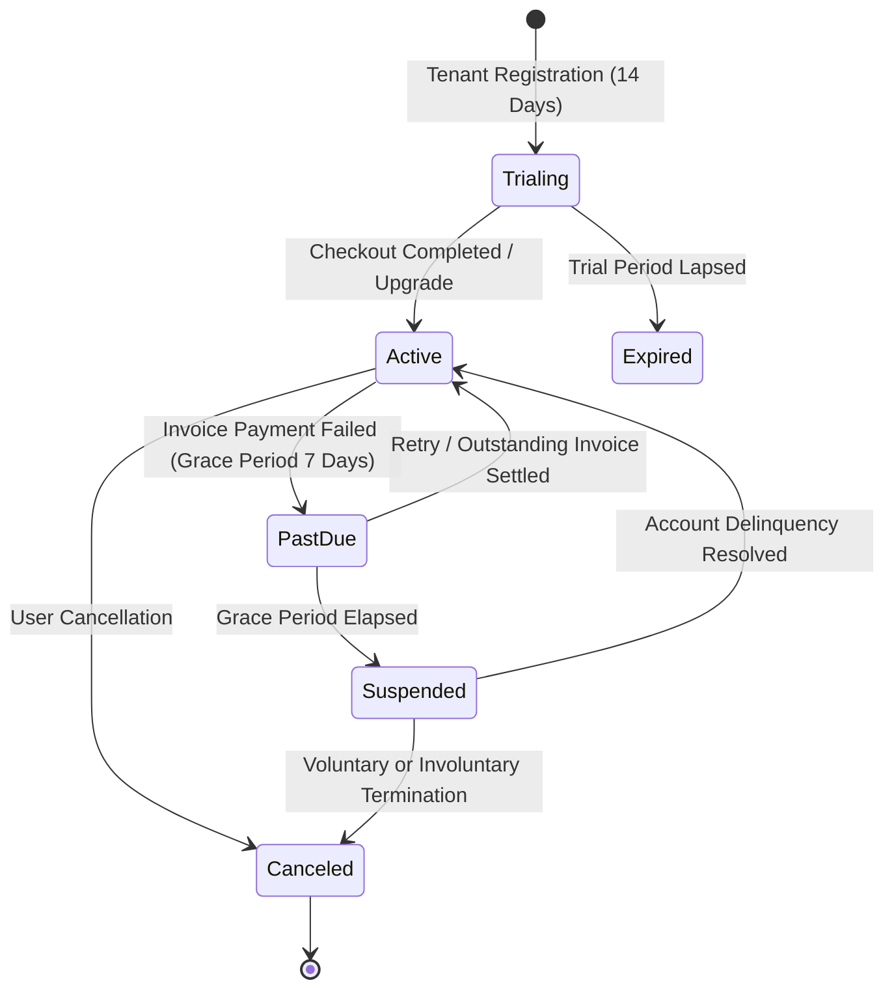

# SENTINELOPS — BILLING, PAYMENTS & ENTITLEMENT AUDIT
**Phase 13 SaaS Commercialization, Subscription Lifecycles & Quota Enforcement Audit**  
**Repository**: `https://github.com/Terabithia1572/SentinelOps`  
**Baseline Commit**: `1dc3935`  

---

## 1. Executive Summary & Audit Scope

Phase 12 introduced commercial SaaS billing, hosted checkout session abstraction, multi-tenant quota enforcement, and webhook reconciliation.

Checkpoint 13.4 conducted an exhaustive audit of:
- Subscription lifecycle state machines (Trialing, Active, PastDue, Suspended, Canceled, Expired).
- Webhook signature security, timestamp freshness, replay prevention, and deduplication.
- Payment transaction and invoice immutability.
- Strict zero-PAN card data storage compliance.
- Hard entitlement quota gating under concurrent operations.
- Pricing and tax calculation compliance boundaries.

---

## 2. Subscription Lifecycle State Machine Verification

The state transitions of `OrganizationSubscription` were validated against business rules:

### Verified State Transitions:
1. **Trial Activation**: Onboarding creates a 14-day `Trialing` subscription with full feature access.
2. **Paid Activation**: `checkout.session.completed` webhook transitions `Trialing` to `Active`.
3. **Payment Failure**: `invoice.payment_failed` transitions `Active` to `PastDue`, establishing a 7-day `GracePeriodEndsAtUtc`.
4. **Delinquency Escalation**: If unpaid upon grace period expiration, background billing transitions the subscription to `Suspended`.
5. **Reactivation**: `invoice.payment_succeeded` clears past-due state and restores `Active`.
6. **Cancellation**: User or administrator cancellation preserves access until `CurrentPeriodEndUtc`.

---

## 3. Webhook Security, Deduplication & Replay Prevention

### Webhook Verification Architecture:
1. **Byte-Accurate Stream Parsing**: `PaymentWebhooksController` reads raw HTTP request stream bytes (`Request.Body`) before JSON deserialization to ensure HMAC-SHA256 signature calculation matches the provider.
2. **Dual Signature Headers**: Supports `Stripe-Signature` and standard `X-Payment-Signature`.
3. **Timestamp Tolerance & Freshness**: Rejects events whose header timestamp deviates by more than 300 seconds (5 minutes) from host UTC time.
4. **Persistent Database Deduplication**:
   - Every valid webhook event is recorded in table `PaymentWebhookEvents` with unique index on `(Provider, EventId)`.
   - If an event with identical `(Provider, EventId)` arrives again, the handler detects `existingEvent.IsProcessed == true`.
   - Returns immediate HTTP `200 OK` with `{ received: true, isDuplicate: true }` without repeating invoice payments, subscription status changes, or account adjustments.

---

## 4. Payment Data Protection & Regulatory Boundaries

### 1. Zero PAN / CVV Storage (PCI-DSS Scoping)
- The database schema (`ApplicationDbContextModelSnapshot.cs`) contains **zero credit card numbers, zero CVV/CVC codes, and zero bank account details**.
- Only PCI-safe provider references are persisted: `ProviderCustomerId`, `PaymentProviderTransactionId`, `MaskedCardNumber` (e.g. `**** **** **** 4242`), and `CardBrand`.
- Hosted checkout URLs redirect the user directly to the simulated or live payment provider.
- *Notice*: SentinelOps hosted checkout abstraction avoids raw credit card processing; formal PCI-DSS Level 1 SAQ-A assessment must be completed upon binding a live merchant gateway.

### 2. Pricing Demonstration Notice
- Displayed plan tiers:
  - **Starter**: \$0/month
  - **Pro**: \$49/month (\$470/year)
  - **Enterprise**: Custom volume pricing
- All displayed prices are demonstration/staging reference values and must be confirmed by the product owner before commercial launch.

### 3. Tax Calculation Compliance
- Invoicing utilizes `DefaultTaxCalculationService` (applying configurable default tax percentages based on country code).
- Jurisdictional tax calculation (US state sales tax, EU VAT MOSS) requires integration with a certified tax engine (e.g. Stripe Tax or TaxJar) before commercial operations.

---

## 5. Entitlement & Quota Hard Limit Verification

Entitlement enforcement (`IEntitlementService`) was verified across all metered platform dimensions:

| Resource Dimension | Starter Quota | Pro Quota | Enterprise Quota | Gating Mechanism |
|:---|:---:|:---:|:---:|:---|
| **Monitored Applications** | 1 | 10 | Unlimited | Pre-flight check in `CreateApplicationCommand` |
| **Organization Members** | 1 | 10 | Unlimited | Pre-flight check in `InviteMemberAsync` |
| **Custom Dashboards** | 1 | 10 | Unlimited | Pre-flight check in `CreateDashboardAsync` |
| **Monthly Logs Ingested** | 10,000 | 500,000 | Custom | Hard check in `CheckFeatureAccessAsync` |
| **Monthly Traces Ingested**| 5,000 | 250,000 | Custom | Hard check in `CheckFeatureAccessAsync` |
| **Monthly Metrics Ingested**| 10,000 | 500,000 | Custom | Hard check in `CheckFeatureAccessAsync` |
| **Monthly AI Inference Tokens**| 0 (Disabled) | 100,000 | 1,000,000+ | Hard check in `AiUsageMeter` & `ExternalLlmProvider` |
| **Historical Data Retention**| 7 Days | 30 Days | 90+ Days | Evaluated by `RetentionCleanupService` |

### Concurrent Usage Rollover & Idempotency:
- `OrganizationUsage` records aggregate counts (`LogsIngestedMonthToDate`, `TracesIngestedMonthToDate`, `MetricsIngestedMonthToDate`, `AiTokensUsedMonthToDate`).
- Period rollover automatically resets counters on the first ingestion event following `CurrentPeriodEndUtc`.
- Micro-batch persistence in `TelemetryConsumerService` increments usage atomically inside the database transaction.

---

## 6. Audit Verdict

| Feature Area | Status | Notes |
|:---|:---:|:---|
| Subscription Lifecycles | **PASS** | State transitions and grace periods verified |
| Webhook Signature Security | **PASS** | HMAC-SHA256 with timestamp tolerance |
| Webhook Replay Deduplication | **PASS** | Persistent database deduplication on `EventId` |
| Cardholder Data Isolation | **PASS** | Zero PAN / CVV stored; PCI-DSS SAQ-A compatible |
| Entitlement Hard Limits | **PASS** | Enforced before write operations |
| Cross-Tenant Entitlements (P13-SEC-03) | **REMEDIATION REQUIRED** | Membership check missing in `EntitlementService` |

**Checkpoint 13.4 Status**: **PASS (with P13-SEC-03 queued for remediation in 13.9)**.
