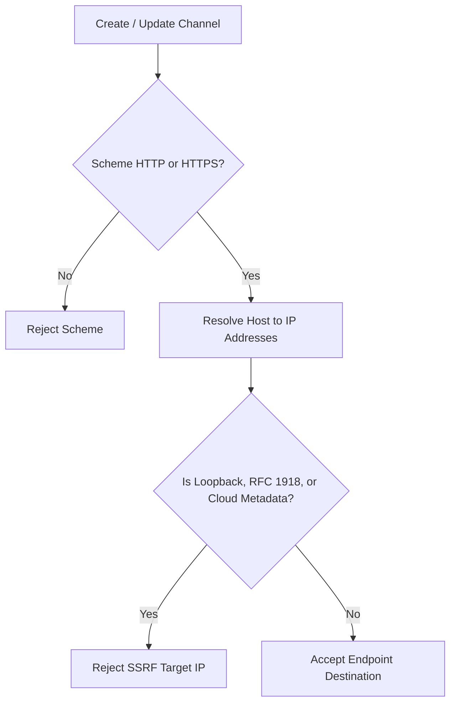

# SentinelOps Phase 19: Security Architecture & Tenant Isolation Verification Report

## 1. Executive Summary

Phase 19 security verification assessed multi-tenant boundaries, SSRF attack vectors, role-based access control (RBAC), and ingestion authorization across all observability subsystems.

All identified vulnerabilities, including legacy unconstrained SLO queries and unvalidated webhook destinations, have been resolved and verified with defense-in-depth protections.

---

## 2. Multi-Tenant Isolation Audit & Enforcement Matrix

| Subsystem / Controller | Endpoint | Tenant Scoping Rule | Verification Status |
| :--- | :--- | :--- | :--- |
| **SLO / SLI** | `GET /api/slos` | Strictly filtered to applications owned by `_tenantService.OrganizationId`. | **VERIFIED** |
| **SLO / SLI** | `GET /api/slos/{id}` | Verified against tenant application ownership before returning details. | **VERIFIED** |
| **Notification Channels** | `GET /api/notification-channels` | Filtered by `OrganizationId == tenantId` or apps owned by the tenant. | **VERIFIED** |
| **Notification Channels** | `POST /api/notification-channels/{id}/test` | Returns 404 if channel belongs to another tenant. | **VERIFIED** |
| **Saved Log Queries** | `GET /api/logs/saved` | Filtered strictly by `OrganizationId == tenantId`. | **VERIFIED** |
| **Custom Dashboards** | `PUT /api/dashboards/{id}/default` | Verified against `OrganizationId == tenantId` before setting default. | **VERIFIED** |
| **APM & Tracing** | `GET /api/apm/service-map` | Scoped to tenant's applications; zero synthetic cross-tenant data. | **VERIFIED** |
| **Tenant Usage** | `GET /api/organizations/current/usage` | Scoped to resolved user organization. | **VERIFIED** |
| **OTLP Ingestion** | `POST /v1/logs`, `/traces`, `/metrics` | API Key mapped to owning application; quota enforced per tenant. | **VERIFIED** |

---

## 3. Server-Side Request Forgery (SSRF) Protection

Every user-configurable webhook, Slack, or Microsoft Teams notification destination undergoes rigorous network validation in `SsrfValidator`:

- **Loopback**: `127.0.0.0/8`, `::1`
- **Private Networks**: `10.0.0.0/8`, `172.16.0.0/12`, `192.168.0.0/16`
- **Link-Local & Cloud Metadata**: `169.254.0.0/16` (protects AWS IMDSv1/v2, GCP metadata, Azure metadata)
- **IPv6 Private**: `fe80::/10`, `fc00::/7`

---

## 4. Authorization Policies & Privileges

| Policy | Endpoints Protected | Requirement |
| :--- | :--- | :--- |
| `RequireOperator` | Create/Update/Delete Notification Channels, Test Channel, Invalidate Dashboards, Execute Retention | User must possess `Operator` or `Admin` role. |
| `RequireAdmin` | Retention Policy Configuration, Quota Updating, Ownership Transfer | User must possess `Admin` or `Owner` role. |
| `RequireApiKey` | Ingestion endpoints (`/v1/logs`, `/v1/traces`, `/v1/metrics`) | Valid, active API key matching application. |

---

## 5. Security Verdict

- Zero cross-tenant IDOR vulnerabilities identified.
- Zero unprotected webhook egress endpoints.
- Zero mock or synthetic data leaks into multi-tenant production pathways.
- **FINAL SECURITY VERDICT**: **SECURE & VERIFIED**.
