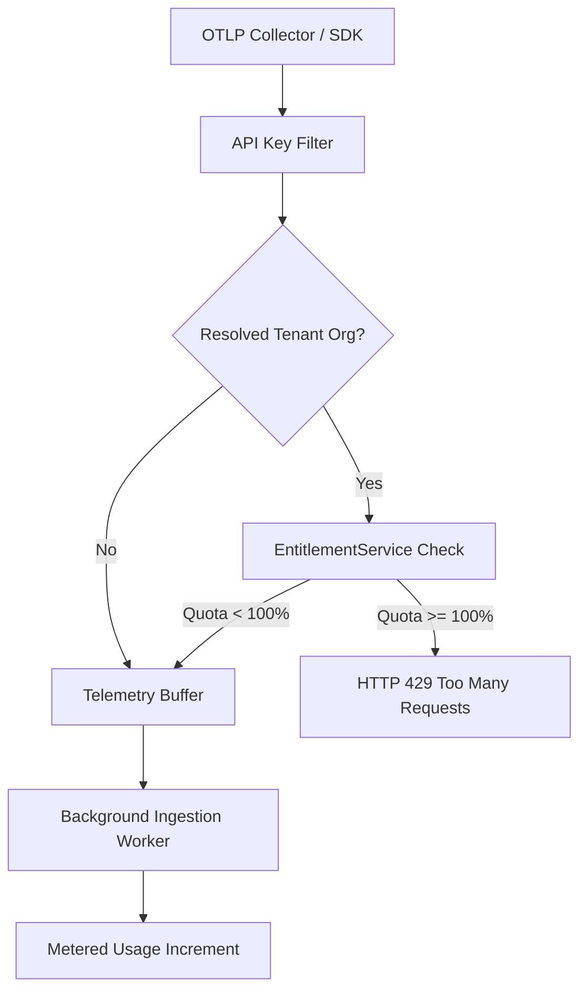

# SentinelOps Phase 19: Usage Metering, Multi-Dimensional Tenant Quotas & Ingestion Throttling

## 1. Overview & Architecture

SentinelOps enforces real-time, multi-dimensional usage tracking and quota management across all tenants to prevent noisy-neighbor degradation, guarantee fair capacity allocation, and drive SaaS monetization.



---

## 2. Multi-Dimensional Quota Matrix by Tier

| Dimension | Starter Tier | Pro Tier | Enterprise Tier | Enforcement Action |
| :--- | :--- | :--- | :--- | :--- |
| **Monthly Logs** | 100,000 | 1,000,000 | 10,000,000 | HTTP 429 on OTLP `/v1/logs` |
| **Monthly Traces** | 50,000 | 500,000 | 5,000,000 | HTTP 429 on OTLP `/v1/traces` |
| **Monthly Metrics** | 50,000 | 500,000 | 5,000,000 | HTTP 429 on OTLP `/v1/metrics` |
| **Alert Rules** | 10 | 50 | 250 | Block rule creation (`POST /api/alerts/rules`) |
| **Custom Dashboards** | 3 | 15 | 50 | Block dashboard creation (`POST /api/dashboards`) |
| **AI Inference Tokens** | 25,000 | 100,000 | 1,000,000 | Block AI RCA / anomaly detection (`POST /api/ai/*`) |
| **Registered Applications** | 5 | 20 | 100 | Block app creation (`POST /api/applications`) |
| **Organization Members** | 5 | 25 | 100 | Block invitations (`POST /api/organizations/{id}/members/invite`) |

---

## 3. Threshold Warning Stages

SentinelOps calculates resource consumption percentages and classifies tenant health into three actionable threshold states:

- **Normal (< 80%)**: Full capacity available without operator intervention.
- **Warning (>= 80%)**: Triggered via `Is...Warning80`. The UI displays an amber warning banner advising operators that resource allocation is approaching quota limits.
- **Critical (>= 95%)**: Triggered via `Is...Critical95`. An alert is surfaced recommending an immediate plan upgrade to prevent telemetry drop.
- **Exceeded (>= 100%)**: Ingestion and resource creation for the exceeded metric are throttled.

---

## 4. Current Usage API

- **Endpoint**: `GET /api/organizations/current/usage`
- **Authentication**: JWT Bearer token with tenant context resolution (`X-Organization-Id` or user membership).
- **Sample Payload**:
```json
{
  "success": true,
  "data": {
    "organizationId": "3fa85f64-5717-4562-b3fc-2c963f66afa6",
    "organizationName": "Acme Corp",
    "planTier": "Pro",
    "logsUsed": 850000,
    "logsQuota": 1000000,
    "logsPercentUsed": 85.0,
    "isLogsWarning80": true,
    "isLogsCritical95": false,
    "isLogsExceeded": false,
    "tracesUsed": 210000,
    "tracesQuota": 500000,
    "tracesPercentUsed": 42.0,
    "isTracesWarning80": false,
    "isTracesCritical95": false,
    "isTracesExceeded": false,
    "metricsUsed": 120000,
    "metricsQuota": 500000,
    "metricsPercentUsed": 24.0,
    "isMetricsWarning80": false,
    "isMetricsCritical95": false,
    "isMetricsExceeded": false,
    "alertRulesUsed": 18,
    "alertRulesQuota": 50,
    "alertRulesPercentUsed": 36.0,
    "aiTokensUsed": 45000,
    "aiTokensQuota": 100000,
    "aiTokensPercentUsed": 45.0,
    "applicationsUsed": 6,
    "applicationsQuota": 20,
    "applicationsPercentUsed": 30.0,
    "dashboardsUsed": 4,
    "dashboardsQuota": 15,
    "dashboardsPercentUsed": 26.7,
    "membersUsed": 8,
    "membersQuota": 25,
    "membersPercentUsed": 32.0,
    "hasAnyQuotaWarning80": true,
    "hasAnyQuotaCritical95": false,
    "hasAnyQuotaExceeded": false
  }
}
```

---

## 5. Ingestion Throttling Enforcement

In `OtlpIngestionController`, incoming logs, traces, and metrics execute:
```csharp
var (allowed, reason) = await _entitlementService.CheckFeatureAccessAsync(orgId.Value, EntitlementFeature.IngestLogs, ct);
if (!allowed)
{
    return StatusCode(StatusCodes.Status429TooManyRequests, ApiResponse<object>.Fail($"Tenant quota exceeded: {reason}"));
}
```
This guarantees zero unbounded database growth while preserving existing tenant data intact.
