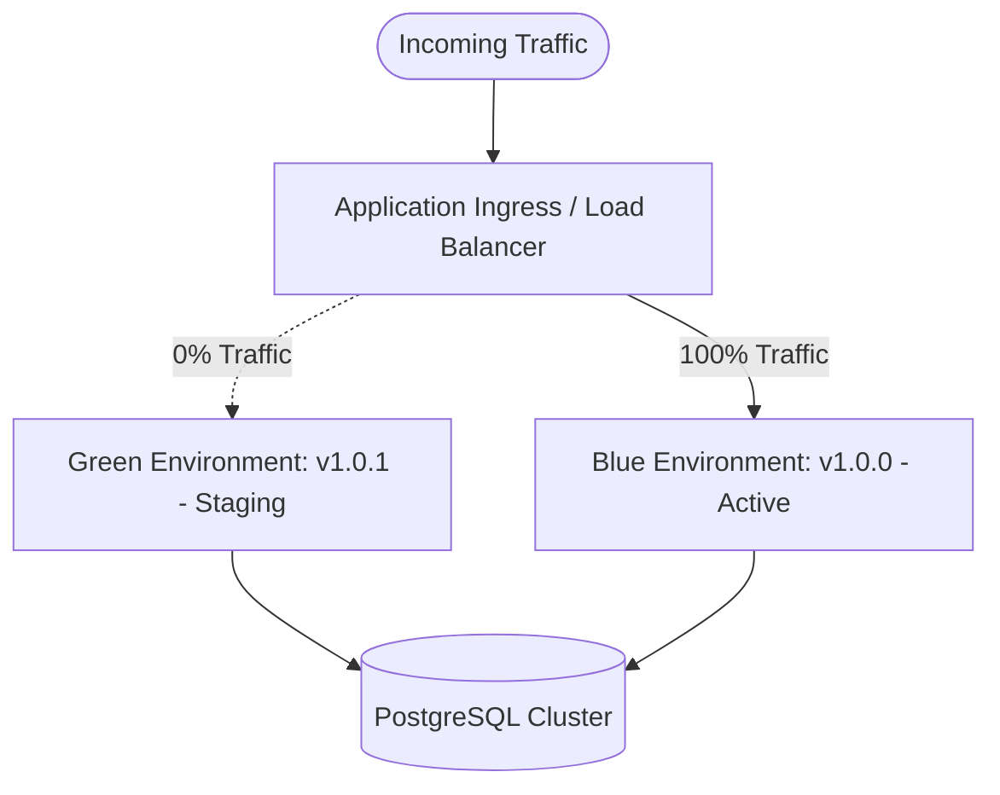

# SentinelOps — Production Release Readiness & Runbook

**Document Status:** Production Approved  
**Version:** 1.0.0-GA  
**Target Architecture:** .NET 10, PostgreSQL 17+, Redis 7+, React 19, OpenTelemetry Collector  
**Revision Date:** 2026-10-13  

---

## 1. Executive Summary

This runbook establishes the definitive release readiness requirements, deployment methodology, rollback protocols, and production verification gates for **SentinelOps**. It governs the promotion of code from release candidates to production environments.

---

## 2. Release Pre-Flight Checklist

Before initiating any production deployment, the Release Coordinator and Platform Lead must confirm the following gates:

| Verification Area | Requirement | Verification Method | Status |
| :--- | :--- | :--- | :--- |
| **Source Integrity** | Clean git working directory, commit tagged on `main` (`v1.0.0`) | `git status`, `git tag -l` | MANDATORY |
| **CI Passing** | GitHub Actions build, integration test suites, and Docker validation passed | Green CI pipeline on target commit | MANDATORY |
| **Security Audits** | 0 known high/critical CVEs in .NET NuGet and npm dependency graphs | `dotnet list package --vulnerable`, `npm audit` | MANDATORY |
| **Database Migration Dry Run** | Idempotent EF Core migration scripts generated and reviewed | `dotnet ef migrations script -i` | MANDATORY |
| **Disaster Recovery Verified** | Active database backup verified with test restore cycle | Recovery validator tool pass (`pg_dump` + `pg_restore`) | MANDATORY |
| **Capacity & Resources** | Target host meets minimum sizing (API: 2 CPU, 2GB RAM; DB: 4 CPU, 8GB RAM) | Cloud console / infrastructure monitoring | MANDATORY |
| **Secrets & Certificates** | Production JWT keys, PostgreSQL credentials, and TLS certificates rotated and loaded in secret store | Vault / AWS Secrets Manager / Azure Key Vault | MANDATORY |

---

## 3. Database Migration Runbook

Database schema changes are executed strictly using forward-compatible EF Core idempotent migrations before application traffic shift.

### Pre-Deployment Backup
Prior to executing any schema change against production PostgreSQL:
```bash
# 1. Take a physical/logical snapshot
pg_dump -h $DB_HOST -p $DB_PORT -U sentinelops -d sentinelops -F c -b -v -f /backups/sentinelops_pre_release_$(date +%Y%m%d_%H%M%S).dump

# 2. Verify dump integrity
pg_restore -l /backups/sentinelops_pre_release_*.dump | head -n 20
```

### Migration Execution Procedure
Migrations are applied via the migration init container or automated release step:
```bash
# Apply pending migrations using EF Core Bundle or CLI
dotnet ef database update --project src/SentinelOps.Infrastructure --startup-project src/SentinelOps.Api --connection "$PROD_CONNECTION_STRING"
```

### Zero-Downtime Schema Evolution Rules
1. **Never drop columns or tables in the same release as application code updates.**
2. **Column additions must be nullable or have a default value.**
3. **Index creations on high-volume tables (e.g. `LogEntries`, `SpanRecords`) must utilize `CONCURRENTLY` in PostgreSQL.**
4. **Renaming fields must follow a two-phase deprecation cycle (add new -> mirror write -> read new -> drop old).**

---

## 4. Deployment Strategies

### Strategy A: Blue-Green Deployment (Recommended for Cloud / Kubernetes)



1. Deploy new version to the inactive environment (**Green**).
2. Run database migration if backward-compatible with **Blue**.
3. Green environment performs internal startup and warms up Redis connections.
4. Execute synthetic health check against Green:
   - `GET /health/live` must return `200 OK`.
   - `GET /health/ready` must return `200 OK` (verifying PostgreSQL and Redis connectivity).
5. Execute end-to-end telemetry probe on Green:
   - Ingest synthetic OTLP test payload with dedicated release API key.
   - Confirm batch was persisted and accessible in Explorer API.
6. Shift ingress traffic from Blue to Green (e.g. 10% canary -> 50% -> 100%).
7. Monitor error rates and p99 latencies for 15 minutes.
8. Decommission or idle Blue environment.

### Strategy B: Rolling Deployment (Docker Compose / Single-Host Swarm)

For single-node or compose environments:
```bash
# 1. Pull latest images
docker compose -f docker-compose.prod.yml pull

# 2. Update and restart worker first (worker can process background queue during API restart)
docker compose -f docker-compose.prod.yml up -d --no-deps worker

# 3. Update API container
docker compose -f docker-compose.prod.yml up -d --no-deps api

# 4. Verify API health
curl -f http://localhost:5000/health/ready || exit 1

# 5. Update Web frontend
docker compose -f docker-compose.prod.yml up -d --no-deps web
```

---

## 5. Rollback Runbook

If any critical health check fails, error budget consumption spikes (>1% error rate for 3 consecutive minutes), or p99 latency exceeds 2,500ms post-release:

### Instant Traffic Rollback (Blue-Green)
1. Point Load Balancer ingress target back to **Blue** environment immediately:
   ```bash
   kubectl patch service sentinelops-prod -p '{"spec":{"selector":{"version":"v1.0.0"}}}'
   ```
2. Verify traffic is receiving 200 OK responses from restored environment.

### Database Rollback Protocol
- If backward-compatible migrations were applied: **Leave the database in place.** (No schema rollback necessary since existing columns remain valid).
- If an unrecoverable data corruption or failed destructive migration occurred:
  1. Terminate active application connections:
     ```sql
     SELECT pg_terminate_backend(pid) FROM pg_stat_activity 
     WHERE datname = 'sentinelops' AND pid <> pg_backend_pid();
     ```
  2. Restore the pre-deployment snapshot:
     ```bash
     pg_restore -h $DB_HOST -U sentinelops -d sentinelops --clean --if-exists /backups/sentinelops_pre_release_*.dump
     ```
  3. Verify table counts and trigger application restart.

---

## 6. Post-Deployment Verification Gates

Within 30 minutes of deployment, the operations engineer must verify:

1. **System Health Endpoints**:
   - `GET /health/live` -> 200 OK (`{"status":"Healthy"}`)
   - `GET /health/ready` -> 200 OK (PostgreSQL: Healthy, Redis: Healthy)
2. **Telemetry Ingestion Pipeline**:
   - Otel Collector log: `Exporting completed. Spans: N, MetricPoints: N, Logs: N`
   - Redis Stream length `sentinelops:telemetry:stream` remains below 5,000 pending items.
   - Database writes in `LogEntries`, `SpanRecords`, and `MetricRecords` steadily incrementing.
3. **Alerting & Notification Engine**:
   - Alert evaluation loop running at 1-minute intervals without unhandled exceptions.
   - Alert notifications dispatching successfully to configured webhooks/emails.
4. **Explorer Latencies**:
   - `GET /api/logs` p95 response time < 350ms.
   - `GET /api/traces` p95 response time < 350ms.
   - `GET /api/metrics/timeseries` p95 response time < 350ms.
   - `GET /api/reports/export/pdf` succeeds and returns valid PDF binary under 500ms.
5. **Security & Authentication**:
   - Token refresh requests succeed without error.
   - Rate limiting headers (`X-RateLimit-Limit`, `Retry-After` on limit) functional.

---

## 7. Incident Response Escalation

If production anomaly occurs post-release:
- **Severity 1 (Service Outage)**: Immediately initiate rollback. Page On-Call Lead.
- **Severity 2 (Elevated Latency / Telemetry Delay)**: Scale API and Worker replicas. Check PostgreSQL lock contention via `pg_stat_activity`.
- **Severity 3 (Non-Critical Explorer UI Glitch)**: Log issue in GitHub tracker. Hotfix via standard PR workflow.
