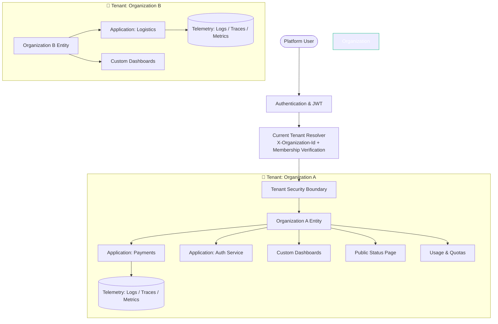

# SentinelOps — Phase 8 Architecture Plan: Multi-Tenant SaaS, Custom Dashboards & Intelligence

**Document Status:** Architecture Approved  
**Author:** Principal Software Architect & SaaS Security Lead  
**Target Version:** SentinelOps v1.1.0-SaaS  
**Target Architecture:** .NET 10, PostgreSQL 18, Redis 7+, React 19, OpenTelemetry  

---

## 1. System Overview & Multi-Tenant Evolution

In Phases 1 through 7, SentinelOps operated as an enterprise single-tenant platform where monitored entities were partitioned by `ApplicationId`. 

Phase 8 elevates SentinelOps into an **Organization-Aware Multi-Tenant SaaS Platform**. The fundamental trust boundary shifts from individual applications to **Organizations**. An Organization represents an enterprise tenant with isolated memberships, applications, custom dashboards, service maps, incident intelligence, public status pages, and resource quotas.



---

## 2. Domain Model Specifications

### 2.1 Core Multi-Tenant Entities

#### `Organization` (`SentinelOps.Domain.Entities.Organization`)
- `Id`: `Guid` (Primary Key)
- `Name`: `string` (max 100, e.g. "Acme Corp")
- `Slug`: `string` (max 50, unique index, URL-safe, e.g. "acme-corp")
- `Description`: `string?` (max 500)
- `IsActive`: `bool` (default true)
- `CreatedAtUtc`: `DateTime`
- `UpdatedAtUtc`: `DateTime?`
- Navigation Collections:
  - `Members`: `ICollection<OrganizationMember>`
  - `Invitations`: `ICollection<OrganizationInvitation>`
  - `Applications`: `ICollection<Application>`
  - `Dashboards`: `ICollection<CustomDashboard>`
  - `StatusPages`: `ICollection<StatusPage>`
  - `Settings`: `OrganizationSettings?`
  - `Usage`: `OrganizationUsage?`

#### `OrganizationMember` (`SentinelOps.Domain.Entities.OrganizationMember`)
- `Id`: `Guid`
- `OrganizationId`: `Guid` (Foreign Key to `Organization`)
- `UserId`: `string` (Foreign Key to `AspNetUsers`)
- `Role`: `OrganizationRole` enum (`Owner`, `Admin`, `Member`, `Viewer`)
- `JoinedAtUtc`: `DateTime`
- Unique Constraint: `(OrganizationId, UserId)`

#### `OrganizationRole` (`SentinelOps.Domain.Enums.OrganizationRole`)
- `Owner` (3): Full administrative control, billing/usage management, organization deletion, role assignment.
- `Admin` (2): Manage applications, API keys, alert rules, dashboards, invite members.
- `Member` (1): Edit dashboards, triage incidents, view telemetry.
- `Viewer` (0): Read-only explorer, reports, and dashboards.

#### `OrganizationInvitation` (`SentinelOps.Domain.Entities.OrganizationInvitation`)
- `Id`: `Guid`
- `OrganizationId`: `Guid`
- `Email`: `string` (max 256)
- `Role`: `OrganizationRole`
- `TokenHash`: `string` (SHA-256 hash of 32-byte cryptographic random token)
- `ExpiresAtUtc`: `DateTime` (7-day default validity)
- `AcceptedAtUtc`: `DateTime?`
- `RevokedAtUtc`: `DateTime?`
- `InvitedByUserId`: `string`
- `CreatedAtUtc`: `DateTime`

#### `OrganizationSettings` & `OrganizationUsage`
- `OrganizationSettings`: Multi-factor enforcement, retention overrides, notification preferences.
- `OrganizationUsage`: Monthly metrics tracking (`LogsIngestedMonthToDate`, `TracesIngestedMonthToDate`, `MetricsIngestedMonthToDate`, `ApiRequestsMonthToDate`, `EstimatedStorageBytes`).

### 2.2 Feature Entities for Subsequent Checkpoints

- **Checkpoint 8.2 (Dashboard Builder):**
  - `CustomDashboard`: `Id`, `OrganizationId`, `Title`, `Description`, `LayoutJson`, `IsDefault`, `IsShared`, `CreatedByUserId`, `CreatedAtUtc`, `UpdatedAtUtc`.
- **Checkpoint 8.3 (APM & Service Map):**
  - Trace and Span aggregations derived on-demand from `SpanRecords` and `TraceRecords` scoped by owning `ApplicationId` within the current `OrganizationId`.
- **Checkpoint 8.4 (AI Incident Intelligence):**
  - `IncidentAnalysis`: `Id`, `IncidentId`, `Summary`, `SuspectedRootCause`, `RecommendedActions`, `CorrelatedEvidenceJson`, `ConfidenceScore`, `ProviderName`, `GeneratedAtUtc`.
- **Checkpoint 8.5 (Public Status Pages):**
  - `StatusPage`: `Id`, `OrganizationId`, `Slug` (unique), `Title`, `Description`, `IsPublished`, `ShowUptimeHistory`, `BrandingJson`, `IncludedServiceIdsJson`.
  - `StatusPageIncident`: `Id`, `StatusPageId`, `Title`, `ImpactLevel`, `Status`, `Message`, `PublishedAtUtc`, `ResolvedAtUtc`.

---

## 3. Tenant Isolation & Server-Boundary Enforcement

Tenant isolation is enforced strictly at the API and Service boundaries, never relying solely on client input:

### 3.1 Tenant Context Resolution (`ICurrentTenantService`)
1. **User Request Path:**
   - Incoming request contains `X-Organization-Id` header (or route param).
   - Middleware queries user's verified memberships:
     ```csharp
     var isMember = await _dbContext.OrganizationMembers
         .AnyAsync(m => m.OrganizationId == requestedOrgId && m.UserId == currentUserId);
     ```
   - If user is not an active member of that organization, the request is immediately aborted with `403 Forbidden`.
   - The verified `OrganizationId` and `OrganizationRole` are placed in `HttpContext.Items` and injected via `ICurrentTenantService`.
2. **Telemetry Ingestion Path (OTLP):**
   - Ingestion requests authenticate with `X-API-Key` or `Authorization: Bearer <key>`.
   - `ApiKeyAuthFilter` resolves `ApiKey` $\rightarrow$ `Application` $\rightarrow$ `OrganizationId`.
   - Cross-application or cross-organization spoofing is mathematically impossible because the API key hash strictly binds to a single pre-existing application and organization.
3. **SignalR Real-Time Hubs:**
   - On connection, SignalR hub validates membership.
   - Hub clients join groups formatted as: `org_{OrganizationId}` and `app_{ApplicationId}`.
   - Pushes are dispatched only to the tenant-specific group.

---

## 4. Database Migration & Backward Compatibility Strategy

### 4.1 Schema Migration (`AddMultiTenantSaasFoundation`)
1. Create `Organizations`, `OrganizationMembers`, `OrganizationInvitations`, `OrganizationSettings`, `OrganizationUsages` tables.
2. Add nullable `OrganizationId` to `Applications` table with Foreign Key to `Organizations(Id)`.
3. Add `OrganizationId` index on `Applications`.

### 4.2 Seed & Legacy Reconciliation Script
To maintain 100% data integrity without orphaned records:
1. Query or create a baseline default organization: `Id = Guid.Parse("00000000-0000-0000-0000-000000000001")`, `Name = "Default Organization"`, `Slug = "default-org"`.
2. Find the earliest active user in `AspNetUsers` and assign them as `Owner` in `OrganizationMembers`.
3. Assign any existing users with `Role = Member`.
4. Update all existing records in `Applications` where `OrganizationId IS NULL` to point to `Default Organization`.
5. Set `OrganizationId` column in `Applications` to non-nullable (`NOT NULL`).
6. Initialize default `OrganizationSettings` and `OrganizationUsage`.

This migration is transactional, fully idempotent, and guarantees zero data loss.

---

## 5. Implementation Roadmap & Checkpoints

```
[Phase 8 Security Remediation Gate] ✅ COMPLETED (Commit: 7c06824)
  │
  ├─► [Architecture Audit & Plan] ✅ (This document)
  │
  ├─► [Checkpoint 8.1] Multi-Tenant SaaS Foundation (Domain, EF Core, Services, API, UI, Tests)
  │
  ├─► [Checkpoint 8.2] Custom Dashboard Builder (12 Widgets, Drag-and-Drop Grid, Live Data)
  │
  ├─► [Checkpoint 8.3] Advanced APM & Trace-Derived Service Dependency Map
  │
  ├─► [Checkpoint 8.4] AI Incident Intelligence (Provider Abstraction, Redaction, Hypotheses)
  │
  ├─► [Checkpoint 8.5] Public Status Pages (Sanitized, Rate-Limited, Organization-Branded)
  │
  ├─► [Checkpoint 8.6] Usage, Quotas & SaaS Administration
  │
  ├─► [Checkpoint 8.7] Product Experience & Visual QA (Browser Screenshots, Responsive UI)
  │
  └─► [Checkpoint 8.8] Final Security, Integration & Acceptance Audit
```
