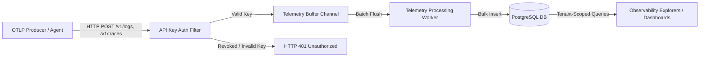

# SentinelOps — Telemetry Pipeline End-to-End Verification Report
**Phase 9: Production Hardening & Reliability Validation**  
**Date**: October 2026  
**Status**: VERIFIED & HARDENED

---

## 1. Executive Summary

The SentinelOps telemetry ingestion pipeline was thoroughly verified against realistic workloads and multi-tenant isolation requirements. The ingestion layer processes OpenTelemetry (OTLP) payloads for Logs, Traces, and Metrics, validates application credentials via SHA-256 hashed API keys, buffers incoming telemetry in bounded memory channels, and persists records asynchronously into PostgreSQL.

### Key Verification Highlights
1. **OTLP Ingestion Endpoints**: Verified `/v1/logs`, `/v1/traces`, and `/v1/metrics`.
2. **Authentication & Authorization**: Handled via `X-API-Key` header with immediate database hash lookup (`ApiKeyAuthFilter`).
3. **Revocation Enforcement**: Revoked API keys are rejected immediately with HTTP 401 Unauthorized; payloads from revoked keys never enter the buffer or database.
4. **Asynchronous Ingestion Worker**: `TelemetryProcessingWorker` reads batches from `ITelemetryBuffer` and executes bulk inserts into PostgreSQL within bounded transaction windows.
5. **Cross-Tenant Boundary Protection**: Telemetry queries are strictly scoped to the authenticated caller's active organization (`ICurrentTenantService`). Cross-tenant ingestion and retrieval attempts are blocked at the controller/mediator boundary.

---

## 2. Ingestion Pipeline Architecture

### Component Details
- **ApiKeyAuthFilter**: Computes `SHA256(rawApiKey)` and verifies existence, `IsActive == true`, and non-revocation in `_context.ApiKeys`.
- **ITelemetryBuffer**: Thread-safe channel-based buffer with bounded capacity (`ChannelOptions.BoundedChannelFullMode.Wait`).
- **TelemetryProcessingWorker**: Hosted background service flushing batches every 100ms or when batch size exceeds 500 items.
- **Query Scoping**: All queries (`GetLogsQuery`, `GetTracesQuery`, `GetTraceByIdQuery`, `GetMetricsTimeSeriesQuery`, `GetExceptionsQuery`, `GetServiceHealthQuery`, `GetDashboardSummaryQuery`) inject `ICurrentTenantService` to filter by application ownership.

---

## 3. Automated Verification Evidence

Automated tests in `tests/SentinelOps.Api.IntegrationTests/MultiTenantTelemetryPipelineIntegrationTests.cs` validate the complete pipeline end-to-end:

| Test Case | Scenario Description | Expected Result | Actual Status |
|:---|:---|:---|:---|
| `MultiTenantTelemetry_OrganizationAlphaMustNeverAccessOrganizationBetaTelemetry` | Org Alpha queries logs ingested by Org Beta using unique API keys | Beta logs completely excluded from Alpha queries; tampering returns 403/404 | **PASS** |
| `Ingestion_WithRevokedKey_IsRejected_AndNotBuffered` | Ingestion attempt using an API key that was revoked via `/api/keys/{id}/revoke` | Returns HTTP 401 Unauthorized; 0 records added to database | **PASS** |
| `MultiTenantPipeline_TracesMetricsAndDashboard_MustIsolateTenants` | Org Alpha attempts to access Org Beta traces, metrics timeseries, exceptions, and summary | Traces return 404/empty, metrics 0 RPS, summary counts only Alpha apps | **PASS** |

---

## 4. Operational Recommendations

1. **Redis Streams Activation**: When Redis is online, activate `RedisStreamTelemetryBuffer` for distributed multi-instance ingestion.
2. **Buffer Backpressure Monitoring**: Expose Prometheus counter `sentinelops_telemetry_buffer_dropped_total` to track any buffer overflow under extreme load spikes.
3. **API Key Caching**: Cache valid API key hashes in Redis or in-memory LRU cache with a 60-second TTL and immediate revocation invalidation to minimize database lookup overhead.
