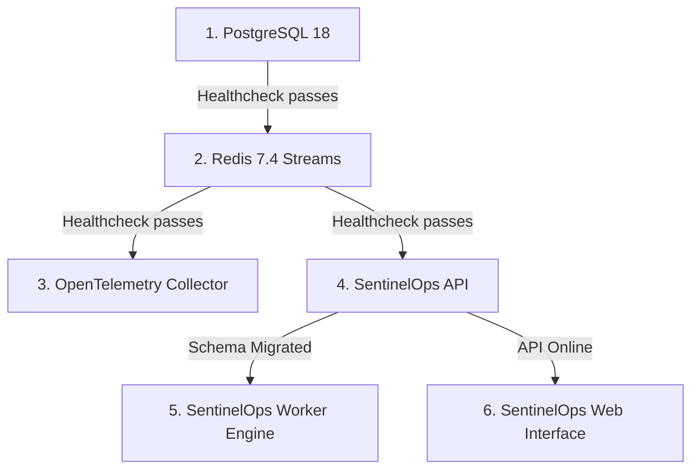

# SentinelOps — Platform Operations & Production Runbook

## 1. System Startup Sequence

To ensure high availability and prevent connection exceptions during initial boot:



### 1.1 Startup Order Execution

1. **Storage Tier**: PostgreSQL must be accepting connections and Redis must respond to `PING`.
2. **Database Migration**: Run `dotnet ef database update` via the CI/CD deployment pipeline before routing traffic to new API instances.
3. **Core Services**: Launch `SentinelOps.Api` instances behind the reverse proxy or load balancer.
4. **Processing Tier**: Launch `SentinelOps.Worker` instances to attach consumer groups to `sentinel:telemetry:stream`.
5. **Collector & Gateway**: Start OpenTelemetry Collector and expose ports `4317` (gRPC) and `4318` (HTTP).

---

## 2. Database Migration Deployment Runbook

### 2.1 Zero-Downtime Migration Principles

- All database migrations must be backwards-compatible (additive columns only, nullable or with default values).
- Never rename or drop existing active columns in a single release.
- Apply migration prior to swapping API container versions:

```bash
# Production migration execution
dotnet ef database update \
  --project src/SentinelOps.Infrastructure \
  --startup-project src/SentinelOps.Api \
  --connection "$DATABASE_CONNECTION_STRING"
```

---

## 3. Worker & Telemetry Ingestion Troubleshooting

### 3.1 Redis Stream Lag Diagnostics

When telemetry ingestion volume spikes, check stream length and pending entries:

```bash
# Check length of the telemetry stream
redis-cli xlen sentinel:telemetry:stream

# Inspect consumer group status
redis-cli xinfo groups sentinel:telemetry:stream

# Inspect specific consumers and pending counts
redis-cli xinfo consumers sentinel:telemetry:stream telemetry-workers
```

### 3.2 Ingestion Backlog Recovery Procedure

If pending entries exceed 50,000 or consumer lag grows:

1. **Scale Workers**: Increase Worker replicas in container orchestrator (e.g. `docker compose up -d --scale worker=4`).
2. **Verify Database Bottlenecks**: Check PostgreSQL active connections and write locks:
   ```sql
   SELECT pid, query_start, state, query FROM pg_stat_activity WHERE state != 'idle' ORDER BY query_start ASC;
   ```
3. **Temporary Retention Prune**: If storage threshold is approached, trigger a bounded retention cleanup via `POST /api/retention/execute` with an administrative token.

---

## 4. Alerting & Incident Notification Triage

### 4.1 Firing Rule Diagnosis

1. Query active incidents: `GET /api/incidents?status=Firing`.
2. Inspect incident timeline events: `GET /api/incidents/{id}/timeline`.
3. Check notification outbox status:
   ```sql
   SELECT "Id", "Destination", "Status", "RetryCount", "LastError", "CreatedAtUtc"
   FROM "NotificationOutboxes"
   WHERE "Status" = 2 -- Failed
   ORDER BY "CreatedAtUtc" DESC
   LIMIT 10;
   ```

### 4.2 Webhook Delivery & SSRF Shield Troubleshooting

If webhook deliveries fail with `Blocked by SSRF filter`:
- Verify the recipient endpoint does not resolve to private IPs (`10.0.0.0/8`, `172.16.0.0/12`, `192.168.0.0/16`, `127.0.0.1`, `169.254.169.254`).
- Ensure DNS resolution returns a public internet IP.
- Verify redirect targets: Webhooks do not auto-follow redirects to prevent redirect hijacking.

---

## 5. Security Stamp & Session Invalidation Incident Response

If a user credential or token is suspected to be compromised:

1. Navigate to **User & Access Management** (`/team`).
2. Select the compromised user and click **Revoke All Sessions**.
3. Alternatively, trigger the administrative endpoint:
   ```bash
   curl -X POST "https://api.sentinelops.local/api/users/{userId}/revoke-sessions" \
     -H "Authorization: Bearer $ADMIN_JWT"
   ```
4. This invalidates all active refresh tokens and triggers security stamp rotation. Any subsequent API requests using previous JWTs will be immediately rejected with 401 Unauthorized.
